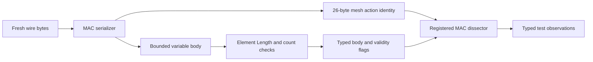
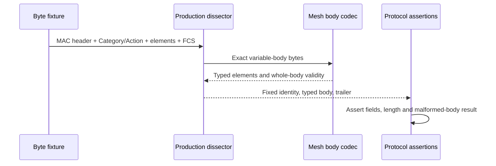

# Mesh wire formats

This change supplies the byte boundary needed by mesh peering and HWMP. IEEE Std 802.11-2024 defines Mesh Control in 9.2.4.8.3, the mesh elements in 9.4.2.96–102/110–113, peering actions in 9.6.15, and metric/path-selection actions in 9.6.16. This is codec evidence; it does not establish that a station can peer, discover a path, or forward a mesh packet.

The parent has Address 4 but lacks Mesh Control, mesh-specific action decoding, and typed HWMP elements. `Ieee80211MeshFrame.msg` declares those elements and `Ieee80211MeshFrameSerializer` owns their byte encoding. The existing beacon and probe codecs share the optional mesh elements, retaining their existing timestamp fields. Non-mesh management leaves those elements absent and retains its previous opaque TIM representation.

The second QoS Control octet remains one authoritative stored byte. Its meaning depends on the BSS/role under Table 9-10. The explicit `Ieee80211MeshDataHeader` type supplies mesh context and exposes Mesh Control Present as an interpretation of that byte. Generic raw data dissection preserves the octet and payload without guessing mesh membership from address roles. This matters even for four-address WDS frames and for group frames from an infrastructure AP.

## Header and body boundary

The MAC parser consumes a fixed 26-byte mesh action header, including Category and Action. The variable body has its own registered serializer. A malformed body marks the entire decoded body incorrect/incomplete; it cannot make the fixed MAC identity disappear. Management must inspect that validity before applying any elements. The later peering and HWMP commits add those consumers.



Every element is parsed inside its own declared Length, after the outer body checks that those bytes exist. A valid PREQ followed by a truncated PREP therefore makes the complete body invalid. An inconsistent target/destination count cannot consume bytes from the next element. Reserved flag bits are ignored on receipt and emitted as zero. Unknown optional elements do not reject an otherwise valid body. The codec structurally decodes Mesh Control AE 0/1/2; the endpoint-only profile's later consumers reject unsupported nonzero AE operation.

## Direct checks

`Ieee80211MeshSerializer_1.test` uses literal fixtures derived from the standard's field widths and order. It decodes fresh byte chunks and compares independently constructed typed frames against those literals. Production encoder-to-decoder round trips cannot satisfy the oracle by themselves.

| Fixture | Stimulus and assertion |
| --- | --- |
| PREQ | Discovery ID, originator sequence, lifetime, metric and target fields decode at their documented offsets; two targets remain distinct. |
| PREP | Target and originator sequences decode independently; lifetime/metric preserve little-endian encoding. |
| PERR | Destination, sequence and reason decode; multiple destinations and external-address presence obey each tuple's flags. |
| RANN | Root, sequence, interval and accumulated metric decode from the 21-byte element body. |
| Metric report | Request and 32-bit metric use the common representation of metric IDs 1 and 2. |
| Peering | Open, Confirm and both Close layouts preserve Link IDs, AID and reason presence; AID remains separate from Link IDs. |
| Profile | Mesh ID/Configuration, both metric IDs, EPD Capability and membership-selector octets remain visible. |
| Beacon | Existing timestamp/beacon prefix plus TIM/DTIM counters, bitmap, and Mesh Awake Window match literal bytes. |
| Mesh Control | AE 0/1/2 encode 6/12/18 bytes, with separate mesh sequence and address fields; reserved AE 3 is invalid. |
| QoS context | Raw nonmesh QoS headers with all four To DS/From DS combinations preserve the high octet and all payload bytes; explicit mesh context enables Mesh Control decoding. |
| Malformed data control | The production dissector records reserved AE and truncated Mesh Control as incorrect, without attempting LLC decoding or raising a chunk-validity exception. |
| Invalid lengths | Every truncation of each HWMP fixture is rejected; inconsistent counts and a malformed tail invalidate the whole body. |
| Optional/reserved | Unknown optional IEs and reserved flag bits preserve acceptance of valid known elements. |

`MeshWireFormats.test` feeds complete action-frame octets through the registered production MAC dissector. A codec-boundary module emits its decoded chunks (fixed identity, variable body when present, and FCS trailer) to the protocol observer. Run 0, seed 0 executes six cases: a valid body containing PREQ/PREP/PERR/RANN; that body with reserved flags; that body with an unknown optional element; that body with a truncated tail; an inconsistent PREQ count; and an empty action body. The assertions require the three valid bodies to be correct, the two malformed nonempty bodies to be incorrect, and the empty body to mark the protocol data unit incorrect. Every case preserves a correct fixed action header.



Before this change these fixtures lack registered mesh types/decoding, which is missing-capability evidence rather than an executed failing protocol assertion. After this change the literal bytes have direct typed assertions. Live malformed frame discard-and-continue behavior belongs to the later management/HWMP tests. This boundary fixture uses a retained FCS trailer and does not assert computed FCS generation, actual ACK transmission, or external decoder interoperability.

## Validation record

Working directory: `/home/miguel/workspace/inet-ieee80211-adhoc-routing`.

| Check | Result |
| --- | --- |
| MSG generation for MAC, management and mesh declarations | PASS |
| C++ syntax checks for modified serializers/dissector | PASS |
| Scoped architecture gate | PASS |
| Scoped naming gate | Existing legacy candidates; no new mesh candidates |
| Fresh debug library | PASS |
| Direct unit/serializer cases | 3/3 PASS: mesh, existing management and MPDU delimiter serializers |
| Mesh boundary protocol fixture | 1/1 PASS, including whole-body and empty-body rejection |
| Selected legacy Wi-Fi controls | 4/5 test files PASS; Block Ack retry run 0 reports a protocol deadline failure, run 1 aborts on the radio medium's simultaneous-transmission check; both reproduce identically on the immediate parent |
| Diagram rendering | PASS; Mermaid 10.9.3 / Firefox headless, visually checked |

Executed focused commands after `make MODE=debug -j8` completed successfully:

```sh
opp_run_unit_tests --load . -p inet -m debug --no-build \
  -f 'Ieee80211(MeshSerializer|MgmtFrameSerializer|MpduSubframeHeaderSerializer)_1\.test$'
opp_run_protocol_tests --load . -p inet -m debug --no-build \
  -w '^tests/protocol/wifi$' -f '/mesh/MeshWireFormats\.test$'
opp_run_protocol_tests --load . -p inet -m debug --no-build \
  -w '^tests/protocol/wifi$' \
  -f '/common/(WifiAssociation|WifiDataDelivery|WifiDuplicateWithRetry|WifiBlockAckDuplicateAddba|WifiBlockAckDataRetry)\.test$'
```

The unit and mesh protocol commands exited 0. The legacy command exited 1. Raw `WifiBlockAckDataRetry` run 0 prints a protocol deadline failure at event 3708/time 1.023764276562 s, despite successful simulation completion. Run 1 stops at time 1.014105463846 s/event 2639 on the radio medium's simultaneous-transmission check. These are distinct unexpected outcomes, not passed retry assertions or expected unsupported cases.

The independent comparison built immediate parent `8a76ae140f` in `/tmp/inet-mesh-c1-parent-verify` with identical feature state, fixture and seed 0, and verified that its test loaded the parent debug libraries. Both failures reproduce at exactly the same event numbers and simulation times. This establishes that the failed control predates C2; it does not turn the control into a pass. No expectation was changed. Parent logs are `/tmp/inet-mesh-c1-parent-{build,test,runner}.log` and the comparison record is `/tmp/inet-mesh-c1-parent-evidence.md`.

Raw retained artifacts are `/tmp/inet-mesh-c2-raw/unit/`, `/tmp/inet-mesh-c2-raw/protocol/`, and `/tmp/inet-mesh-c2-raw/legacy-retry/`. Runner logs are `/tmp/inet-mesh-c2-unit-complete.log`, `/tmp/inet-mesh-c2-protocol-complete.log`, and `/tmp/inet-mesh-c2-legacy-retained.log`; the matching build log is `/tmp/inet-mesh-c2-complete-build.log`.
