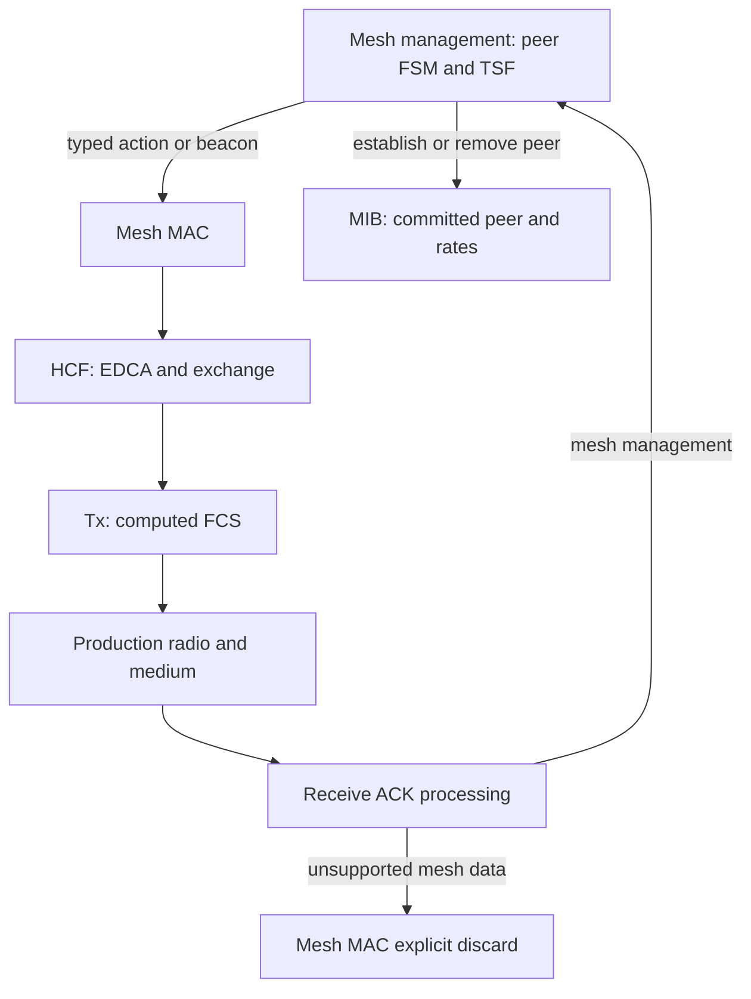
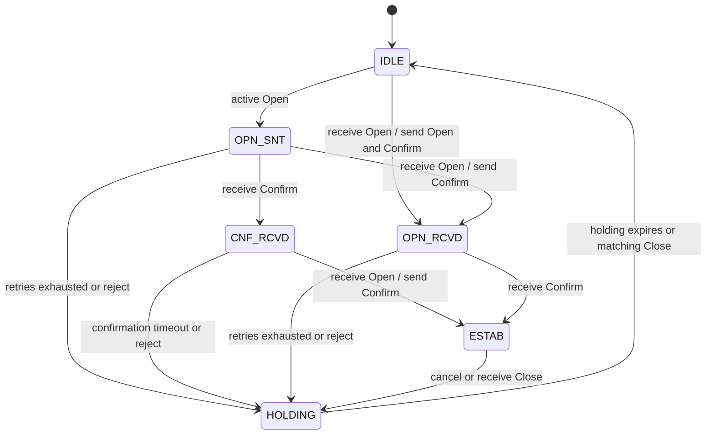
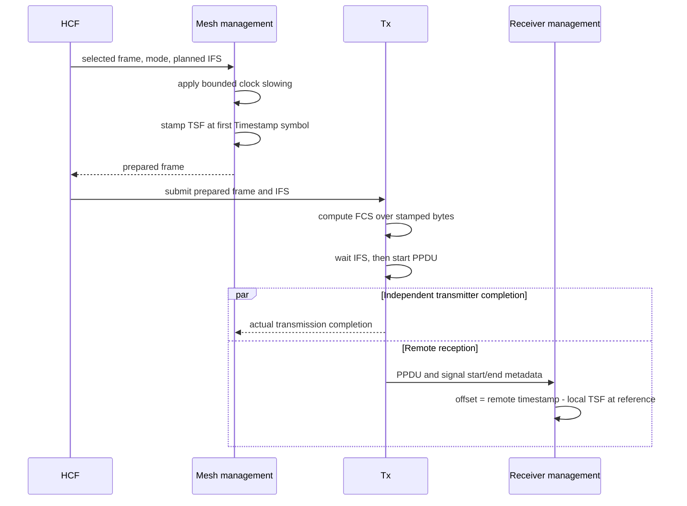

# Open mesh peering and beacon timing

This is the reviewer document for plan commit **C3**, proposed subject `ieee80211: add open mesh peering and beacon timing`. It accompanies [MeshPeering.test](MeshPeering.test), [MeshPeeringFailure.test](MeshPeeringFailure.test), and [MeshBeaconTiming.test](MeshBeaconTiming.test). The requirements come from IEEE Std 802.11-2024, principally 14.3.3–14.3.4 (compatibility), 14.4–14.5 (open mesh peering), and 14.14 (synchronization, beacons and DTIM). The [plan](../../../../plan/done/ieee80211-hwmp.md) and [standards catalog](../../../../doc/project/evidence/standard/ieee80211/catalog.md) record the supported profile and clause trace.

C2 supplies the wire representations but has no live mesh management owner. C3 adds an opt-in `Ieee80211MeshInterface`: stations discover compatible neighbors, exchange Open and Confirm actions, and commit usable peer links. A Close, rejected handshake, exhausted retry timer, or management stop removes that commitment. This is a missing-capability change; the parent cannot initialize these new mesh fixtures. No pre-change execution is claimed.

## Ownership and frame flow

`Ieee80211MgmtMesh` owns link IDs, local AIDs, the six-state handshake and its selected timer. `Ieee80211Mib` owns configured profile values and committed peer/rate state; infrastructure association state is not installed to imitate a mesh link. `Ieee80211MeshMac` preserves the complete management header/body boundary and provides the mesh role before raw data is observed. Existing HCF, Tx, Rx and radio modules still perform channel access, ACKs, duplicate handling, retransmission, FCS and propagation.



The shared MAC hooks have inert base implementations. The mesh variant uses them for admission, timestamp preparation, transmit completion and unsupported data. Receive data is discarded after ordinary ACK processing and before legacy reassembly/deaggregation: interpreting mesh A-MSDU length as the legacy big-endian format would otherwise reach the wrong decoder. Explicit mesh context also keeps packet observations from decoding that unsupported body prematurely. Raw nondata paths retain their existing parsing behavior.

The initial profile supports unsecured, always-awake stations with fixed-rate legacy OFDM and no RTS, fragmentation, aggregation, Block Ack or adaptive control. Initialization rejects unsupported combinations. Opaque optional action elements are retained by the codec so the first live consumer can reject AMPE or MIC elements even when the peering protocol ID is zero. This preserves unknown optional data without adding authentication.

## Handshake and failure behavior

An active open sends Open and starts the retry timer. Receiving the peer Open sends Confirm; receiving both required peer messages establishes the link regardless of their order. A Confirm received first selects a distinct confirmation timer. Retries keep the link instance and do not restart the timer on duplicate input. Holding retains the Close reason and cannot be extended by late Open/Confirm. Cancellation sends reason 52. These are management timers, separate from the MAC's ACK/retry machinery.



`MeshPeering.test` uses four production mesh NICs. Two pairs have different metric IDs, so each pair can establish while cross-profile peers remain ineligible. It observes actual beacon/Open/Confirm transmissions and reciprocal link IDs/AIDs in committed state. Beacon TSF phases are staggered to ensure each pair receives a beacon within the finite run. Co-located ideal clocks with a known 25.6 ms phase difference must yield opposite signed neighbor offsets within one microsecond; the received beacon rates are 6 and 24 Mb/s, and DTIM periods produce different body lengths.

`MeshPeeringFailure.test` places sixteen pairs on distinct actual bands with a guard band. It verifies the effective listening centers and bandwidths. Its driver starts both endpoints of one pair in the same event and asserts the crossed-Open state path. A second pair loses Open while Confirm arrives first, then establishes after retransmission. A timeout pair checks deadlines immediately before and at retry/holding expiry, and a late Confirm cannot extend holding. Another pair receives a valid, byte-reconstructed Confirm at the retry deadline with ordinary receive priority; it must enter CNF_RCVD with a new confirmation deadline instead of taking the retry-timeout transition.

Nine independent pairs mutate the mesh protocol, metric, congestion, synchronization, authentication, Mesh ID, EPD capability, EPD membership selector, or basic-rate set. Each mutation recomputes FCS before entering the live radio path and must leave the recipient uncommitted. Two more pairs append complete AMPE or MIC elements to otherwise open peering frames and must remain IDLE. A dedicated pair receives a truncated peering element with valid computed FCS, records a management discard without establishing, and then establishes from the later valid retry. Separating this pair avoids a simultaneous-Open collision hiding the malformed-input stimulus. All emitted mesh management headers are checked for Address 3 equal to the transmitter address, as required by 9.3.3.1 for the transmitted beacon and peering subtypes.

The same failure fixture transmits separate A-MSDU and fragment MPDUs through the production Tx/radio path. The tap reconstructs each MAC header as bytes before reception. Distinct receiver counters require both inputs to reach the explicit unsupported-data discard, proving that neither a typed-header shortcut nor repeated reception of only one input satisfies the check. Peering continues afterward. The deliberate cancellation exchange separately asserts the Close reason and final removal of both peers.

## Timestamp reference, slowing and beacon ordering

The timestamp refers to the OFDM symbol carrying the first Timestamp bit, not to frame completion. The mode class owns the symbol calculation: after the 20 microsecond preamble/SIGNAL prefix, 16 SERVICE bits and the 24-byte management header put this reference at 52 microseconds for 6 Mb/s and 28 microseconds for 24 Mb/s. Management stamps the selected outgoing frame immediately before Tx computes FCS, using the selected mode and planned IFS. Neighbor offsets use received signal-start metadata plus the same mode reference.



`MeshBeaconTiming.test` compares actual transmitted timestamp and computed-FCS bytes against independent literal symbol offsets and a bitwise CRC-32 oracle. A nonzero initial TSF with DTIM period two checks the initial DTIM phase. Controlled receive frames have realistic PPDU duration and distinct reference/completion times; changing rate and body length must preserve the prescribed signed offset, including −200 microseconds. TBTT-adjusting invalidates an offset. A decreasing offset creates 100 microseconds of pending slowing, consumed in 40.96, 40.96 and 18.08 microsecond pauses over successive beacon periods. The test checks residual drift, future TBTTs and immutability of previously transmitted bytes.

Separate VO and VI successors are arranged so their planned SIFS start crosses TBTT. Admission must defer them before the reversible Tx commitment, allow the pending beacon first, and later send both data frames without inventing a retry. The timing fixture also fills a bounded VO pending queue at TBTT: backoff optimization is disabled only on this station so a management request queued 10 microseconds before TBTT must observe AIFS. A separate checkpoint one microsecond before TBTT confirms that the capacity-one queue contains that request. The subsequently dropped beacon must release its owned pending identity, allow older management traffic to proceed, and permit a later beacon. Finally, an isolated management stop cancels its timers; late preparation/completion callbacks are inert while the rest of the NIC stays operational.

## Validation record

Working directory: `/home/miguel/workspace/inet-ieee80211-adhoc-routing`. All direct mesh fixtures use configuration General, run 0, seed 0 and debug libraries. Source state is C2 commit `320e19d47c` plus the C3 working diff. The latest matching build command is `make MODE=debug -j4`, exit 0; the log is `/tmp/inet-mesh-c3-final-build.log`.

| Check | Executed result |
| --- | --- |
| Matching debug library | PASS |
| MeshPeering | PASS |
| MeshPeeringFailure | PASS |
| MeshBeaconTiming | PASS |
| Retained mesh wire boundary control | PASS |
| Focused codec units | 3/3 PASS: mesh, management and MPDU delimiter serializers |
| Selected legacy controls | 5/6 files PASS; Block Ack data retry retains both exact pre-existing parent failures |
| Scoped architecture | PASS for IEEE 802.11 MAC/management and OFDM mode |
| Naming and interfaces | Existing whole-scope candidates; none introduced by C3 |
| Release note format and whitespace | PASS |
| Diagram rendering | PASS; Mermaid 10.9.3 / Firefox headless, visually inspected |

The final protocol selection includes the four mesh files and the six legacy controls:

```sh
opp_run_protocol_tests --load . -p inet -m debug --no-build \
  -w '^tests/protocol/wifi$' \
  -f '/(mesh/(MeshPeering|MeshPeeringFailure|MeshBeaconTiming|MeshWireFormats)|common/(WifiAssociation|WifiDataDelivery|WifiDuplicateWithRetry|WifiBlockAckDuplicateAddba|WifiBlockAckDataRetry)|11n/N_Amsdu)\.test$'
opp_run_unit_tests --load . -p inet -m debug --no-build \
  -f 'Ieee80211(MeshSerializer|MgmtFrameSerializer|MpduSubframeHeaderSerializer)_1\.test$'
```

The protocol command exits 1 with nine passed test files and one failed control. Raw artifacts for every selected file are retained under `/tmp/inet-mesh-c3-raw/complete-protocol/`; the summary is `/tmp/inet-mesh-c3-complete-protocol.log`. `WifiBlockAckDataRetry` run 0 prints a protocol deadline failure at event 3708, time 1.023764276562 seconds. Run 1 aborts on the radio medium simultaneous-transmission check at event 2639, time 1.014105463846 seconds. Both outcomes match the independent immediate-parent comparison described in [C2's record](hwmp-c2-wire.md#validation-record). Neither outcome is reported as a pass. The codec command exits 0; its log is `/tmp/inet-mesh-c3-unit.log` and raw artifacts are `/tmp/inet-mesh-c3-raw/unit/`.

After making the controlled Probe Response and deadline Confirm Address 3 fields match their transmitters, the affected fixtures were rerun with selectors `/mesh/(MeshPeeringFailure|MeshBeaconTiming)\.test$` and `/mesh/MeshBeaconTiming\.test$`, exit 0. Final raw artifacts are `/tmp/inet-mesh-c3-raw/fixture-final/`; logs are `/tmp/inet-mesh-c3-fixture-final.log` and `/tmp/inet-mesh-c3-timing-final.log`. These fixture-only corrections required no production rebuild.

The scoped architecture commands are `doc/project/enforcement/check-architecture.sh src/inet/linklayer/ieee80211` and the same command with `src/inet/physicallayer/wireless/ieee80211/mode`; both exit 0. The complete IEEE 802.11 naming scan reports 32 existing declarations, with no new mesh candidate. The global interface scan reports 16 existing classes and nine review notes; its only IEEE 802.11 violations are the unchanged `ITransmitStep` and `IReceiveStep`, and the new pure `IMeshManagement` is clean. No ledger or seal status is changed. Full release compilation, feature-disabled compilation, native fingerprint comparisons and global push gates are coordinated for the whole series and are not claimed by this focused C3 record.

These tests establish the supported open-peering and timing contracts at selected deterministic boundaries. They do not claim authenticated peering, sleeping peers, mesh data delivery, path selection, HT/VHT operation, external implementation interoperability, or broad stochastic performance. The existing Block Ack data-retry control has two separately documented failures reproduced on the C1 parent; a failed control remains a failure even when established as pre-existing. No baseline or expected failure is changed.
