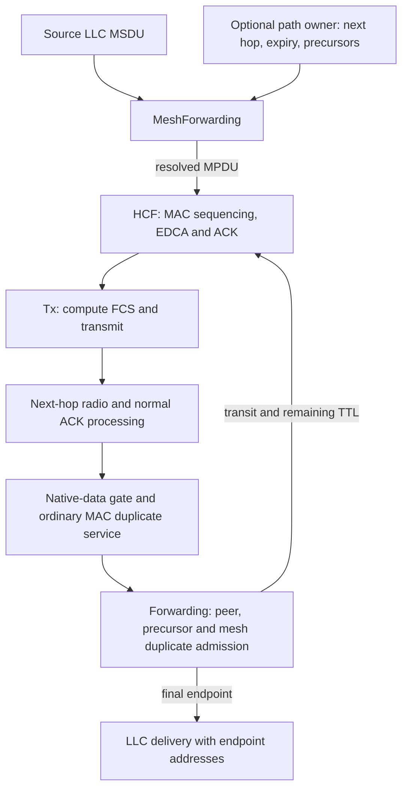
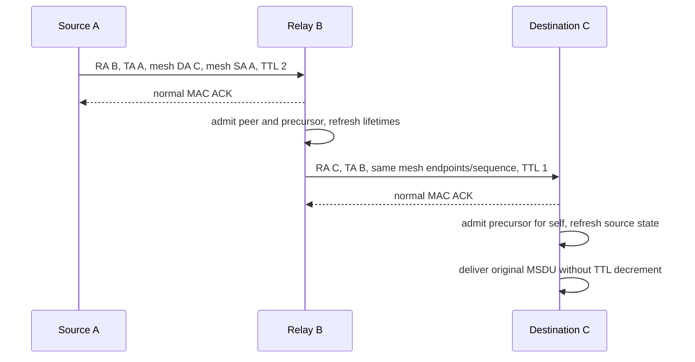
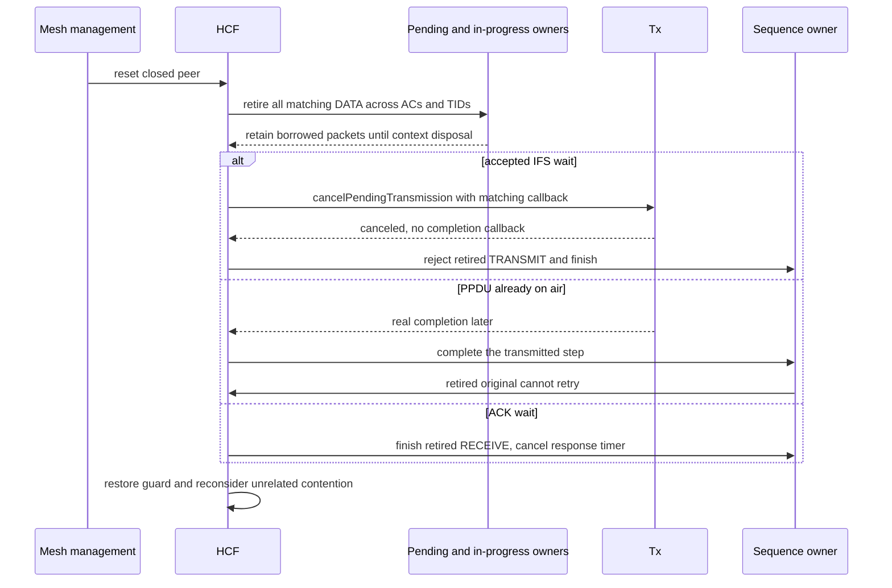

# Native mesh data forwarding

This document accompanies plan commit **C4**, proposed subject `ieee80211: add: forward mesh data through established peers`, and the production-path fixtures [MeshForwarding.test](MeshForwarding.test) and [MeshGroupForwarding.test](MeshGroupForwarding.test). IEEE Std 802.11-2024, 10.37.2–10.37.4 and 10.37.6 define forwarding information, precursor admission, native mesh data addresses, TTL and duplicate filtering. C3 establishes peers but explicitly discards data; C4 supplies the missing data path. The parent has no forwarding module or these protocol fixtures, so the before-change result is missing capability, not an executed failing assertion.

## Data and state ownership

The MAC delegates each source LLC MSDU before encapsulation to `MeshForwarding`, its distribution-service role. Forwarding owns mesh sequence allocation and a bounded, expiring duplicate cache. The normal originator still owns per-hop MAC sequence assignment, EDCA, ACK/retry state and FCS. A resolved frame enters `processUpperFrame` directly, avoiding a second source encapsulation. The source marks the complete MPDU with the MAC protocol before any HCF queue/drop observation.

`IMeshPathSelection` returns copied next-hop/expiry information and precursor expiry. Forwarding requires `now < expiry` and an established next-hop peer. The provider owns initial lifetimes and refresh operations; refreshing a precursor preserves the later of its existing and refreshed expiry. The provider also admits the transmitter as a precursor at the final destination, even when that destination is the local station. The optional provider defaults to absent: source unicast then has an explicit unsupported/no-path discard, while native group propagation works. The fixtures supply a small test-only provider; no production HWMP table or discovery placeholder is introduced.



Receive processing preserves the complete MAC header and Mesh Control until forwarding classifies the frame. Native unfragmented, nonaggregated data retains the ordinary recipient duplicate service. Unsupported fragments and A-MSDUs are rejected before legacy transformation; AE other than zero is rejected by forwarding. A raw receive header gets mesh context before packet observation, using the C3 boundary. When forwarding a frame, popped PHY history is trimmed before the next hop computes FCS. Local delivery strips MAC/Mesh Control/FCS and publishes the mesh endpoint addresses, rather than the hop transmitter/receiver.

## Unicast and group cases

`MeshForwarding.test` creates A–B–C with real mesh peers and radio exchanges. A test-only provider supplies A's next hop B, B's next hop C, valid precursors and lifetimes. The source uses a four-address QoS header and AE zero Mesh Control. A and B transmissions must preserve source A, destination C, mesh sequence and payload while changing RA/TA and decreasing TTL from two to one. Exact serialized lengths and literal Mesh Control bytes are checked. C delivers once with TTL one; B never delivers the transit MSDU upward. Received MAC bytes are reconstructed by the tap so typed sender chunks cannot hide decoding mistakes.

The same fixture separates a fresh per-hop sequence carrying an already-seen mesh sequence from a MAC Retry duplicate carrying a distinct mesh sequence. Neither may cause another delivery. Precursors expire independently from paths. An expired relay path, an expired relay precursor and an expired destination-self precursor each prevent forwarding or delivery. The admitted first flow checks exact source/destination path refresh deadlines and both precursor directions, including extension of a shorter expiry and preservation of a longer expiry. Otherwise valid frames from a discovered nonpeer and from a closed peer are discarded through the live receive path, with the normal MAC ACK policy retained. Unsupported AE, fragment and A-MSDU inputs do not reach legacy transformations or produce an upper delivery.



`MeshGroupForwarding.test` uses a four-station ring. A native group frame has three MAC addresses: group RA, current TA and mesh source in Address 3. Legal configured EDCA waits separate the hidden relays: both use CW zero, while one uses AIFSN 15 with backoff optimization disabled. This leaves the short first relay PPDU complete before the other begins, allowing both duplicate paths to reach the receiver deterministically. Every reached nonoriginating station delivers once; the source's seeded cache prevents looped-back MAC delivery. A duplicate with the same mesh source/sequence is suppressed independently of hop identity. Received TTL one decrements to zero and still permits local delivery without onward propagation. A zero TTL on the wire is invalid under 9.2.4.8.3/Figure 9-35; a reconstructed raw-zero input with valid computed FCS must be discarded, consistent with the existing C2 codec.

One ring station disables forwarding. Its actual Beacon/Open/Confirm advertisements must clear Mesh Configuration's forwarding bit; the MIB owns that bit and the data path reads the same value. This station still receives local group and final unicast MSDUs, while transit unicast and group relay remain disabled. A separate source unicast with no provider must be discarded before radio transmission. Native group frames from a nonpeer and after peer closure must not produce new local deliveries.

## Peer teardown during a live exchange

Closing a peer retires its pending and in-progress data in every AC/TID, including Normal Ack operation without Block Ack. The existing in-progress owner defers destruction while a sequence still borrows the packet. Cleanup loops finish before interrupting that sequence, under the procedure-update suppression guard; contention is reconsidered after the guard is restored so an unrelated peer can progress.

Tx can cancel only a matching callback's scheduled IFS wait before the PPDU begins. Cancellation deletes its retained copy and timer, clears its callback/NAV choice, and emits no transmit completion, NAV update, PHY activity or failure result. A retired TRANSMIT step then finishes as rejected through the sequence owner. An already on-air PPDU keeps its context until real completion. Late ACK/timeout/recovery handling checks whether the original DATA is still in progress and cannot resurrect retired data. The public pure virtual API addition is described in the development migration guide.



The teardown driver uses the live production HCF/Tx/radio path for three separate closures: an accepted nonzero SIFS wait, an on-air DATA PPDU, and an ACK wait. It observes the active sequence boundary, queues the peer's data in multiple access categories, closes at a scheduled event, and checks that all matching queued data is retired. An unrelated peer's data is already queued in another AC before closure; the fixture asserts its presence both before and after cleanup and requires exactly one delivery. The configured holding timeout is five milliseconds, and both endpoints must be IDLE before each explicit re-open. Fresh traffic must then succeed while the original queued frames never transmit again. This distinguishes cancellation from a fabricated transmission result and exercises late callback safety with real MAC exchanges.

## Validation record and limits

Working directory: `/home/miguel/workspace/inet-ieee80211-adhoc-routing`; source state is C3 commit `f6a9863f8f` plus the C4 working diff. New protocol fixtures use configuration General, run 0 and seed 0 with computed FCS and a matching debug library built by `make MODE=debug -j4`.

| Check | Result |
| --- | --- |
| Debug compilation | PASS |
| Complete MeshForwarding and MeshGroupForwarding fixtures | 2/2 PASS, including all three teardown boundaries |
| C3/C2 mesh controls | 4/4 PASS |
| Selected legacy protocol controls | 5/6 PASS; Block Ack data retry retains both exact pre-existing parent failures |
| Mesh/management/delimiter codecs and Tx NAV/cancellation unit | 4/4 PASS |
| Frame-sequence and Rx completion module controls | 2/2 PASS |
| Scoped architecture, release/migration format and whitespace | PASS |
| Naming/interface audit | Existing candidates only; no new contract/module finding |
| Diagrams | PASS; Mermaid 10.9.3 / Firefox headless, visually inspected |

Executed commands after the matching debug build:

```sh
opp_run_protocol_tests --load . -p inet -m debug --no-build \
  -w '^tests/protocol/wifi$' \
  -f '/(mesh/(MeshForwarding|MeshGroupForwarding|MeshPeering|MeshPeeringFailure|MeshBeaconTiming|MeshWireFormats)|common/(WifiAssociation|WifiDataDelivery|WifiDuplicateWithRetry|WifiBlockAckDuplicateAddba|WifiBlockAckDataRetry)|11n/N_Amsdu)\.test$'
opp_run_unit_tests --load . -p inet -m debug --no-build \
  -f 'Ieee80211(MeshSerializer|MgmtFrameSerializer|MpduSubframeHeaderSerializer|TxNavChoice)_1\.test$'
opp_run_module_tests --load . -p inet -m debug --no-build \
  -f 'Ieee80211(FrameSequenceObservations|RxTransmissionCompletion)_1\.test$'
```

The combined protocol command exits 1 with 11 passed files and the known failed `WifiBlockAckDataRetry` control. Run 0 fails its protocol deadline at event 3708/time 1.023764276562 seconds; run 1 aborts on the simultaneous-transmission check at event 2639/time 1.014105463846 seconds. These exactly match the independently reproduced parent failures in [C2's record](hwmp-c2-wire.md#validation-record); neither outcome becomes a pass. The unit and module commands exit 0. Logs are `/tmp/inet-mesh-c4-final-protocol.log`, `/tmp/inet-mesh-c4-unit.log`, and `/tmp/inet-mesh-c4-module.log`; retained raw artifacts are `/tmp/inet-mesh-c4-raw/protocol/`, `/tmp/inet-mesh-c4-raw/unit/`, and `/tmp/inet-mesh-c4-raw/module/`.

A final rebuild after simplifying the already-validated nonzero TTL decrement is logged in `/tmp/inet-mesh-c4-final-build.log`, exit 0. The new fixtures were then rerun with selector `/mesh/(MeshForwarding|MeshGroupForwarding)\.test$`, exit 0, 2/2 PASS; log `/tmp/inet-mesh-c4-focused-final.log` and raw `/tmp/inet-mesh-c4-raw/focused-final/`. This includes the strengthened pre-queued other-peer retention and both-endpoint IDLE assertions. Removing a diagnostic warning afterward changes no stimulus or assertion.

The scoped architecture command `doc/project/enforcement/check-architecture.sh src/inet/linklayer/ieee80211` exits 0. Release/migration format and `git diff --check` pass. The complete subtree naming scan reports the same 32 legacy candidates; the global interface scan reports the existing 16 classes and nine review notes, with none in the new mesh contracts. No seal or exception-ledger status is changed. Series-wide release compilation, feature-disabled compilation, native fingerprints and global push gates are coordinated separately and are not claimed here.

These tests establish native endpoint forwarding and peer-data retirement. They do not establish path discovery, metric selection, external-address/proxy operation, authenticated mesh, high-throughput aggregation, power save or whole-NIC restart. Existing Block Ack data-retry failures remain separately reported failures; no recorded expectation is changed to make this feature pass.
