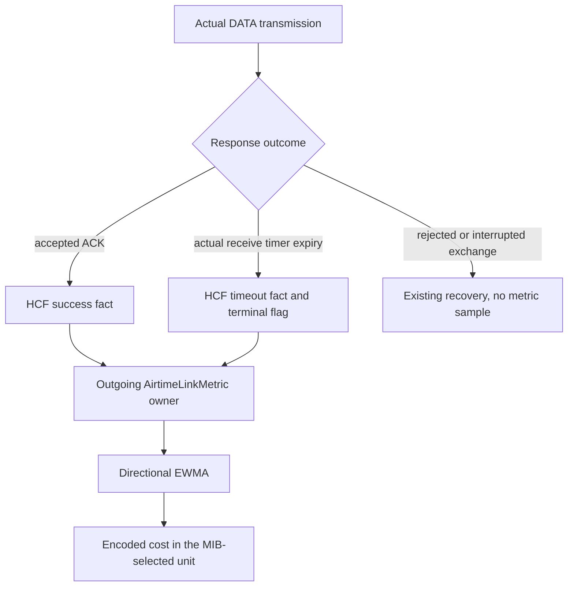
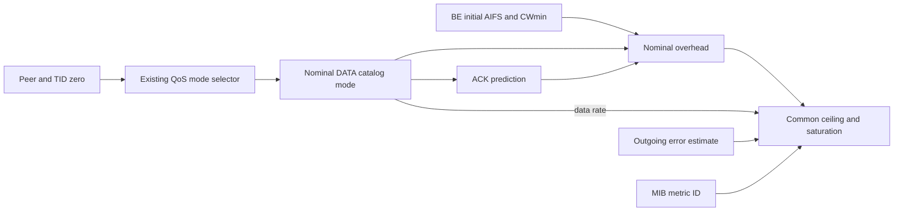
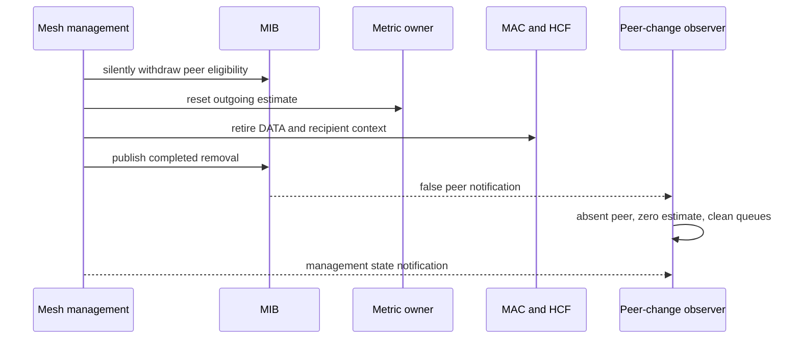

# Directional mesh airtime costs

This document accompanies plan commit **C5**, proposed subject `ieee80211: measure directional airtime link costs`, [MeshAirtimeMetric.test](MeshAirtimeMetric.test), and `tests/unit/Ieee80211AirtimeMetric_1.test`. IEEE Std 802.11-2024, 14.10.2 and Table 14-4 define the cost formula, nominal 8192-bit body and encoding units. Clause 14.9.3 requires a reply to a peer's metric request and permits a local policy for received reports. C4 forwards data but has no production estimator or metric-report consumer. The parent has missing capability rather than an executed failing version of these new fixtures.

## One outgoing estimate per peer

`AirtimeLinkMetric` owns each local-to-peer frame-error estimate. It starts at zero and applies the declared local EWMA policy: multiply the previous estimate by seven eighths, then add one eighth for an ACK timeout or zero for an acknowledged attempt. The reverse direction has a separate owner at the other interface. Management, group frames, QoS Null, RTS/BAR, internal collisions and frames dropped before transmission do not sample this estimate.

HCF publishes a typed synchronous `MeshDataAttempt` fact at the accepted DATA ACK branch or the genuine ACK-timeout branch. The fact includes peer, selected actual PHY mode, acknowledgment result and terminal-timeout status. Queue membership uses the transmit step's original packet; Tx's retained transmitted copy is a distinct object. The estimator listens to this fact rather than reconstructing outcomes from generic packet drops or `linkBroken`. Existing retry recovery, management outcomes and generic link-broken notifications retain their behavior.



An empty receive step and a completed transmit step alone do not prove a timeout. A received mesh Close can interrupt that empty wait before management retires the DATA. The actual timeout owner therefore marks the existing receive-step completion `EXPIRED`; management interruption marks `REJECTED`, and a rejected decoded response retains its received frame. HCF requires `EXPIRED`, an empty receive step, the matching preceding DATA original, a completed PPDU and current queue membership before publishing a timeout. A mesh PHY-corruption abort uses the existing rejected-interruption path; non-mesh corruption behavior is unchanged. These excluded aborts may consume the existing retry budget but do not become error samples or terminal-timeout indications under this selected estimator policy.

## Rate authority and encoding

HCF's nominal timing query builds a local nominal DATA query for the peer and TID zero, then uses the existing QoS rate selector and ACK prediction role. The overhead is initial AC_BE AIFS plus half the initial CWmin times slot duration, the selected DATA preamble/header, SIFS and a legal predicted ACK duration. The query reads the EDCAF owner's initial contention timing, not its current recovery CW or random backoff. PHY mode APIs own the durations; the metric owner does not parse per-receiver configuration or reproduce PHY formulas.

The common calculation is `(O/n + 8192/r)/(1-ef)`, rounded upward and saturated to the unsigned 32-bit range, with a minimum encoded cost of one. Metric ID 1 encodes 0.01 TU and fixes `n=1`; ID 2 encodes 0.01 microseconds. Both production paths currently use `n=1`. The arithmetic helper permits fractional `n>=1` for future aggregation work; this is not a live aggregation claim. Invalid rates, probabilities, overheads, identifiers and aggregation counts are rejected, and `ef=1` saturates.



The fixed OFDM selector used in C5 returns the configured catalog mode independently of optional peer legacy-rate changes. A compatible optional-rate update commits management and MIB state while preserving the estimate because the effective DATA/ACK tuple is unchanged. A candidate lacking the configured DATA mode or predicted ACK support is rejected before publication. There is no accepted tuple-changing update in this bounded profile; the later high-throughput work must extend tuple legality/comparison and reset before publishing a changed effective PHY. No speculative mode history table or MIB transaction is introduced here.

## Peer retirement and metric reports

Peer retirement first withdraws eligibility silently, resets the metric owner and the typed MAC peer context, and only then publishes the MIB's rate/peer change and the management transition. The change result is a local boolean, not a second transaction state table. Isolated management stop uses the same cleanup path for each established peer. A synchronous false-notification observer must see absent eligibility, a zero estimate and retired peer data across all ACs; listener subscription order cannot expose partially cleaned state. The fixture also observes a new recipient-clear completion count on each notification. A test-only HCF subclass transparently decorates the existing recipient-service interface, forwarding every operation to the real production service and incrementing its count only after `clearPeer` returns. This checks completion ordering without production telemetry or a replacement receive algorithm.



A received metric request is admitted only from an established peer, with whole-body validity checked before processing. Management replies through the production MAC/radio with its own outgoing cost. The selected local policy does not replace measured samples with an unsolicited remote report; the standard explicitly leaves that update policy to the implementation.

## Direct fixtures

`MeshAirtimeMetric.test` creates three isolated live mesh pairs with test-only forwarding providers. Two pairs use metric IDs 1 and 2 with fixed 6 and 24 Mb/s DATA. A third uses fixed 18 Mb/s to exercise optional-rate admission without changing the basic-rate set. Each pair loses its first DATA ACK, directly checks `ef=1/8`, then accepts a retry and checks `ef=7/64`; reverse estimates remain zero. Independent overhead expectations verify that error recovery's changed CW is not an estimator input, and actual mode details must identify the transmitted rate.

Separate DATA exhausts the configured retry budget. Every actual ACK timeout produces one fact, and only the last timeout is terminal. Simultaneous VO/VI access forces an internal collision with the losing frame's retry budget exhausted before transmission: one actual winning transmission and one metric fact must remain. An expired source path produces no DATA attempt. A valid received transit frame with TTL one is discarded before a new hop transmission and produces no metric fact at the relay. Requests and unsolicited reports test reply units/value and preservation of local samples. Optional-rate removal is committed without resetting a nonzero estimate; removing the configured fixed DATA rate leaves the previous committed rates and estimate unchanged.

A corrupt response is separate from a missing response, and the fixture covers both relevant event orders. For 6 Mb/s DATA/ACK, the ACK completes 60 microseconds after DATA while the default start-reception timer expires at 50 microseconds during physical reception; subsequent corruption causes the direct rejected PHY abort and no timeout sample. For 18 Mb/s DATA with a legal 12 Mb/s ACK, the corrupt ACK completes at 48 microseconds while that 50-microsecond timer is still pending; a later real timer expiry is a genuine timeout and does produce an error sample. Each case then accepts a retry, and the fixture checks the resulting directional estimates. This policy excludes the direct rejected abort, not every exchange that has encountered a corrupt frame.

Another source DATA is retired while on air, followed by late callbacks, re-peering and fresh traffic. A real received Close interrupts an empty ACK wait before retirement, proving why `EXPIRED` is necessary. Finally, isolated management stop withdraws a peer with data still queued; the fixture asserts that queue precondition before stop, and the synchronous false observer checks completed cleanup.

The arithmetic unit uses independent values: `O=100 us`, `r=100 Mb/s`, `ef=0` gives ID-1 cost 18, ID-2 cost 18192 for `n=1` and 10692 for `n=4`. It also checks a fractional aggregation count, one-picosecond ceiling boundaries, both encoding units, invalid values and saturation near/at total loss. Those calculations supplement the production protocol evidence.

## Validation record

Working directory: `/home/miguel/workspace/inet-ieee80211-adhoc-routing`; source is C4 commit `03489ad1f9` plus the C5 working diff. The protocol fixture uses General, run 0, seed 0 and computed FCS. Builds use `make MODE=debug -j4`.

| Check | Result |
| --- | --- |
| Matching debug library | PASS |
| Arithmetic and retained codec/Tx units | 5/5 PASS |
| Complete new metric protocol fixture | PASS, including both corruption event orders and synchronous recipient-cleanup observation |
| C2–C4 mesh controls | 6/6 PASS |
| Selected legacy protocol controls | 5/6 PASS; Block Ack data retry retains both exact pre-existing parent failures |
| Frame-sequence/Rx completion module controls | 2/2 PASS |
| Scoped architecture, release format and whitespace | PASS |
| Diagrams | PASS: Mermaid 10.9.3 / Firefox, rendered and visually inspected |

Executed commands after `make MODE=debug -j4` completed with exit 0:

```sh
opp_run_protocol_tests --load . -p inet -m debug --no-build \
  -w '^tests/protocol/wifi$' \
  -f '/(mesh/(MeshAirtimeMetric|MeshForwarding|MeshGroupForwarding|MeshPeering|MeshPeeringFailure|MeshBeaconTiming|MeshWireFormats)|common/(WifiAssociation|WifiDataDelivery|WifiDuplicateWithRetry|WifiBlockAckDuplicateAddba|WifiBlockAckDataRetry)|11n/N_Amsdu)\.test$'
opp_run_unit_tests --load . -p inet -m debug --no-build \
  -f 'Ieee80211(AirtimeMetric|MeshSerializer|MgmtFrameSerializer|MpduSubframeHeaderSerializer|TxNavChoice)_1\.test$'
opp_run_module_tests --load . -p inet -m debug --no-build \
  -f 'Ieee80211(FrameSequenceObservations|RxTransmissionCompletion)_1\.test$'
```

The protocol command exits 1 with 12 passed files and the known failed `WifiBlockAckDataRetry` control. Run 0 fails its protocol deadline at event 3708/time 1.023764276562 seconds; run 1 aborts on the simultaneous-transmission check at event 2639/time 1.014105463846 seconds. Both match the independently reproduced parent failures recorded in [C2](hwmp-c2-wire.md#validation-record). A failed control remains a failure. The unit and module commands exit 0.

Logs are `/tmp/inet-mesh-c5-final-build.log`, `/tmp/inet-mesh-c5-final-protocol.log`, `/tmp/inet-mesh-c5-final-unit.log`, and `/tmp/inet-mesh-c5-final-module.log`. Raw stdout/stderr and generated fixtures are retained under `/tmp/inet-mesh-c5-raw/protocol/`, `/tmp/inet-mesh-c5-raw/unit/`, and `/tmp/inet-mesh-c5-raw/module/`. The scoped command `doc/project/enforcement/check-architecture.sh src/inet/linklayer/ieee80211` exits 0; release-note format and `git diff --check` pass. The global naming/interface scans retain existing candidates, with no new mesh interface/module finding. No seal or exception-ledger status is changed.

Series-wide release compilation, feature-disabled compilation, native fingerprints and global push gates are coordinated separately. The earlier C4 fingerprint checkpoint is not C5 final-tree fingerprint evidence. No baseline or expected-failure declaration is changed. These fixtures establish the declared deterministic estimator and reporting policy, not its statistical accuracy under variable-size stochastic traffic, aggregation, authenticated mesh, high-throughput PHY selection or HWMP path choice.
