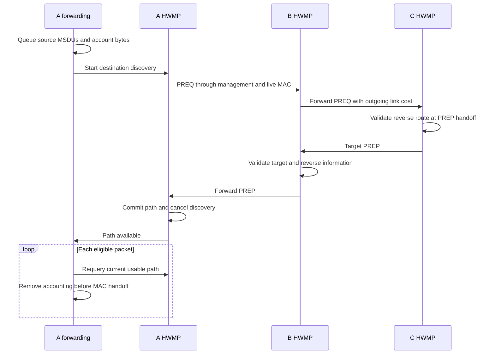
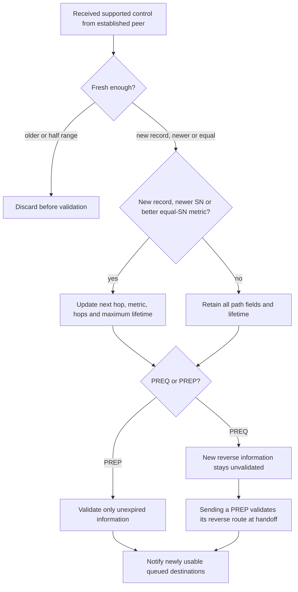
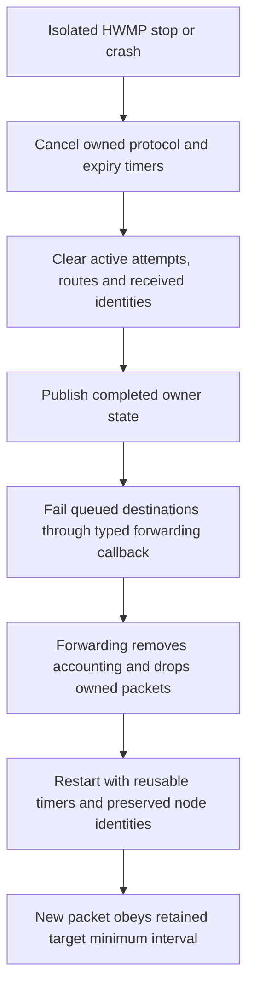

# Discovering native mesh paths

This document accompanies plan commit **C6**, proposed subject `ieee80211: discover native mesh paths with HWMP`, and [HwmpDiscovery.test](HwmpDiscovery.test), [HwmpPathSelection.test](HwmpPathSelection.test) and [HwmpDiscoveryLimits.test](HwmpDiscoveryLimits.test). The C5 parent measures directional link costs and forwards along a supplied path, but has no production path-discovery provider. C6 makes `Hwmp` the default provider and lets unresolved native unicast traffic wait for a discovered path. IEEE Std 802.11-2024, 14.11.8–14.11.10 and Tables 14-9/14-10 govern reactive forwarding information and PREQ/PREP processing; 10.37.3.2 governs native data admission and refresh. Path errors, proactive roots, aggregation and power save are separate additions.

## A packet has one queue owner

`MeshForwarding` owns pending source packets, shared packet/byte accounting and each packet's exclusive deadline. `Hwmp` owns routes, precursor lists, sequence numbers, received-PREQ identities and destination discovery timers. Management receives an immutable control body and immediate transmitter/receiver identities through its existing mesh action path. Only an established transmitter with a fully valid supported body can change HWMP state. A malformed later element rejects the entire body before an earlier valid element can mutate a route.



A packet expires when `now >= deadline`, including when a retry or readiness event runs before the packet-expiry timer at the same simulation time. HWMP asks forwarding to expire/check pending packets before every initial or retry attempt. The last packet leaving cancels the active destination budget; a later packet gets a fresh budget while retaining the required time since that target's last PREQ. Queue overflow drops the new packet before it can create an orphan discovery. Shared count, bytes and individual wait policies are configured by the authoritative declarations in [MeshForwarding.ned](../../../../src/inet/linklayer/ieee80211/mesh/MeshForwarding.ned).

The accepted synchronous HWMP-to-management handoff is the declared model boundary for a generated attempt and PREQ pacing. It is distinct from actual PHY transmission after EDCA, queued management traffic or future power-save buffering. IEEE 802.11-2024 Table 6-1 and 6.3.4 describe the Type 3 request without a confirmation; this model does not add a PHY completion protocol for discovery. Traversal and packet-wait budgets include contention delay. If management is inactive, HWMP cancels the attempt and fails its source queue before incrementing any counter or scheduling a retry.

## Freshness, validity and admission are separate

Each route retains a known destination sequence number even after expiry. Serial comparison accepts a difference strictly between zero and half the 32-bit range; the exact half-range is unordered and rejected. Newer information wins even when its metric is worse. Equal sequence numbers replace fields only for a strictly smaller cumulative metric. The cumulative metric saturates at `UINT32_MAX` and adds the receiving station's **outgoing** airtime cost toward the immediate transmitter. Hop count and metric remain separate.



A PREQ creates reverse control information but does not by itself validate a new data route. Sending a PREP validates the reverse originator route at management handoff; receiving a nonstale PREP validates its target record. Equal-SN/nonimproving PREP reception can therefore validate retained unexpired information without replacing fields, extending its deadline or propagating that PREP. Expiry is independently enforced by lookup and an owner timer. Data lifetime refresh preserves invalidity once an old path has expired or its next hop is no longer established; refresh alone cannot revive a route.

PREQ receipt and propagation use the two distinct standard predicates. Receipt's no-update alternative compares the requested **target** sequence number; propagation's alternative compares the **originator** sequence number. Both consult whether the `(originator, Discovery ID)` identity was already seen before recording this reception. USN=1 makes the target sequence bytes reserved: they cannot supply a freshness floor or satisfy the target equality predicate, and generated reserved bytes are zero. Target-only, intermediate reply, multitarget removal/TO update and TTL processing remain per target; processing does not stop after the first reply. Both target and intermediate replies start at hop zero and copy the PREQ lifetime.

The finite received-identity cache is an explicit model policy, configured by `seenIdentityCapacity` in [Hwmp.ned](../../../../src/inet/linklayer/ieee80211/mesh/hwmp/Hwmp.ned). Retention uses the received Lifetime, and an unexpired identity is never silently evicted. A new identity that cannot fit is dropped before path mutation. Repeated identities can retain a later expiry. Expiry occurs lazily and at relevant owner timers. Discovery IDs are equality identities, not serially ordered counters.

Pairwise precursor insertion follows the PREQ/PREP propagation rules. Native final-destination data also needs self-destination admission, so the integration adds two explicit derived policies: target PREP generation admits its reverse next hop for the local destination, and any accepted nonstale local-originator PREP admits its **actual receiving transmitter** for that local destination. The latter also applies to validation-only PREPs without changing the retained target route or adding normative propagation precursors. Both retain a later existing precursor expiry. These policies satisfy the native data admission rule; they are not claimed as standalone verbatim precursor insertion requirements in the target-PREP text.

The model rejects received PREQs whose originator is local and PREPs whose target is local before learning or discovery mutation. This declared no-self-learning policy protects the local sequence authority and keeps self-admission separate from next-hop lookup. Ordinary PREQ.target=local and PREP.originator=local remain valid. The optional direct-transmitter route shortcut is omitted, so every learned forwarding route has a known destination sequence number.

## Lifecycle and observations

Isolated HWMP stop/crash cancels its timers and clears volatile routes, received identities and active budgets before failing the snapshot of queued destinations. Forwarding drops those packets through its own accounting/drop owner. Destructors delete only owned packets/state/timers and do not call neighboring modules. HWMP sequence/Discovery ID counters, forwarding's mesh sequence counter and relevant target PREQ pacing history persist across supported isolated owner restarts; resetting them would collide with histories still retained at live neighbors. This does not claim whole-interface or whole-NIC restart support.



`hwmpPathUpdated` and `hwmpDiscoveryChanged` publish completed owner changes with typed read-only snapshots. Path events describe actual path/self-admission changes rather than no-op receptions; their boolean is current data usability. Discovery events describe active attempts, count and next deadline. WATCH state exposes stored paths and precursor expiries as well as discovery state. Observations do not coordinate queues; typed readiness/failure calls do that work.

The isolated management-down test exposed a real late-input failure: a Close delivered at 180.04 ms while mesh management was stopped reached the inherited down-state error instead of being discarded. The narrow correction overrides the mesh owner's existing down-message hook for real `macIn` packets, using the normal management drop/ownership path. Self-messages and unexpected inputs retain base diagnostics. The fixture keeps that late Close reachable, checks the stopped-owner discard and then establishes a fresh peer relationship before sending new traffic.

## Direct evidence

All three fixtures use seed 0, production mesh MACs, HCF, radios and computed FCS. `HwmpPathSelection.test` executes two runs for metric IDs 1 and 2. Its controlled outgoing-control suppression occurs after the test observes a production HWMP handoff, keeping adversarial receive cases independent; it neither installs paths nor substitutes the production estimator. Exact packet-deadline stimuli in `HwmpDiscoveryLimits.test` enter the production typed receive contract at specified times, while its normal control, restart and identity-history cases traverse the live MAC/radio.

| Fixture | Decisive stimulus and assertion |
| --- | --- |
| `HwmpDiscovery` | Two A–B–C meshes queue two A→C source packets, inspect hop costs and precursors, and deliver once. Already queued C→A traffic releases when the incoming target PREQ causes a PREP handoff; B→A traffic releases when the received C PREP is propagated. Immediate later reverse traffic needs no new discovery. Malformed-then-valid whole bodies, external addresses, nonpeer/closed controls and own echoes cannot mutate state. Signal listeners read the same committed snapshot as the published fact. |
| `HwmpPathSelection` | An asymmetric diamond primes the real directional EWMA with one dropped ACK. Newer/worse, stale/cheaper, equal/better, two-hop/cheaper, wrap, half-range and saturated metrics choose the required fields in both units. TO/USN combinations, reserved bytes, receipt/propagation predicates, multitarget processing, target-only local reply, TTL and individual PREQ admission are distinguished. Validation-only PREP preserves fields/deadline and admits the actual transmitter. Expiry is queried at deadline−1 ns, deadline and deadline+1 ns; real final DATA refreshes an expired source lifetime without validating it. |
| `HwmpDiscoveryLimits` | Shared count and byte bounds reject new traffic before orphan PREQs. Independent destinations exhaust exact handoff retry budgets and restart fresh. Packet expiry cancels attempts, including retry/deadline coincidence. Same-destination stop/start and short-gap rearrival preserve the PREQ minimum interval. Deadline−1 ns releases; exact/late replies cannot resurrect packets. A capacity-one received-identity cache retains a duplicate's extended expiry and admits a new identity only after expiry. Isolated HWMP restart retains SN/ID after prior advancement beyond the fresh retry budget; forwarding restart preserves source mesh sequence against live duplicate history. Inactive management produces no counted attempt and late input is safely discarded before recovery. |

The parent lacks the new provider and contract methods, so these fixtures are not directly runnable against C5 without compatibility scaffolding. The pre-fix late-Close reproduction is retained as an executed negative result. No parent differential run of the entire new discovery fixture is claimed.

The final matching `make MODE=debug -j4` passed after the down-state correction (`/tmp/inet-mesh-c6-build-lifecycle.log`). The explicit 16-file protocol selection passed all ten mesh files and five legacy controls; `WifiBlockAckDataRetry` retained its pre-existing failure. Its first run missed step 2 at 1.023764276562 s/event 3708; its second run hit the exact-start runtime guard at 1.014105463846 s/event 2639, matching the independent parent comparison. The failed control remains failed; its expectations are unchanged. The final protocol log is `/tmp/inet-mesh-c6-protocol-final.log`, and complete generated artifacts are retained under `/tmp/inet-mesh-c6-raw/protocol-final/`.

A subsequent test-only precision refinement leaves the delayed packet pending through its 126 ms retry/deadline coincidence, requiring cancellation rather than an active rescheduling publication at that instant. A separate source packet receives its positive reply at deadline−1 ns. The final `HwmpDiscoveryLimits.test` rerun passed against the unchanged matching production library (`/tmp/inet-mesh-c6-limits-boundary-final.log`); its complete generated artifacts and exact source fixture are retained under `/tmp/inet-mesh-c6-raw/limits-boundary-final/`.

The focused unit command selected `Ieee80211(MeshSerializer|MgmtFrameSerializer|MpduSubframeHeaderSerializer|TxNavChoice|AirtimeMetric)_1.test` and passed all five cases (`/tmp/inet-mesh-c6-unit-final.log`). The module command selected `Ieee80211(FrameSequenceObservations|RxTransmissionCompletion)_1.test` and passed both cases (`/tmp/inet-mesh-c6-module-final.log`). Both commands used `--load . -p inet -m debug --no-build` against the matching library; raw artifacts are retained beside the protocol artifacts. The protocol command used `--load . -p inet -m debug --no-build -w '^tests/protocol/wifi$'` and this exact filter:

```text
/(mesh/(MeshWireFormats|MeshPeering|MeshPeeringFailure|MeshBeaconTiming|MeshForwarding|MeshGroupForwarding|MeshAirtimeMetric|HwmpDiscovery|HwmpPathSelection|HwmpDiscoveryLimits)|common/(WifiAssociation|WifiDataDelivery|WifiDuplicateWithRetry|WifiBlockAckDuplicateAddba|WifiBlockAckDataRetry)|11n/N_Amsdu)\.test$
```

Scoped architecture, changed NED/MSG naming, source-seal, release-fragment and whitespace checks passed. The broader WLAN naming/interface inventories still report legacy candidates outside this diff; they are not presented as clean whole-subtree gates. All three Mermaid diagrams rendered and passed visual inspection; artifacts are retained under `audit/hwmp-implementation/diagrams-c6/`. Final-tree fingerprints, release compilation and project-wide before-push gates remain separate root-owned checks; earlier checkpoints do not establish their result for this tree.
