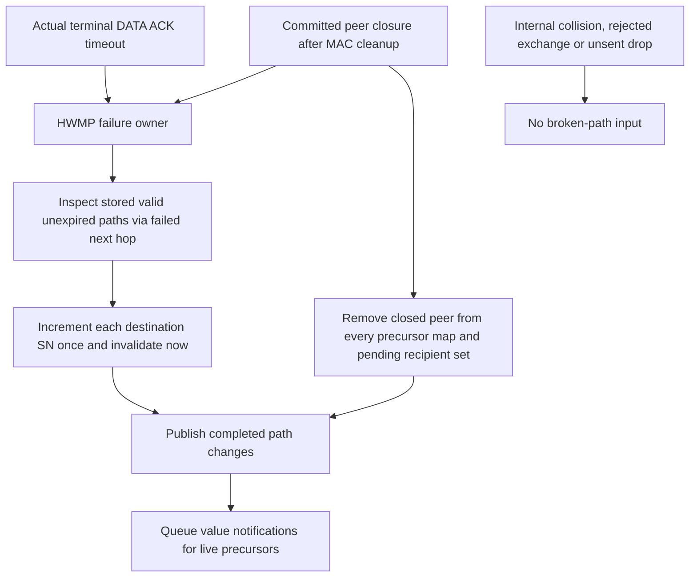
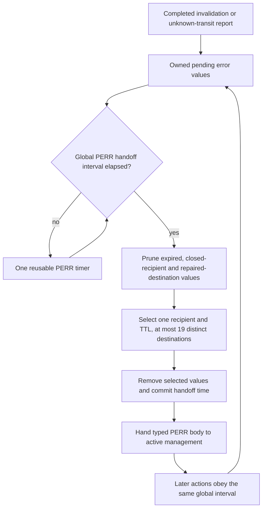
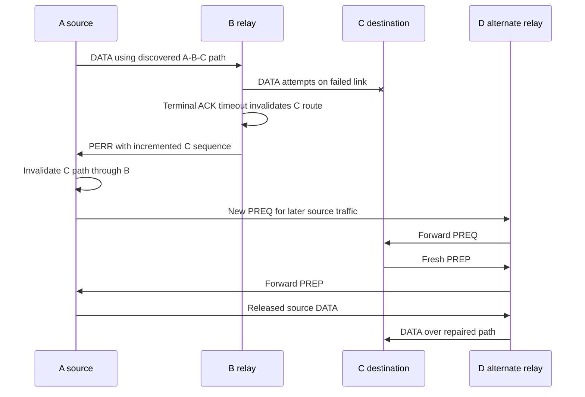

# Repairing broken mesh paths

This document accompanies plan commit **C7**, proposed subject `ieee80211: invalidate broken HWMP paths and propagate errors`, [HwmpPathError.test](HwmpPathError.test) and [HwmpRediscovery.test](HwmpRediscovery.test). The C6 parent discovers routes but does not invalidate them from broken-link outcomes or consume PERRs. C7 makes later source traffic discover a usable alternative after failure. IEEE Std 802.11-2024, 14.11.8.3, 14.11.11.3 and 14.11.11.4.3/Table 14-25 govern invalidation, generation and received error propagation. Root procedures, external proxy destinations and power-save behavior remain separate additions.

## One failure changes a route once

HWMP subscribes to completed MIB peer-closure facts and C5's typed actual DATA-attempt facts. Only an unacknowledged attempt marked as a genuine terminal ACK timeout qualifies. Generic `linkBroken` is not a failure input: internal collision exhaustion also emits that signal. Rejected responses, interrupted exchanges, unsent queue drops and callbacks for retired originals do not establish the terminal radio outcome. C5 supplies that distinction; C7 consumes it without a second attempt history or recovery policy.



Local invalidation scans stored records rather than ordinary `findPath()`: MIB eligibility has already been withdrawn when closure is published, so lookup would hide the affected routes. The route's stored known sequence number increments modulo 32 bits and validity clears before any notification is deferred. A later Close, duplicate error or retired outcome finds that route invalid and cannot increment it again. The local sequence authority and self-admission record are not broken paths to self. Closure removes the peer from self-admission and every route's precursor map, so re-peering does not revive an old relationship's admission.

Received errors affect only a stored valid, unexpired route whose selected next hop is the transmitter. Unsupported reason entries are ignored individually; a supported entry elsewhere in the same body can still act. The existing whole-body unsupported-external-address gate precedes every mutation.

| Received reason and sequence | Mutation and relayed value |
| --- | --- |
| NO-FORWARDING-INFORMATION, zero | Increment stored SN, invalidate, relay the incremented SN. Incrementing `UINT32_MAX` yields zero. |
| NO-FORWARDING-INFORMATION, nonzero | Accept equal or serial-newer; retain the received SN and invalidate. Older and unordered half-range values have no effect. |
| DESTINATION-UNREACHABLE | Require serial-newer; retain the received SN and invalidate. Zero is an ordinary wrapped sequence here. Equal, older and unordered half-range values have no effect. |

The nonzero NO-FORWARDING-INFORMATION rule is the catalog's explicit reading of 14.11.11.4.3(c), constrained by the general stale-information rule. The source sentence's conjunction structure is not presented as unambiguous. It is a declared interpretation, tested separately from DESTINATION-UNREACHABLE. Local invalidation is independent of forwarding enablement and received TTL; propagation requires forwarding enabled and TTL greater than one, and decrements TTL exactly once while preserving supported entry flags and reasons.

## One global notification owner

HWMP owns deferred errors as values: recipient, destination entry, TTL and dependency expiry. It never owns a queued error `Packet *`. For local or propagated path errors, the dependency is the captured live precursor expiry. An unknown-transit response has no route/precursor Lifetime; its declared model policy retains it while the immediate transmitter is established and until repair, closure or owner cleanup, without inventing a separate expiry parameter.



The minimum interval is global across recipients and actions, configured by the authoritative [Hwmp.ned](../../../../src/inet/linklayer/ieee80211/mesh/hwmp/Hwmp.ned) declaration. Its boundary is accepted synchronous HWMP-to-management handoff, as in C6, rather than PHY start/end after EDCA. Each action contains one PERR element, one recipient and one TTL, with at most nineteen distinct destinations to stay within the existing codec's element length. The fixtures exercise the default 100 TU interval across multiple recipients.

Deferred coalescing is a declared model policy. Only exact `(recipient, TTL, destination, flags, reason, sequence)` identities deduplicate, retaining the later dependency expiry. Different semantic values remain distinct. If several values concern the same destination, only one enters an action; the others wait for later globally paced actions. Recipient, TTL, destination, flags, reason and sequence order selection deterministically. There is no invented sequence replacement order inside the pending owner.

Accepted repair prunes the destination's obsolete **unhanded** values immediately, before forwarding readiness callbacks, as well as before a later error handoff. A failure after repair therefore starts with a new value instead of resurrecting an old deferred error. Already handed actions belong to management/MAC and are not recalled. Inactive management clears volatile pending errors without advancing handoff history or scheduling a zero-time retry loop. Isolated HWMP stop/crash unsubscribes first, clears pending values and cancels the timer; restart preserves relevant node-global handoff history. The destructor only cleans its own state.

## Transit traffic does not become source discovery

An otherwise supported native transit unicast with no usable path invokes `reportUnknownTransit(transmitter, destination)` and is dropped by forwarding. HWMP generates Case B's NO-FORWARDING-INFORMATION PERR with reserved sequence zero to the immediate transmitter. This call transfers no packet ownership and does not queue a source packet or start discovery. A usable path with bad precursor admission is a separate silent drop. Nonpeer, unsupported external/Mesh Control, malformed, group and local-delivery paths remain excluded.



## Direct evidence

The two fixtures use seed 0, live production MACs/HCF/radios, computed FCS and the production C6 discovery/metric owners. `HwmpRediscovery` creates the main and alternate routes through actual PREQ/PREP exchanges. Its controlled initial alternate-relay suppression ends before recovery; subsequent bidirectional B–C radio loss leaves A–D–C as the available path. The source packet wait is long enough to include C6's retained PREQ minimum interval.

`HwmpPathError` supplements live control reception with synthetic destination pressure, explicitly representing stored records rather than claiming twenty-five additional radio endpoints. Valid PREPs and intermediate-reply PREQs create those records and precursor subsets through the production engine. Outgoing HWMP controls are fault-suppressed **after** their accepted management handoff is observed, isolating each receive-table case without writing the production route table or substituting its estimator. Test-only subclass queries inspect pending state; no production API was added solely for those assertions.

| Fixture | Decisive assertion |
| --- | --- |
| `HwmpRediscovery` | Actual terminal DATA loss causes one B→A PERR and one sequence increment; a stale PREP cannot validate the failed path. Later traffic discovers D and is delivered while unrelated A→E remains usable. A corrupted ACK reaches an actual rejected receive completion, then retries successfully without a terminal fact or path invalidation. Internal-collision retry exhaustion is observed as a retry-limit drop without a terminal DATA fact; a queue overflow also leaves the unrelated route intact. Closing D–C with DATA on air and other DATA queued retires those originals without a second terminal outcome. A later Close on the already failed B–C route cannot increment or notify again. |
| `HwmpPathError` | Reason-specific equal/stale/newer/zero/wrap/half-range handling, selected-next-hop and expired/invalid record filters, whole external-body rejection, TTL and forwarding-disabled invalidation are distinguished. Twenty-five destinations yield recipient subsets of 25 and 10, split 19+6 and 10 under one global default interval. Closed-peer precursor/self-admission cleanup survives re-peering. Expired dependencies disappear before handoff; exact duplicates coalesce while different reason/SN values for one destination require separate actions. Repair before deferred sending removes the old value even when the route fails again before the next opportunity. Stop/restart preserves global pacing; inactive management clears pending values without advancing history. Unknown-transit exclusions do not start discovery or notify. |

The C6 parent lacks PERR maintenance and the new typed transit method, so the new fixtures are not directly runnable against it without compatibility scaffolding. Parent capability gaps are not reported as executed failing tests.

The matching final `make MODE=debug -j4` passed (`/tmp/inet-mesh-c7-build-final.log`). The final protocol selection executed eighteen files: all twelve mesh files and five legacy controls passed. `WifiBlockAckDataRetry` remains failed with unchanged expectations: run 0 misses step 2 at 1.023764276562 s/event 3708, and run 1 hits the exact-start runtime guard at 1.014105463846 s/event 2639. Both match the independent parent reproduction. The log is `/tmp/inet-mesh-c7-protocol-final.log`; complete generated artifacts are retained under `/tmp/inet-mesh-c7-raw/protocol-final/`.

The protocol command used `opp_run_protocol_tests --load . -p inet -m debug --no-build -w '^tests/protocol/wifi$'` with this explicit filter:

```text
/(mesh/(MeshWireFormats|MeshPeering|MeshPeeringFailure|MeshBeaconTiming|MeshForwarding|MeshGroupForwarding|MeshAirtimeMetric|HwmpDiscovery|HwmpPathSelection|HwmpDiscoveryLimits|HwmpPathError|HwmpRediscovery)|common/(WifiAssociation|WifiDataDelivery|WifiDuplicateWithRetry|WifiBlockAckDuplicateAddba|WifiBlockAckDataRetry)|11n/N_Amsdu)\.test$
```

The focused unit selection `Ieee80211(MeshSerializer|MgmtFrameSerializer|MpduSubframeHeaderSerializer|TxNavChoice|AirtimeMetric)_1.test` passed all five cases (`/tmp/inet-mesh-c7-unit-final.log`). The module selection `Ieee80211(FrameSequenceObservations|RxTransmissionCompletion)_1.test` passed both cases (`/tmp/inet-mesh-c7-module-final.log`). Both runner commands used `--load . -p inet -m debug --no-build` against the same matching library. Complete raw artifacts are retained in the sibling `unit-final/` and `module-final/` folders.

Scoped architecture, changed NED/MSG naming, source-seal, release-fragment and whitespace checks passed. Self-audit retraced failure admission, immediate state mutation, value ownership, recipient subsets, global pacing, repair pruning and lifecycle cleanup against the C6-based handoff. No sealed packet-core files changed. All three diagrams rendered with Mermaid 10.9.3 and Firefox and were visually inspected. Release compilation, final-tree fingerprints and project-wide push gates remain separate root-owned checks.
