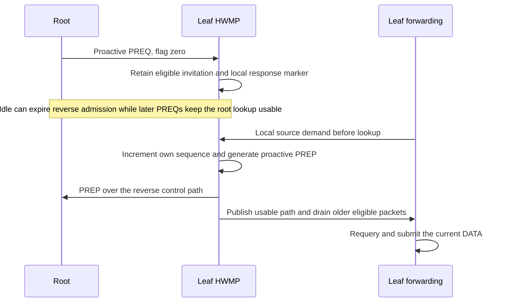
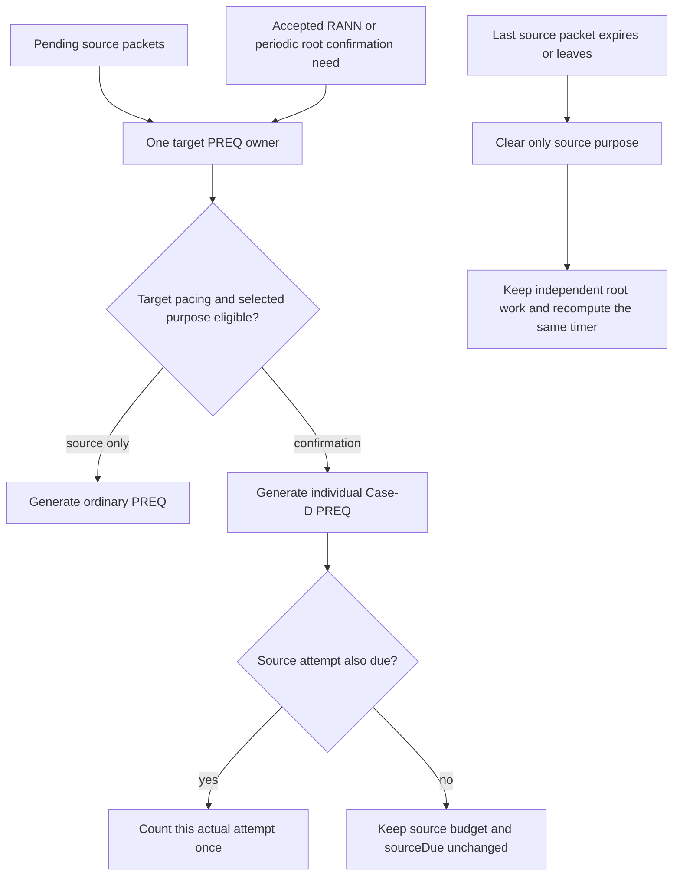
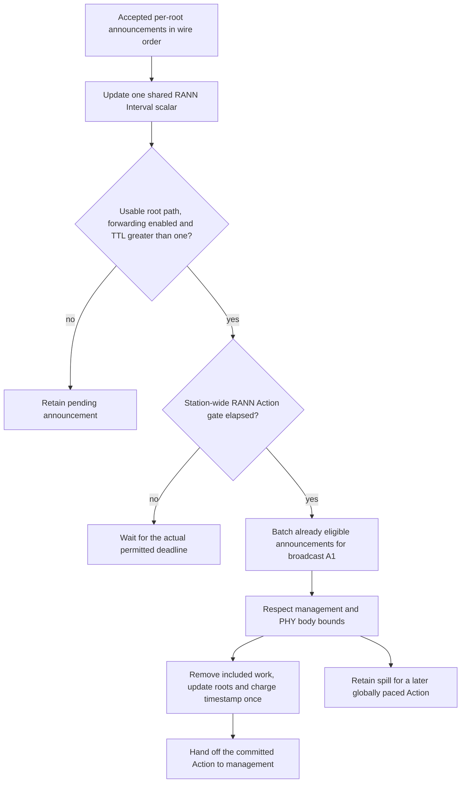

# Proactive HWMP roots without losing on-demand traffic

This document accompanies plan commit **C8**, subject `ieee80211: add+change: maintain proactive HWMP root paths`, [HwmpProactivePreq.test](HwmpProactivePreq.test), [HwmpRann.test](HwmpRann.test) and [HwmpRootCoexistence.test](HwmpRootCoexistence.test). C7 maintains reactive paths and errors but has no root mechanism. C8 adds proactive PREQ and RANN roots, keeping ordinary discovery and its packet ownership in the existing owners. IEEE Std 802.11-2024, 14.11.4, 14.11.9, 14.11.10, 14.11.12 and their field tables define the procedures; C.3 supplies the distinct timing attributes. The authoritative configuration declarations are in [Hwmp.ned](../../../../src/inet/linklayer/ieee80211/mesh/hwmp/Hwmp.ned).

## A proactive reply precedes source lookup

A flag-zero proactive PREQ can leave a leaf's root lookup usable throughout an idle interval while root-to-leaf forwarding information and precursor admission expire elsewhere. A later leaf-only packet would not start ordinary discovery, so lookup failure cannot be its only repair trigger. Forwarding now calls the explicit `sourcePathNeeded(destination)` contract before lookup or draining. HWMP sends the required proactive PREP, validates the reverse control information at handoff and publishes readiness through the existing C6/C7 path. The current packet stays owned by the source entry while older pending packets may drain synchronously.



The response marker is a local invitation/response fact, not knowledge of the remote root's cache. Accepted new or better reverse information replaces the retained invitation and clears the sent marker; stale or no-op copies do not. Flag one requires the reply without waiting for application data. Flag zero responds to either a new local source call or source packets that were already pending when the invitation arrived. The latter uses forwarding's existing expiry-aware query under the synchronous deferral scope, without a second demand history. The saved reverse control record must remain unexpired with an established next hop. A marker becomes sent only at active-management handoff.

Before every locally generated proactive PREP, the model increments its own HWMP sequence modulo 32 bits and ignores the broadcast target's reserved sequence. This is the selected interpretation of 14.11.8.3 applied to the responder represented by Table 14-21. It is not presented as an unambiguous shall: the proactive PREQ names broadcast, and Table 14-21 lacks Table 14-18's explicit after-update qualification. The current updated sequence then appears in Table 14-21; forwarding another station's PREP never increments the forwarding station's counter. No equal-sequence/equal-metric lifetime-refresh exception or optional Case-B maintenance feature is added.

## Source and confirmation share one PREQ procedure

Each target retains one PREQ timer, one source attempt budget/deadline and one `lastSent` authority. Root confirmation is an independent purpose in that same scheduler. Case A's ongoing-discovery gate prevents a second source procedure; Case D has its own eligibility conditions and can use the existing procedure. An eligible Case-D Action can serve both purposes, but it counts against the source budget only when source packets remain and that source attempt's traversal decision and spacing are due. Root-only work before `sourceDue` updates target pacing without advancing the source counter or its traversal deadline.



The periodic Case-D predicate derives from the shared target history for **all locally originated PREQs to that root**, including Case A. There is no synchronized per-root duplicate timestamp. Relayed PREQs and proactive broadcast-target PREQs do not update this local individual-target history. A separate station-wide confirmation-Action timestamp enforces C.3's Action limit across roots. Source exhaustion is removed and failed before independently eligible root work proceeds; queue expiry cannot cancel confirmation.

RANN confirmation begins through the actual recorded RANN transmitter without requiring an existing DATA path. Individual PREQs carry Table 14-14's unused Discovery ID as zero, consume no group ID, and neither read nor occupy the group identity cache. The actual target processes the request without requiring `findPath(self)`; ordinary forwarding still requires the applicable valid target path. RANN reception alone never validates a DATA path.

## One shared Interval and station-wide Action gates

Accepted RANNs update the one mutable `rannInterval` scalar as required by 14.11.12.4.3(a). The NED parameter seeds it; it is not a separate permanent scheduling authority. Multiple accepted fields in one body apply in wire order, with the last accepted value winning before scheduling is reconsidered. Local RANN origination and its advertised Interval use that current scalar. Forwarding preserves each selected announcement's original wire Interval. Confirmation Interval remains separate. Configured seeds must be integral TUs, and received TU values retain one exact scheduling/encoding representation.



There is no additional random RANN delay. Clause 14.11.8.2's exception to immediate propagation resolves to the path/forwarding/TTL and sending-interval conditions in 14.11.12/Table 14-27; no distribution appears there. Eligible work executes inline instead of scheduling a zero-time event to gather it.

C.3's RANN-containing and root-confirmation-containing Action limits apply across roots at the station. Eligible RANNs share broadcast A1. Case-D PREQs batch only when their **actual next-hop A1** matches, as permitted by 14.11.7. Different recipients progress by oldest pending deadline with deterministic ties. Each Action charges its station-wide timestamp once and updates every included target. Work that does not fit remains pending.

The selected non-HT management Frame Body limit is 2304 octets (9.2.4.8.1/Table 9-34 and 9.3.3.1). Category and Mesh Action occupy two of those bytes inside the existing 26-byte action-identity chunk, leaving at most **2302 bytes of following HWMP IEs**. The producer also respects the admitted OFDM catalog's MPDU bound after subtracting that header and FCS. Batches therefore fit at most 59 one-target PREQ IEs or 100 RANN IEs. The named wire authority is in [Ieee80211MeshFrame.msg](../../../../src/inet/linklayer/ieee80211/mgmt/Ieee80211MeshFrame.msg); DATA-mode maxima cannot replace this management bound.

## Lifecycle and coherent observations

Disabled root mode schedules no local root-originator timer and consumes no random draw. A nonroot still participates in received root procedures. Initial local originator scheduling uses a positive policy interval. Inactive management advances no sequence, discovery ID or handoff history; eligible root work retries at a positive existing policy cadence. Stop/crash cancels root work and clears volatile invitations/announcements/purposes while preserving node counters, the current shared scalar and necessary target/global pacing histories. Reconsideration after restart uses preserved handoff deadlines rather than granting a fresh interval bypass. Whole-interface/NIC restart is not claimed.

`hwmpRootUpdated` reports copied completed root/global state, derived target history and current path usability. It emits only for changed state. WATCH state exposes invitations, response markers, RANN transmitter/metric, pending purpose dates, derived deadlines and global histories. The synchronous deferral scope prevents readiness callbacks and source cancellation from flushing work between accepted Interval updates in the same control body; nested scopes restore the previous state, and the outer boundary flushes inline. Observations never coordinate discovery or forwarding.

## Diagram validation

All three Mermaid blocks rendered with Mermaid 10.9.3 in Firefox headless and were visually inspected. The third diagram commits included-root state and the global timestamp before handing the Action to management, matching the observable production ordering. Rendered screenshots and source blocks are retained under `audit/hwmp-implementation/diagrams-c8/`. Rendering checks the explanation, not protocol behavior.

## Direct evidence and limits

All three new fixtures run separately for metric IDs 1 and 2 with seed 0, production HWMP/MAC/HCF/radios and computed FCS. Held control bodies are released through fresh management/MAC transmissions, preserving valid PHY timing; the tests do not delay an already modeled radio arrival. Exact Interval-boundary stimuli enter the production typed receive contract while ordinary exchange paths use live radios.

| Fixture | Decisive assertions |
| --- | --- |
| `HwmpProactivePreq` | Flag zero learns without replying until demand; flag one replies without DATA and refreshes root/relay leaf routes over several lifetimes. A leaf whose root lookup remains usable after idle generates a new proactive PREP before its next DATA, with no ordinary leaf discovery supplying the sequence increment. Another chain queues demand before the first invitation while the ordinary PREP is held; the required proactive reply releases the original queue. Forwarded PREPs leave relay own sequence unchanged. |
| `HwmpRann` | No prior root path is needed for individual confirmation. Holding the PREP prevents DATA usability and RANN propagation. A full group cache does not block individual ID-zero traffic. Source expiry leaves confirmation pending; a later Case-A handoff participates in the shared periodic history. Two accepted Interval fields leave one shared 64-TU scalar while forwarding preserves the selected root's 48-TU wire value, with before/at-boundary checks. Received Interval does not change the independent confirmation policy. Owner restart preserves the scalar/history, and management-down root work pauses without counter/history advancement or zero-time retries before recovery. |
| `HwmpRootCoexistence` | Two real roots interleave with an ordinary source and destination. A root-only confirmation before the source traversal deadline leaves its attempt counter/deadline unchanged. RANN Actions batch across roots, while individual PREQs group by actual A1. Suppressing one root's advertisements **and** confirming replies lets only that forwarding path expire. A separate native-control pressure case uses 104 synthetic stored root records, not 104 additional radio endpoints: 59-PREQ/2301-byte Actions and 100+3 RANN spills are checked against literal serialized IE widths, globally paced, and a second recipient makes progress. |

Ordinary source traffic in the coexistence fixture originates at station 2 in root mode 0. It proves on-demand operation in a two-root topology; it does not execute separate local-source initiation runs on root modes 2, 3 and 4. Their common source path is inspected, with no distinct per-mode source implementation. Stopping announcements alone is not asserted to cause expiry while successful confirmations continue refreshing a path.

The C7 parent lacks these root procedures and the source-demand contract, so the new fixtures are not directly runnable on it without compatibility scaffolding. Parent capability gaps are not reported as executed failing tests.

The final matching `make MODE=debug -j4` passed (`/home/miguel/inet-mesh-c8-build-final.log`). The explicit protocol selection executed 21 files: all fifteen mesh files and five legacy controls passed. Each new root file executed two metric-ID runs. `WifiBlockAckDataRetry` retained its independently reproduced parent failure with unchanged expectations: run 0 misses step 2 at 1.023764276562 s/event 3708, and run 1 hits the exact-start runtime guard at 1.014105463846 s/event 2639. The final log is `/home/miguel/inet-mesh-c8-protocol-final.log`; complete generated artifacts and exact new fixture/support sources are retained under `/home/miguel/inet-mesh-c8-raw/protocol-final/`.

The protocol command used `opp_run_protocol_tests --load . -p inet -m debug --no-build -w '^tests/protocol/wifi$'` with this exact filter:

```text
/(mesh/(MeshWireFormats|MeshPeering|MeshPeeringFailure|MeshBeaconTiming|MeshForwarding|MeshGroupForwarding|MeshAirtimeMetric|HwmpDiscovery|HwmpPathSelection|HwmpDiscoveryLimits|HwmpPathError|HwmpRediscovery|HwmpProactivePreq|HwmpRann|HwmpRootCoexistence)|common/(WifiAssociation|WifiDataDelivery|WifiDuplicateWithRetry|WifiBlockAckDuplicateAddba|WifiBlockAckDataRetry)|11n/N_Amsdu)\.test$
```

The unit selection `Ieee80211(MeshSerializer|MgmtFrameSerializer|MpduSubframeHeaderSerializer|TxNavChoice|AirtimeMetric)_1.test` passed all five cases (`/home/miguel/inet-mesh-c8-unit-final.log`). The module selection `Ieee80211(FrameSequenceObservations|RxTransmissionCompletion)_1.test` passed both cases (`/home/miguel/inet-mesh-c8-module-final.log`). Both commands used `--load . -p inet -m debug --no-build` against the matching final library; raw artifacts are in sibling `unit-final/` and `module-final/` folders.

Scoped architecture, changed NED/MSG naming, source-seal, release-fragment and whitespace checks passed. Self-audit retraced root/source purpose ownership, wire field/length authorities, shared scalar and Action pacing, response markers, synchronous deferral, no-op observations and lifecycle cleanup. No sealed packet-core file changed. Release compilation, final-tree fingerprints and project-wide before-push gates remain separate root-owned checks.
