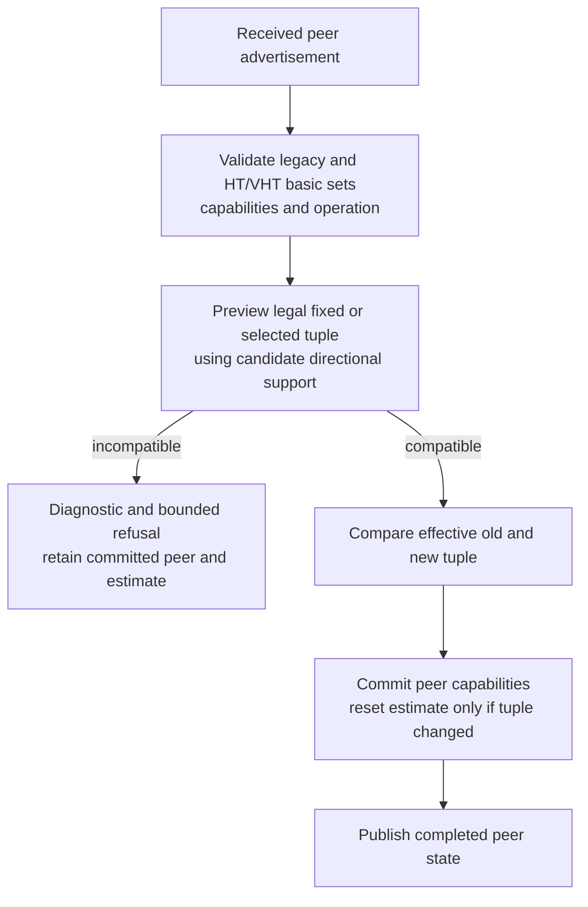
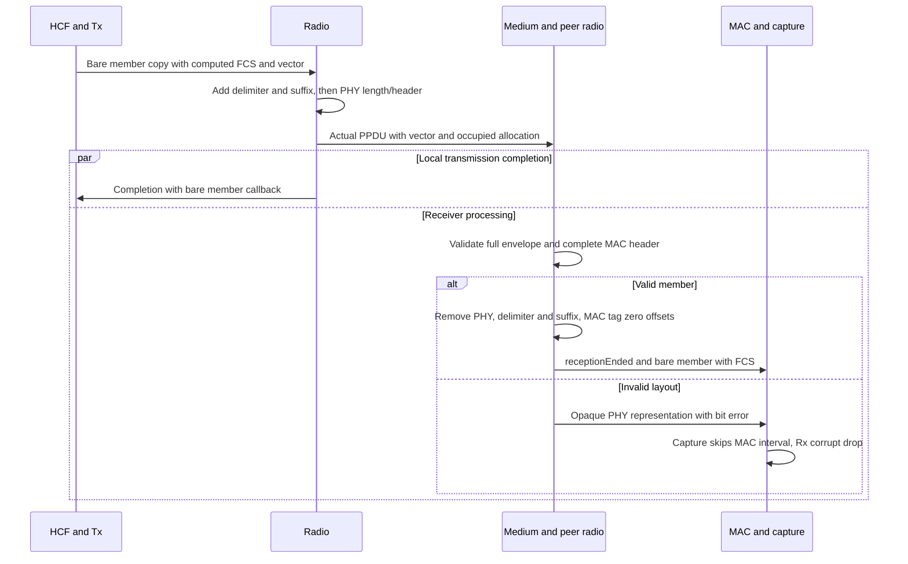
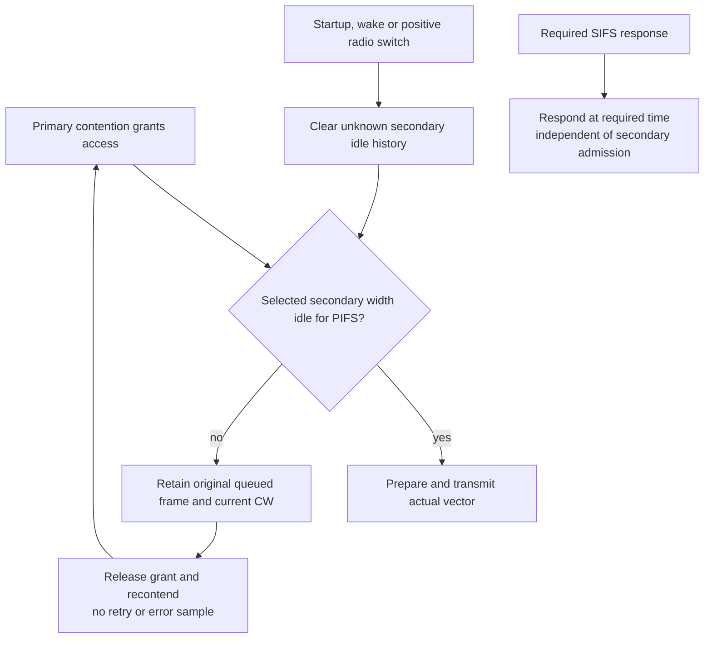

# HT and VHT mesh transport

The new profiles carry native mesh traffic over negotiated HT and VHT links, including narrower transmissions within a fixed wider allocation and the matching wide ACK response. The default OFDM profile remains the reference path. The three new fixtures start real stations without peers, establish through the production management exchange and use production HWMP, forwarding, HCF and radio paths; they install neither routes nor estimator values.

## Capability and selection

The MIB owns committed local and directional peer capabilities; management validates a candidate before changing peer state, and rate selection is the authority for legal effective tuples. The fixed tuple is selected by family, MCS, width, GI and NSS, with existing bitrate constraints checked for consistency. HT MCS determines NSS; VHT uses an explicit NSS. The configured catalog is the opt-in `ac-complete` set introduced by the preceding preparation commit, while legacy `ac` remains unchanged.

Device support differs from the operating allocation: a VHT station operating at 20 MHz still supports the mandatory 20/40/80 MHz baseline, and optional 160 MHz device capability is explicit. Local SGI transmission activation is independent of our receive advertisement and also requires the peer's width-specific receive permission. Supported Rates membership requirements are recognized on receive without requiring their transmission by this non-AP mesh role; basic-set compatibility remains a separate check. These rules follow IEEE 802.11-2024 9.4.2.54–55, the VHT capability/operation elements, 11.1.4.6, 14.3.4 and 21.1.1; legal tuple holes follow the VHT MCS tables, including the invalid 80 MHz/NSS6/MCS9 combination.

## Framing and observations

One actual `Ieee80211TxVector` carries the catalog mode, PPDU format, occupied bandwidth and single-member fact through transmission and receiver indications. A non-HT duplicate response keeps its per-copy legacy OFDM rate and duration while occupying the eliciting width; it is never represented as a faster legacy rate or as a VHT frame. The selected duplicate reception model decodes the receiver's primary 20 MHz copy, while retaining full-width occupancy and the original reception/result identity. Scoped filtered power and SNIR drive that copy's sensitivity/error decision without modifying medium noise or cache objects. This is a declared packet-level primary-copy model for 21.3.10.12, rather than a claim to serialize all PHY SIG bits or combine arbitrary successfully decoded secondary copies.

For VHT DATA, the radio wraps the outgoing duplicate after its member FCS and before PHY length/duration construction. The delimiter follows 9.7.2 and Table 9-659, including split high length bits, EOF, signature and CRC bit order. Receive validates the complete envelope and type-dependent MAC header before exposing a member, then removes the PHY wrapper, delimiter and complete suffix before `receptionEnded` and MAC observations. Valid receive tags explicitly identify a zero-offset bare member; the actual indication retains the original PPDU's single-member fact. Invalid input remains consistently PHY-wrapped/tagged with a bit error, so capture/dissection stays opaque and Rx discards it before a bare-MAC observer can peek it. Tx completion continues to reference the bare original member.

The PHY dissector visits delimiter/padding as PHY chunks and the actual member including FCS as MAC chunks. This supplies the existing recorder/helper with a real MAC interval on transmit, while early receive unwrapping avoids the incompatible generic-dissector versus recorder suffix-offset conventions. Radiotap records actual HT/VHT MCS/GI/NSS/width and the primary channel; duplicate ACK records honestly carry legacy Rate and primary channel, with occupied width verified separately by the actual typed vector.

## Allocation and channel access

The opt-in allocation uses existing mapped band, channel index and bandwidth as its only geometry inputs. The supported contiguous 5 GHz hierarchy covers primary channels 36 through 64 and nested 20/40/80/160 MHz centers, including both primary halves of 160 MHz; channel indices remain distinct from IEEE channel codes. The canonical allocation is immutable during the radio lifetime, including supported sleep/wake and isolated owner restart. Equivalent borrowed per-packet requests normalize to that canonical object, different allocations are refused, and idempotent owned runtime requests preserve its identity.

Primary-channel energy controls contention; secondary-channel energy controls admission of the selected occupied width after PIFS. The radio owns idle history, and unobserved startup, sleep or switching intervals supply no retrospective idle credit. The medium's initialized interference-observation query and a dimensional model are prerequisites; filtering relevant interference by listenability, address or communication range is unsupported for this profile. These are implementation/model prerequisites alongside the homogeneous unprotected-neighborhood bound, rather than additional IEEE requirements.

A wider successor after a narrower PPDU ends the current TXOP and recontends before widening. This holds the same original frame, preserves identities and retry accounting, and does not cancel a required SIFS response. Native high-profile receive admits at most a 2304-byte MSDU after ordinary ACK handling and before forwarding; the threshold uses the parsed header length plus AE0 Mesh Control and FCS. Source and receive oversize drops do not create DATA error samples or path errors. Native A-MSDU, multi-MPDU aggregation, noncontiguous 80+80, protection and rate adaptation remain later or unsupported work.

## Direct evidence mapping

`MeshHtNegotiation.test` runs 16 configurations: 20/40 MHz, long/short GI, one/two source streams and both metric IDs, with asymmetric advertised Tx/Rx support and bidirectional actual DATA/ACK. `MeshVhtNegotiation.test` runs 64 configurations across 20/40/80/160 MHz, both primary halves, both GIs, one/two source streams and both metric IDs. The matrices check actual transmit and receiver-derived vectors, analog centers, delimiter/member FCS, no outer MAC/FCS, bare callbacks, operation-channel mapping, directional response selection and live metric costs. VHT payload lengths cover every modulo-four member residue, including nonzero suffixes through generic dissection and actual captures.

| Boundary fixture configurations | Direct assertion |
| --- | --- |
| 0–8 | Missing HT/VHT, inconsistent operation, all basic sets, malformed reconstructed VHT bytes and metric mismatch are refused; following valid exchange establishes and delivers |
| 9–11 | Received HT/VHT requirement selectors accepted with support; unsupported requirement refused |
| 12–14 | Raw four-byte member, truncated QoS four-address header and bad delimiter CRC remain opaque through radio/dissection/recorder, reach one Rx corrupt drop and then deliver exactly once on retry |
| 15–16 | Fixed short GI with local Tx disabled is diagnosed before establishment; advertised Rx SGI with legal long-GI Tx succeeds |
| 17 | Real secondary-only energy leaves primary idle, retains original frame/CW and progresses after exact PIFS without another arrival |
| 18 | Sleep/off/wake and idempotent requests preserve allocation identity; five changes are refused; wake history waits PIFS |
| 19–21 | Accepted optional capability retains tuple/estimate; incompatible fixed tuple preserves established state/estimate with diagnostic; accepted effective tuple change resets before publication |
| 22–23 | Required same-width duplicate ACK proceeds at SIFS during secondary occupancy; valid reconstructed single-member bytes are admitted |
| 24–25, 27, 29 | Legal HT/legacy DATA to VHT peers and HT-profile/VHT-profile MCS0 below 54 Mb/s retain metric ID2 and independently calculated unit costs |
| 26, 30–31 | Source 2305-byte drop, literal receive 2304-byte acceptance and 2305-byte rejection with normal ACK, no path/precursor refresh on rejection, then ordinary delivery |
| 28 | Actual narrow-to-wide successor is held at TXOP termination and starts in a later sequence after AIFS, with no retry/error sample |
| 32 | Positive receptive-to-receptive switches are unavailable during switching and regain secondary credit at exact PIFS after completion |
| 33 | Genuine ACK timeout grows CW above minimum; secondary refusal preserves that CW/original retry frame and estimate, then retry ACK succeeds |

Configuration 0 additionally invokes the production tuple initializer in a test-only selector probe, covering seven missing/contradictory/absent tuple diagnostics without installing another HCF selector. Test-only MIB probes distinguish optional 160 MHz device support from operating width and reject operating 160 without that capability. These are direct owner-initialization checks, separate from the live transport matrix.

`MeshAirtimeMetric.test` retains its original OFDM run and adds real HT and VHT runs at 65 Mb/s with ACK loss then success, exact directional estimates 1/8 and 7/64, and independent ID2 overhead/cost oracles. The metric keeps n=1; no aggregation count is claimed. Lower-family boundary cases independently retain ID2 at rates below 54 Mb/s, rather than deriving metric identity from the selected instantaneous rate.

The four new units cover geometry, literal delimiter/PSDU bytes and truncation, VHT capability/operation bytes and directional PHY selection. The independently owned `Ieee80211DuplicateReception_1.test` covers three 80 MHz/6 Mb/s radio-only rounds: baseline, secondary interference and primary interference, with power/SNIR/PER, full-width occupancy, original cache/result identity and teardown ownership assertions. Its scope does not establish a complete width/rate/interference matrix.

## Validation record

All three Mermaid diagrams rendered successfully and were visually inspected. The envelope diagram separates local transmission completion from receiver processing, without implying an ACK or cross-radio event ordering. Rendered artifacts are under `audit/hwmp-implementation/diagrams-h1/`.

The production checkpoint is based on parent `3ff5d570869262cedf14797f3629b4ab2888105b`, source manifest SHA256 `b28f1c2dfcce128715e2d33b6de903d29a8fcc6c7b3c8b33663a331b00c20cee`, and matching debug library SHA256 `de0a5ac9968d120b2c0a699f6dbc7918afb0b7556d37e09397cddbb2de64bba7`. Its manifest and build log are under `/home/miguel/inet-mesh-h1-source-checkpoint/` and `/home/miguel/inet-mesh-h1-source-checkpoint-build.log`.

The final explicit protocol selection contains 36 distinct files: 18 mesh, five common legacy and thirteen HT/VHT controls. `N_Amsdu`, also retained by C5, occurs once in that union. The preview selected 36 dry-run skips; the actual matching-debug run recorded 32 passes, three declared failures and the known unexpected Block Ack retry failure. All 18 mesh files passed, including 16 HT, 64 VHT and 34 boundary configurations and the three-run airtime fixture. Exact commands, generated test output, fixture sources and 1344 file hashes are retained at `/home/miguel/inet-mesh-h1-raw/protocol-final/`; the runner log is `/home/miguel/inet-mesh-h1-protocol-final.log`.

The independent guard verified 19 distinct units: the initial batch passed 18 and exposed one compile error in the retained `TxNavChoice` mock, which lacked the newly required transport-admission method. Its one-line inert mock adaptation passed the separate focused rerun, with the original NAV assertions unchanged. Eleven module files passed 29 simulation runs, including the new three-round duplicate fixture. The guard's authoritative `/home/miguel/inet-mesh-h1-final-verification/record.json` retains exact selections, seeds, raw output, the initial setup error and the repaired result; it also confirms all 56 production inputs, pinned/current library, feature configuration and fingerprint store remain unchanged. The adapter's false classification of a successful `FAIL: 0` summary is retained separately from the direct native runner results.

The corrected NAV unit retains three completion-ownership warnings that independently match its C8 raw output; they are not new H1 warnings. The module batch has no ownership or undisposed-object warnings. Independent final review closed all four H1 findings and returned 35 PASS, 11 N/A, no flags/questions, leaving only the explicitly deferred C9 fingerprint item unverified.

The separate final-snapshot faulted-capture audit `/home/miguel/inet-mesh-h1-faulted-capture-final-audit.json` independently validates twelve PCAP files and 367 exact bare-MAC CRC32 values without importing production codecs. The three malformed cases each have two source DATA records but only the valid retry in the receiver capture, confirming that the malformed receive was not exposed as an ordinary MAC record. Reconstructed valid and 2304/2305-byte native cases remain correctly decodable captures, including the frame subsequently rejected by the MAC size policy.

The stable-diff authoring self-audit retraced capability admission and reset-before-publication, actual vector and channel-pointer ownership, bare versus PHY-wrapped terminal paths, response bypass, retained-frame/CW accounting and positive-switch history. It confirmed that the frozen implementation matches the root-validated contract, including the approved radio-envelope ownership correction and native receive limit. No sealed packet or recorder code changed, and this self-audit does not replace independent review.

Two additional direct initialization checks use isolated copies of the generated boundary fixture and the same matching debug library: a scalar analog medium and a dimensional medium with listening filtering enabled. Both terminate at the radio's explicit dimensional/interference-observation prerequisite diagnostic during network initialization, before simulation, protocol execution or any on-air/capture record. Exact commands, unchanged fixture input hashes, loader paths and diagnostics are retained at `/home/miguel/inet-mesh-h1-initialization-refusals/record-final.json`. The first copied-directory attempt lacked the relative included INI directory and is retained separately as setup failure, not refusal evidence. H0's actual-arrival/filter fixture remains the direct provider proof.

After the 36-file batch, a test-only assertion extension compares the actual post-capability-update PPDU with the selected tuple and requires a changed actual mode only in configuration 21. All 34 boundary configurations passed again with unchanged stimuli and production/library hash; source SHA256 `8104e24c036764ddf49ae54fa9a161ce9ee2b05c60853870fa2d7019c35708b1` and raw evidence are retained at `/home/miguel/inet-mesh-h1-raw/boundary-actual-tuple-final/`, with `/home/miguel/inet-mesh-h1-boundary-actual-tuple-final.log`.

The final frozen-snapshot positive capture audit at `/home/miguel/inet-mesh-h1-final-positive-pcap-audit/` passed all 2880 bare-MAC CRC32 checks: HT16 runs/32 files/576 records and VHT64 runs/128 files/2304 records, including all 1120 honestly encoded legacy ACKs. Every record decoded with tcpdump without invalid/truncated diagnostics; the independent parser checked tuple metadata, channels, direction and all four member residues. The guard independently verified 185 relevant archive hashes, including every capture and its associated fixture/log inputs. The earlier development audit remains preserved at `/home/miguel/inet-mesh-h1-positive-pcap-audit-complete/` and does not replace this final reconciliation.

The H0 parent reference records ten passes and three declared failures among the thirteen HT/VHT compatibility files: `N_Ampdu`, `Ac_Ampdu` and `Ac_VhtIe`. Their declarations and assertion boundaries match exactly: respectively 2s/event149187, 2s/event161849 and 2.5s/event48880; each later termination event is two events after its assertion. The separately retained `WifiBlockAckDataRetry` control reproduces the known protocol deadline failure at 1.023764276562/event3708 and runtime abort at 1.014105463846/event2639, including byte-identical exception stderr. The authoritative comparison is `/home/miguel/inet-mesh-h1-final-positive-pcap-audit/reconciliation.json`. These are unchanged failures rather than aggregation success or fingerprint equality. Final-tree release/feature-disabled builds and fingerprint comparisons remain later C9 obligations; no expected-result or baseline replacement is part of H1.
