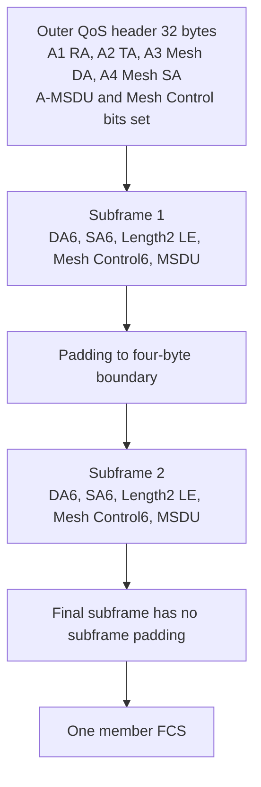
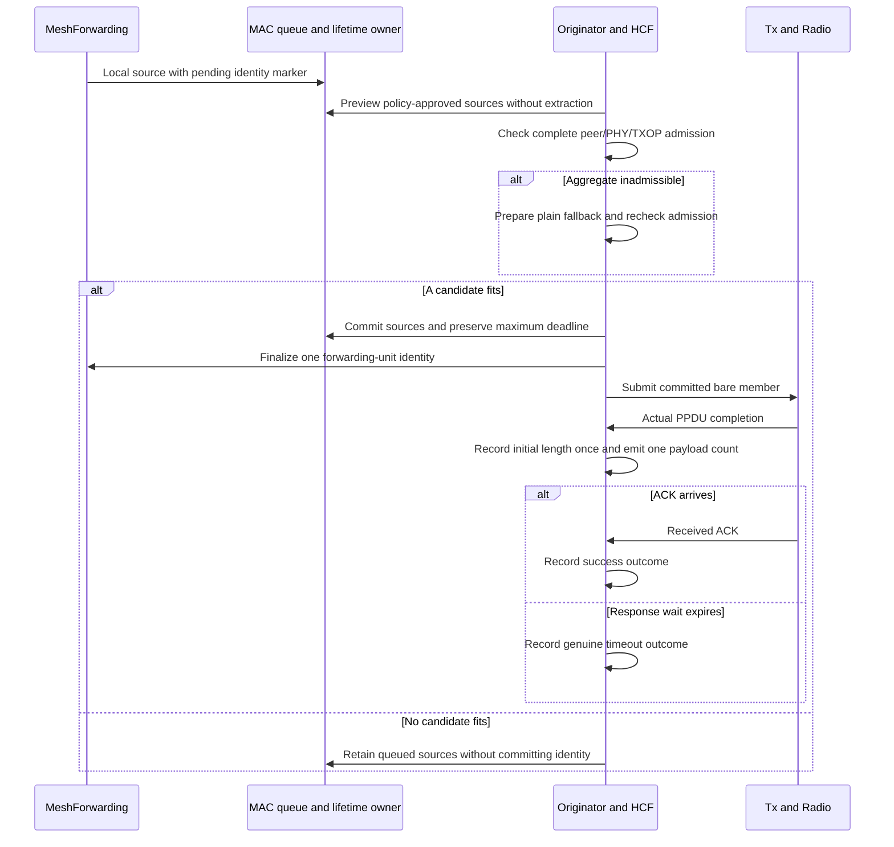
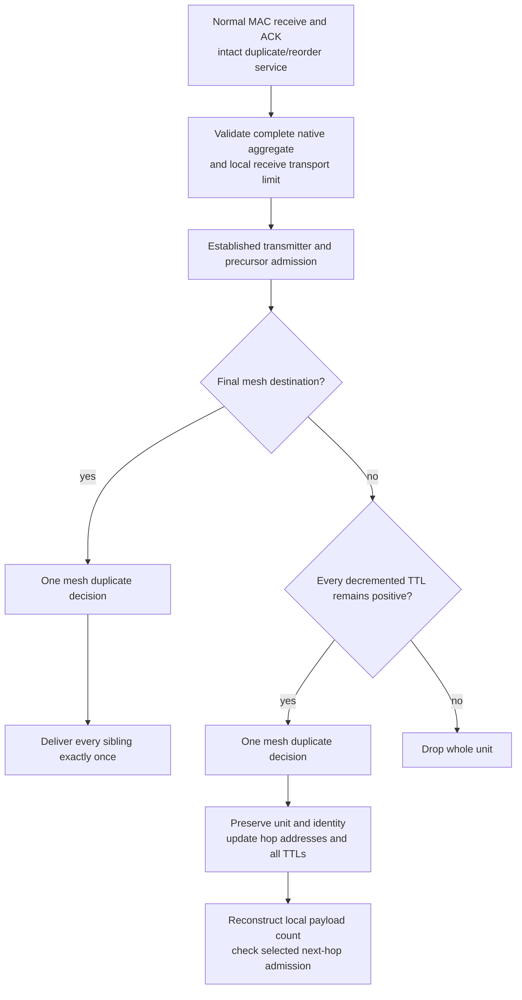

# Native mesh A-MSDU

H2 forms an A-MSDU from local sources sharing a next hop, TID and native mesh endpoints, then forwards it as one unit across the mesh. It preserves Basic A-MSDU bytes and keeps source formation opt-in through the existing MSDU aggregation policy. Receiver support is independent of that local policy.

## Bytes and identity

Every native subframe is Mesh DA, Mesh SA, little-endian MSDU Length, Mesh Control and MSDU, followed by alignment padding only when another subframe follows. The Length counts the MSDU alone. The outer four-address QoS header carries both A-MSDU Present and Mesh Control Present but has no standalone outer Mesh Control. These are IEEE 802.11-2024 9.3.2.2.3/Figure 9-124 and 9.2.4.5.10; the ordinary Basic header retains its big-endian Length and address rules.

MeshForwarding is the only mesh sequence owner. It marks local unicast source units pending; the originator can preview grouping and exact encoded length without allocating an identity. Both reversible commitment and direct extraction call the same finalizer, assigning one modulo-32 sequence value to a newly formed plain or aggregate unit. Plain transit frames and intact transit aggregates are already committed and cannot be merged or reidentified. All subframes of a newly formed aggregate carry the same source identity under 9.2.4.8.3/Table 9-35.

## Whole-unit receive and forwarding

The shared parser validates all bounds, endpoint mappings, sequence identities, controls and alignment before mesh-state mutation or delivery. MAC duplicate/reorder handling sees the intact unit first. Forwarding then applies peer/path/precursor admission and one mesh duplicate decision before delivering all local siblings. A relay changes hop addresses and every TTL without splitting the aggregate. Under the declared preserve-unit policy, a relay drops the complete unit if any decremented TTL would be zero; final delivery accepts every valid nonzero incoming TTL. Preservation and atomic rejection are model policies layered on 10.11 and 10.37.3.2/10.37.6.

At radio capture a reconstructed DS11 A-MSDU is ambiguous with Basic/WDS. The unsealed Wi-Fi dissector keeps that generic body opaque while preserving its full MAC/FCS interval, then the receiving MeshMac supplies explicit mesh context. No sender tag, DS bit pattern or radio-to-MIB dependency selects the native codec. Basic two-/three-address traversal remains unchanged; detailed ambiguous raw WDS display is a stated limitation.

## Transport, lifetime and samples

Standalone HT uses its advertised 3839/7935-byte body tier, subject to actual PHY duration. The 4095-byte HT member limit belongs to an enclosing A-MPDU and is future H3 work, rather than a blanket standalone HT restriction. Mandatory non-HT Normal-Ack receive uses the advertised tier and the 4095-byte OFDM PSDU limit, so native overhead 32+4 leaves at most 4059 body bytes. VHT uses its advertised member cap minus actual header/FCS. Sources are 10.11, Table 9-34, Table 9-224, Table 17-24 and 10.12.2. Local aggregate transmission is deliberately restricted to actual HT/VHT as a model policy, while legal lower-family plain DATA is unchanged.

Selected 5 GHz HT-mixed and VHT complete PPDUs must also fit 5484 microseconds, using the existing mode duration authority. ACK/SIFS remain separate TXOP exchange costs. A zero TXOP limit permits one complete PPDU plus responses. A fresh individual aggregate must fit a positive limit before identity/queue commitment. The fresh plain-MSDU overrun exception requires a Block Ack agreement; no blanket Normal-Ack exception is added. A same-size retry exception requires actual prior-transmission evidence and recovery status, with no earlier Data/Management frame in that TXOP. These limits follow 10.23.2.9, Table 9-34, 10.27.4 and Table 21-28.

Pending sources expire individually before formation. Commitment captures the maximum constituent deadline before deleting/replacing their objects, registers that exact deadline and retains complete retry bytes until whole-unit expiry. It neither starts a fresh lifetime at formation nor trims old constituents from a committed identity. This implements the selected 10.11 all-constituents lifetime contract through the existing MAC lifetime owner.

HCF emits one payload-MSDU count at actual PPDU completion, including an unacknowledged transmission and every actual retry. The original member supplies retirement membership and retains the first actual bare member length; the callback copy supplies transmitted metadata. Prepared, unsent, retired, multicast, management and QoS-Null work supplies no count. ACK/timeout observations independently update the error estimate. AirtimeLinkMetric owns the directional payload EWMA, initialized to one with gain one eighth; three MSDUs move it to 5/4 and another three to 47/32. Metric ID 1 always computes with n=1. Aggregation-limit changes reset n alone when the effective tuple stays unchanged; tuple changes reset both estimates before publication.

Isolated forwarding stop/crash or provider deletion withdraws pending-source eligibility and asks the MAC queue/lifetime owner to retire uncommitted local sources. It preserves peers and committed/transit/on-air work. Isolated deletion performs this retirement in `preDelete` while the MAC is alive; whole-subtree teardown skips sibling callbacks. A missing provider makes pending sources unavailable, while committed units finalize without querying an allocator. The finalizer diagnoses an impossible down-owner call rather than transmitting an uncommitted identity. Independent review identified these cleanup requirements after sequence allocation moved later in the pipeline.

## Evidence status

All three Mermaid diagrams rendered successfully and were visually inspected. The receive diagram validates transit TTLs before recording duplicate identity, matching the repaired same-identity assertion in scenario 6.

`MeshAmsdu.test` crosses each scenario with HT/VHT and metric IDs 1/2. The ordinary A–B–C paths come from live peering and HWMP exchanges; the fixture does not install routes or replace the estimator. Deliberate raw injections preserve computed FCS and reach the production receiver. The test-only driver exposes owner state for assertions and supplies bounded medium/capability stimuli.

| Scenario | Direct assertion |
| --- | --- |
| 0 | Three local MSDUs form one identity; one lost ACK produces an immutable retry, one intact relay and exactly-once sibling delivery. |
| 1 | With the policy's documented unlimited setting, the negotiated 7935-byte standalone body produces a legal 7971-byte HT/VHT MPDU, including the HT case above the future nested-member limit. |
| 2 | Different TIDs prevent merging even when they share an access category. |
| 3 | A malformed reconstructed subframe rejects the whole body; a subsequent valid same mesh identity succeeds. |
| 4 | Missing destination-self precursor admission rejects the whole aggregate. |
| 5 | A fresh-hop MAC sequence carrying a repeated mesh identity delivers no additional siblings. |
| 6 | Mixed TTLs reject transit atomically; a repaired same-identity unit forwards all resulting TTLs as one. |
| 7 | A non-HT Normal-Ack PPDU at the 4095-byte PSDU boundary delivers an aggregate even with local formation disabled. |
| 8 | Advertised lower-tier size rejects 3840 body bytes and accepts 3839. |
| 9 | A lower next-hop limit drops an intact transit aggregate without splitting or an error/PERR sample. |
| 10 | A fixed lower-family relay refuses aggregate transmission while later plain DATA progresses. |
| 11 | Simultaneously queued committed transit MSDUs retain their separate identities. |
| 12 | Unequal constituent lifetimes become the exact maximum deadline, including an actual failed transmission and retained retry. |
| 13 | Repeated previews consume no sequence; commitment consumes one; never-transmitted Retry-marked work cannot claim the actual-retry exception. |
| 14–15 | Stop and crash before the first grant retire all pending local sources; restart cannot resurrect them. |
| 16 | A positive budget fitting plain DATA but excluding the policy-approved aggregate falls back before identity commitment. |
| 17–18 | Negotiated size refusal preserves configured minimum count and minimum length by falling back as a whole. |
| 19 | Different mesh destinations prevent merging despite a common next hop and TID. |
| 20 | Accepted aggregation-limit change preserves the selected tuple/error estimate, resets only payload estimation before publication and then learns new samples. |
| 21 | A positive budget fitting neither aggregate nor plain DATA causes no transmission, identity or sample; another access category progresses. |
| 22 | An actual optional-NSS2 exchange fits the positive budget; accepted removal of optional receive streams selects mandatory NSS1, resets both estimates before publication and permits only the actual same-size first retry to exceed that budget. |
| 23–24 | Isolated stop preserves on-air work and an already committed retry without reidentifying either. |
| 25 | Isolated forwarding deletion retires queued sources before allocator removal; committed finalization and unrelated-peer progress remain safe. |

`MeshAirtimeMetric.test` retains its OFDM and plain HT/VHT cases and adds aggregated HT/VHT runs, asserting completion-time n=5/4 then 47/32 separately from ACK-time ef=1/8 then 7/64 and reverse-direction n=1. `Ieee80211MeshAmsdu_1.test` supplies independent literal little-endian bytes and Basic big-endian controls, malformed layouts, exact non-HT/lower-tier boundaries and existing-mode duration admission at and beyond 5484 microseconds. These helper checks complement the live cases rather than substituting for them.

The production checkpoint is parent `139c8e1bac44f6a79ca0350b32d88b8b033d5f1c`, 30-input manifest `39167ad900eecc30e1f0011c8951ea177f23b34b0e0865bcb962de3459a36d90` and debug library `e1ed30eb8c9c035b70eb9c6e457559809cf2d612fa1f9ef99e58826dab6090b3`. Exact input hashes and the clean matching debug-build reference are at `/home/miguel/inet-mesh-h2-unlimited-source-checkpoint/`. Source hashes and the loaded-library artifact were rechecked after the final protocol campaign.

The final explicit 37-file protocol union reports **33 PASS, 3 declared FAIL and the one preserved unexpected WifiBlockAckDataRetry FAIL**. All 19 mesh files pass, including 104 MeshAmsdu configurations, five airtime configurations, 16 HT negotiations, 64 VHT negotiations and all 34 high-throughput boundary configurations. Across 262 simulation invocations, 257 report protocol PASS, four report assertion FAIL and one aborts; simulation completion is not counted as protocol success. The exact selector, preview and command log are `/home/miguel/inet-mesh-h2-protocol-final-selection.json`, `inet-mesh-h2-protocol-final-preview.log` and `inet-mesh-h2-protocol-final.log`. The source/generated-input archive and its 1718-file hash manifest are `/home/miguel/inet-mesh-h2-raw/protocol-final/`.

The declared assertion failures retain their established boundaries: N_Ampdu at 2 s/event 149187, Ac_Ampdu at 2 s/event 161849 and Ac_VhtIe at 2.5 s/event 48880. WifiBlockAckDataRetry retains its run-0 deadline failure at 1.023764276562 s/event 3708 and its run-1 exact-start abort at 1.014105463846 s/event 2639. No expected-result marker or stored baseline changed.

The final matching-library campaign passes **23 selected units and 21 selected module files across 108 native simulations**, with runner exit 0 in both categories. The authoritative record, exact selectors, loader proofs, source/test snapshots and per-file results are `/home/miguel/inet-mesh-h2-unlimited-final-verification/record.json`. All 30 production-input hashes and 44 test-source hashes remained unchanged during that campaign. The repaired single-protection adapter passes all 26 of its configurations. Earlier adapter compile failure and developmental library snapshots remain separate retained evidence.

Runtime assertions pass, but the unit/module campaign is not ownership-clean: TxNavChoice reports three previously parent-proven ownership warnings, FrameSequence reports 34 undisposed objects without parent-runtime attribution, and the lifetime/congestion modules report 22 and 20 ownership warnings. The lifetime sink/source comparison establishes unchanged fixture code only; it does not prove those counts on the parent at runtime. These categories remain explicit C9 attribution obligations, with raw details retained in the final verification record and `ownership-parent-source-comparison.json`. No unrelated sink/source repair or expectation change was made. C9 release, feature-off and fingerprint checks also remain separate obligations.

Development evidence includes the original four HT/VHT/metric combinations, the five-run metric fixture, 84 boundary configurations and the 16-run retry/terminal subset. The final union supersedes those developmental executions. Earlier failures are preserved separately as fixture setup/oracle errors, including missing tap/type declarations, copied configuration quoting, listener/retained-template ownership and the medium's explicit bound for a long test noise pulse. The first positive-budget oracle omitted the possibility of a later legal two-member aggregate; its intended minimum count is now explicit. The retry-overrun stimulus uses a real optional-NSS2-to-mandatory-NSS1 receive-capability update rather than relying on the separately reported existing HT short-GI duration limitation. None of those failures justifies an expected-result or baseline change.

The retained H1 width-successor observer needed a bounded ownership adaptation: reversible Normal-Ack preparation now leaves a refused fresh source queued without an identity, whereas its earlier observer searched only extracted in-progress frames. It now checks either owner while preserving the actual narrow/wide transmission ordering and eventual delivery requirements. The corrected full 34-configuration boundary fixture passes; its earlier failed raw is retained. The HCF single-protection adapter also delegates the two H1 rate-selection role additions so its original assertions can compile unchanged.

Final self-audit also caught an actual mesh-policy configuration defect: converting the configured byte sentinel `-1` to bits gives `b(-8)`, while the new mesh branch compared it with `b(-1)`. Comparing with `B(-1)` restores the documented unlimited policy setting without changing negotiated limits or the legacy branch. The upper-tier live scenario now exercises that setting; the pre-fix failure is archived separately.

The author self-audit retraced source preview/commit, both originator extraction paths, intact receive/transit, lifetime replacement, actual completion/ACK separation and isolated stop/crash/deletion against the validated H2 owner contract. Independent final review cleared F1 lifecycle, F2 TXOP admission and F3 policy-threshold handling, verifying all source/test and protocol archive hashes. Its checklist returns 34 PASS, 12 N/A, no flags/questions, with final fingerprints explicitly unverified until C9. No sealed packet/recorder target, expectation or baseline was edited. Scoped architecture, naming, source protection and whitespace checks pass. This stage implements standalone A-MSDU; multiple-MPDU transport and power save follow separately.
