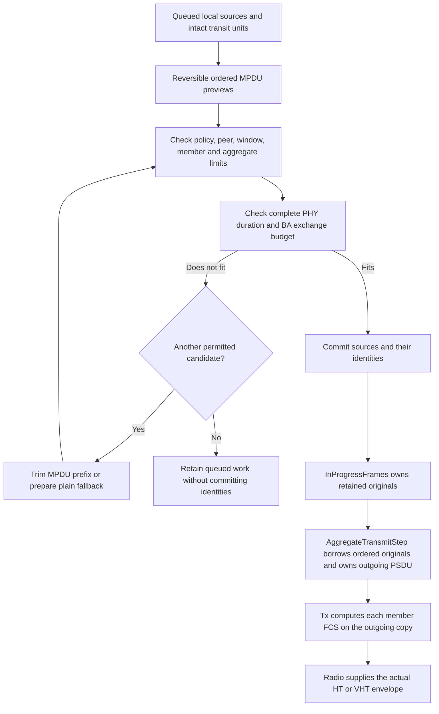
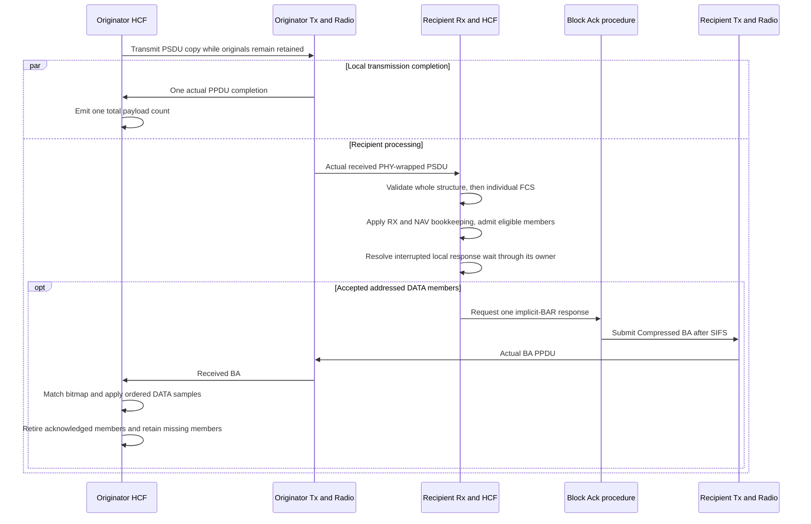
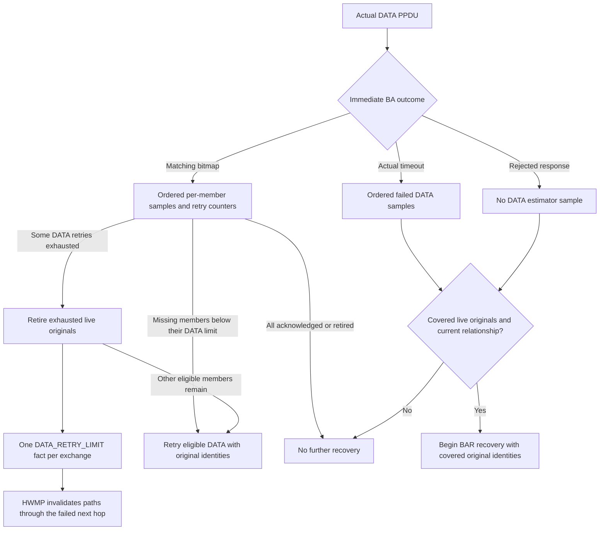
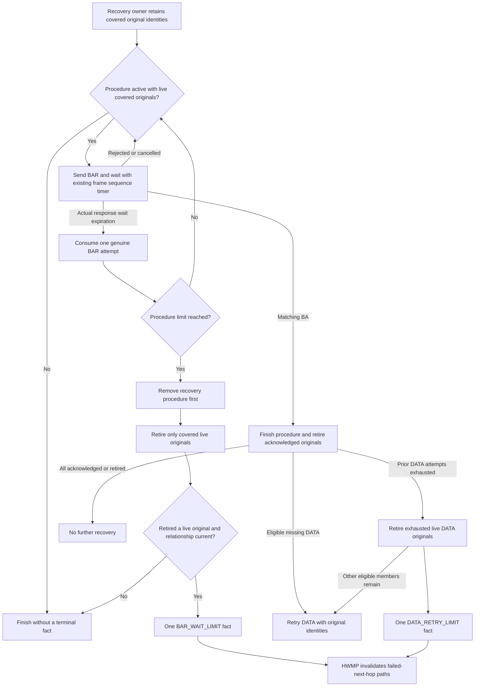

# Selective mesh MPDU recovery

H3 carries several retained mesh MPDUs in one actual HT or VHT PPDU and answers them with one immediate Compressed Block Ack. A missing member is retried with its original MAC and mesh identity. A lost Block Ack first uses BAR recovery, which can retire data already received without transmitting that data again. The existing standalone Normal-Ack A-MSDU and VHT EOF1 paths remain separate.

## Queue commitment and ownership

The originator prepares an ordered prefix sharing receiver, transmitter and TID. EOSP and QoS Control bits 8–15 match; A-MSDU Present may differ. Policy-approved local sources can form a nested A-MSDU, while committed transit units remain intact. Preview does not allocate a MAC or mesh sequence. HCF checks all members, the complete encoded aggregate, response, negotiated capabilities, lifetime, start spacing and positive TXOP budget before commitment. A zero TXOP limit permits one PPDU rather than imposing a zero-time budget.

Every borrow is included in lifetime and peer/agreement retirement scans. Reversible IFS submission can be cancelled through the existing Tx owner; an on-air aggregate keeps its context until actual completion. Completion ignores originals already retired from the relationship. New local identities are finalized by MeshForwarding, and each retained member preserves H2's constituent deadline and once-only initial transmitted length.

## Receive and feedback

Radio keeps a multi-member PSDU in its matching PHY representation through reception and capture. Rx validates the complete delimiter layout before returning any member, then checks individual FCS values. HCF derives response context from accepted, FCS-correct addressed DATA rather than the first raw header. It checks the established peer, actual directional PHY permission, TID, QoS compatibility, negotiated transport limits and agreement before changing receive state. A fatal structural error drops the whole PPDU; an individual bad FCS omits only that member. Without accepted addressed DATA there is no implicit Block Ack.

MAC-correct members get acknowledgment bookkeeping before native forwarding semantics, just as standalone Normal-Ack DATA does. TTL zero, unsupported AE, absent or truncated Mesh Control, an oversized native MSDU, or malformed native A-MSDU then drops through MeshMac/forwarding without consuming mesh duplicate identities, refreshing paths or creating a link-error sample. An explicit immutable mesh header view is materialized before observers and recipient service; its received-byte cache preserves the original FCS. A mere lazy view left reconstructed byte chunks vulnerable to later generic peeks losing the mesh role. The dissector keeps native bodies shorter than six octets opaque and incorrect instead of manufacturing a Mesh Control chunk.

Receiving another aggregate also resolves an originator response wait whose timer expired during reception. That is a rejected interruption rather than a synthetic timeout. Valid overheard headers update the existing Rx NAV owner; bad FCS and unsupported addressed context cannot authorize a response. The live overlap cases distinguish accepted addressed DATA, valid overheard DATA and all-bad-FCS DATA.

A valid overheard member still supplies ordinary Rx/NAV bookkeeping without payload delivery or a BA. Incoming aggregate processing also resolves a local response wait whose start timer was consumed during reception. That uses the existing REJECTED interruption under the HCF coordination guard, rather than manufacturing a timeout or estimator sample. The guard spans all receive terminal paths and the recipient BA submission.

The airtime estimator receives one error sample for each actually transmitted MPDU, in transmitted order: a set immediate BA bit gives zero, a missing bit or genuine response timeout gives one. Rejected responses and interruption give no sample. One actual PPDU contributes the sum of its validated payload MSDUs to `n`; BAR and its response contribute neither error nor count samples. The reference overhead uses the legal Compressed BA response while the nominal TID has an active aggregation agreement. Agreement changes that alter outgoing eligibility reset `n` before the agreement notification, while retaining the independent error estimate.

BAR recovery resolves acknowledgment ambiguity without replaying DATA samples:

BAR recovery belongs to QosRecoveryProcedure and is keyed by the existing agreement peer/TID. The selected model uses `shortRetryLimit` as an initial-inclusive budget of genuine BAR response expirations. It stores covered original identities, not packet ownership or another timer. Matching recovery BA ends that procedure without revising an earlier DATA sample. DATA retry exhaustion from valid BA zero bits uses a distinct reason and leaves `terminalTimeout` false. Multiple exhausted members produce one cleanup-complete fact. Expiry, peer/agreement retirement, internal collision, rejected response and unsent work do not manufacture terminal failure.

## Length and format boundaries

IEEE 802.11-2024 9.7.1–9.7.2 defines the delimiter and CRC; 10.12.1–10.12.3 defines member compatibility, negotiated length and minimum start spacing; 10.12.6–10.12.7 defines the selected VHT/HT framing. Start distance uses Equation 10-12 with the selected DATA net rate and GI, rounding up to octets and inserting complete four-octet spacing delimiters. The HT nested member limit is 4095 octets, while standalone HT A-MSDU retains H2's advertised body tiers. VHT member and whole aggregate limits are distinct, and a full VHT PSDU may exceed 65535 octets within its negotiated aggregate, window and duration bounds.

VHT transmission fills exactly the byte capacity of the existing raw DATA symbols: fitting final alignment, complete zero-length EOF1 delimiters, then up to three trailing octets. Received final alignment and trailing contents are unspecified. Timing uses the pre-EOF prefix; full PSDU extent remains separately represented. RAW data-mode duration is the capacity authority because whole-mode SGI rounding can hide a new symbol. The independent 1560-byte request has capacity 1589 at VHT20 MCS7 SGI; 1590 requires another raw symbol despite an equal rounded whole-PPDU duration.

The same exact-fill authority corrects the EOF1 Normal-Ack single-member path. For example, a 58-octet member needs a 62-octet request that fits two DATA symbols; the old unconditional four-byte alignment made it 64 octets and added a symbol. The direct transmission test distinguishes the resulting 48 and 52 microsecond whole VHT durations. Bare Tx completion and member FCS remain unchanged.

There is a source-text tension at the negotiated VHT cap: 10.12.2/Table 9-313 names the structural pre-EOF length, while 10.12.6's earlier request snapshot and SIG-B quantization can turn content 8191 into prefix 8192. The selected model admits content up to the exact cap and permits only its final zero-to-three-octet alignment up to the rounded cap. All EOF0 spacing counts as content; EOF1 padding and trailing EOF octets do not. Thus content 8191/prefix 8192 is admitted at cap 8191, while content 8192 or extra spacing is rejected. This is an explicit bounded interpretation, not an unambiguous IEEE receive mandate or a blanket extra-three-byte allowance. The model PHY header retains full byte extent; incomplete HT/VHT SIG serializers do not establish a complete SIG-field wire round trip.

The shared A-MSDU permission query now follows the recipient's ADDBA response bit under 10.11; the request bit does not grant receiver permission. Immediate Compressed BA follows 9.3.1.8.2 and 10.25, and reasoned feedback integrates with the existing HWMP path-error owner. Delayed/extended/group Block Ack, MU, LDPC, STBC and power saving remain outside this profile.

Configured multiple protection uses HCF's existing Duration calculation with the admitted complete PPDU and its selected BA response, projected start, remaining TXOP and prior reservation. Invalid raw intervals are refused before source commitment, and every member gets the same Duration before FCS creation. Default single protection retains its strict continuation reservation check. The teardown fixture selects multiple protection and a positive TXOP explicitly to exercise an accepted SIFS wait; it does not invent a single-protection reservation.

## Direct scenario mapping

Each numbered aggregate scenario runs with HT and VHT and both metric encodings. `MeshAmpduBlockAck.test` covers clean exchange, selective last-member/header faults, whole-layout/PPDU loss, lost or rejected BA followed by BAR, repeated BA-zero DATA exhaustion and initial-inclusive BAR exhaustion. Strict oracles check ordered numerical `ef`, unchanged mesh and MAC sequence identities on selective retry, one PPDU-level payload sample, cleanup before terminal publication and progress of already queued unrelated work.

Scenarios 10–12 put a real incoming aggregate across the local response deadline and distinguish overheard NAV/expiry, all-bad-FCS opacity and an addressed aggregate's single BA. Scenarios 20–30 reconstruct MAC-correct native semantic errors and require BA success followed by a whole-body drop; a later byte-reconstructed valid aggregate with fresh hop sequence numbers and the same original mesh identities must deliver. Scenarios 40–42 close a peer during actual transmission, ACK wait and an accepted nonzero SIFS wait, then re-peer and send fresh traffic. Their explicit PREQ minimum interval and traversal time are 1 ms and 5 ms so ordinary rediscovery retries fit the finite case. Scenarios 43–44 cover last-original expiry during BAR recovery and a real 4095-to-zero sequence-window crossing with selective retry; the final execution record determines their validated status.

Scenarios 45–48 close a peer synchronously from the first successful DATA sample, first genuine timeout sample, cleanup-complete DATA terminal notification and first BAR-limit drop respectively. Each requires unrelated queued work to progress, fresh delivery after re-peering and no later feedback for retired work. They use the ordinary computed Block Ack timeout: the longer 500-microsecond overlap-test timeout permits unrelated relay reception to interrupt the wait and therefore cannot establish a genuine DATA timeout.

These callbacks exposed two lifetime defects during final review. Peer reset could recursively delete an already-resolving frame-sequence context while its completion callback still borrowed it. It now interrupts only an outstanding receive step whose existing completion is UNDEFINED; terminal resolution stays with the running handler. BAR cleanup also rechecks current membership before dereferencing each covered original, because a preceding drop subscriber can retire the rest of the peer's work. A compatible pre-fix timeout execution crashes in `FrameSequenceHandler::abortFrameSequence()` when returning to the cleared callback. The same corrected-source case and all sixteen callback combinations pass. A successful-BA pre-fix case did not visibly crash; source-invalid lifetime and an observed crash are distinct claims.

`MeshAggregationLimits.test` separates policy minimums, nested HT/VHT member limits, exact aggregate content caps, full VHT PSDUs beyond 65535 octets, received over-cap content/spacing, complete PPDU duration and positive TXOP budgets. The receive-only HT cap fault reuses the same raw DATA-symbol allocation; because the current HT model omits uncoded tail/padding chunks, it grows the modeled byte extent rather than claiming an unchanged serialized padding region. VHT faults consume existing EOF space. All mutated members retain valid computed FCS and all layout validation completes before the tested cap refusal.

`MeshAirtimeMetric.test` adds a three-MSDU nested member plus one plain MPDU, followed by a plain-only retry: `n = 11/8`, then `85/64`, while ordered BA results give `ef = 7/64`. A real queued ineligible sentinel retains the agreement through the cost checkpoint. Releasing it records its actual payload/ACK observations, then normal empty-transfer DELBA resets `n` while preserving the updated error estimate.

`HwmpPathSelection.test` warms four directed links of one diamond branch through production aggregates while keeping actual queued work to retain those agreements. It lets old paths expire and starts fresh discovery. Actual PREQ processing checks the same originator sequence with measured directional estimates and encoded costs; the destination's metric improvement precedes the resulting PREP target-sequence increment. The source caches the cost observed during PREP processing, and later DATA samples do not rewrite that path cost. ID 1 fixes the formula's aggregation factor to one; VHT's encoded alternatives can tie. Legal VO AIFSN 15 orders one relay's unacknowledged PREQ after the first branch's response while ordinary RF carrier sensing remains visible.

## Capture

The opt-in Ieee80211PcapRecorder validates a complete actual aggregate, creates temporary bare-member copies and delegates each to the ordinary recorder role. Base filtering, bad-frame policy, verbose dissection, interface lookup and writing remain authoritative. A recorder-only observation tag supplies a shared reference and member position to the radiotap helper. It never authorizes production decoding. Corrupt member headers are opaque only in that explicit bad-frame observation context, preserving their exact bytes and FCS. Structurally invalid aggregates produce no valid-looking prefix records; ordinary nonaggregate inputs delegate unchanged.

Radiotap A-MPDU status follows the [official field definition](https://radiotap.org/fields/A-MPDU%20status.html): a reference relates members from one observed PPDU with channel context, rather than supplying a global network identity. Every member keeps the same event time and actual tuple. Generic raw multi-member dissection remains opaque; a single merged MAC interval would incorrectly include delimiter gaps.

## Evidence status

All four Mermaid diagrams rendered successfully and were visually inspected. Immediate DATA outcomes and BAR recovery use separate diagrams for readability; the exchange diagram distinguishes local completion from recipient processing and uses separate transmitting endpoints.

The clean debug build uses T0 parent `2719dc3da5`, 63-input manifest `9cbfd0193cf2605c90ab15b18113ca3a764d612d1a6fd26ef48b6e9a87e6bbc1` and library `83d6ec476a10d8691a31afe7bc85df0ae6bbc4f75646693405ac65450c6f3ad6`. `/home/miguel/inet-mesh-h3-callback-source-checkpoint/record.json` records the exact production inputs. Source, current/pinned library, features and fingerprint store remain matched through verification.

The reconciled 39-file protocol selection has 35 PASS files, three declared FAIL files and the known unexpected Block Ack retry failure. All 21 mesh files pass: 128 aggregate exchange configurations, 64 limits configurations, nine metric configurations, six path-selection configurations, and all retained peering, forwarding, discovery, root, HT/VHT and 104 A-MSDU configurations. Across the selected final per-file executions there are 462 simulations, 457 protocol PASS verdicts, four assertion failures and one runtime abort. The five legacy failure boundaries, causes and stderr match T0 exactly. They remain failures, rather than evidence of mesh aggregation correctness or a reason to replace expectations.

The full campaign initially stopped `MeshHighThroughputData` at case12 because its updated malformed-PSDU adapter queried a transmit-only mode tag at the receive seam. The correction uses actual `Ieee80211ModeInd`; its complete 34-case rerun passes on the same library. All other fixture hashes and all production inputs remain unchanged. The original campaign's error and skipped cases remain archived. `/home/miguel/inet-mesh-h3-callback-final-protocol/record.json` retains the full campaign and 2011 raw artifact hashes; `/home/miguel/inet-mesh-h3-final-protocol-reconciliation/record.json` explicitly composes those unchanged files with the repaired file's 185 archived artifacts. This is a complete selection plus one focused adapter rerun, not a relabeled all-green original run.

Independent frozen verification passes 25 unit files and 23 module files, with 121 native module simulations and both runner exits zero. All 63 production inputs and 48 selected fixtures, both model loader resolutions, library, feature and store hashes match. The capture fixture passes 12 HT40/VHT80 rounds, 24 PCAPs and 40 records, including intentional bad frames and 40 verbose calls; all 44 PCAP/PSDU artifact hashes independently match. Exact commands, configuration/run/seed records and raw artifacts are in `/home/miguel/inet-mesh-h3-callback-final-verification/record.json`.

This is not an ownership-clean campaign. The retained unit/module output has 45 ownership warnings and 34 undisposed objects with exact ordered-line equality to T0, and no new diagnostics. The final protocol selection retains one ownership warning in the oversized-source boundary and one undisposed-object diagnostic in the known retry abort; both exactly match T0. The earlier stale serializer-unit assertion remains separately archived and is superseded by the complete corrected 25-file execution. No baseline or declared expected-result changes are part of H3.

Before/after callback logs use `/home/miguel/inet-mesh-h3-sync-short-wait-before.{log,err}` and `/home/miguel/inet-mesh-h3-sync-fixed.{log,err}`. The former retains the compatible pre-fix crash stack; the latter has sixteen PASS verdicts and empty stderr, repeated within the complete 128-case file. Scoped MAC/PHY architecture, source protection, documentation seals, evidence/reviewer links and whitespace checks pass. Independent final review clears H3 with 36 PASS, 10 N/A, one not verified and zero flags/questions. Both callback findings are closed, all 2196 protocol artifact hashes and 63 current production inputs independently match, and the sole fixture adapter correction is reconciled. Retry run0's unprinted assertion timestamp remains unavailable; its recorded termination endpoint is reported separately. Final combined-tree release/feature-disabled builds, lifecycle and native fingerprint checks remain C9 obligations; mesh power saving remains a later stage.
