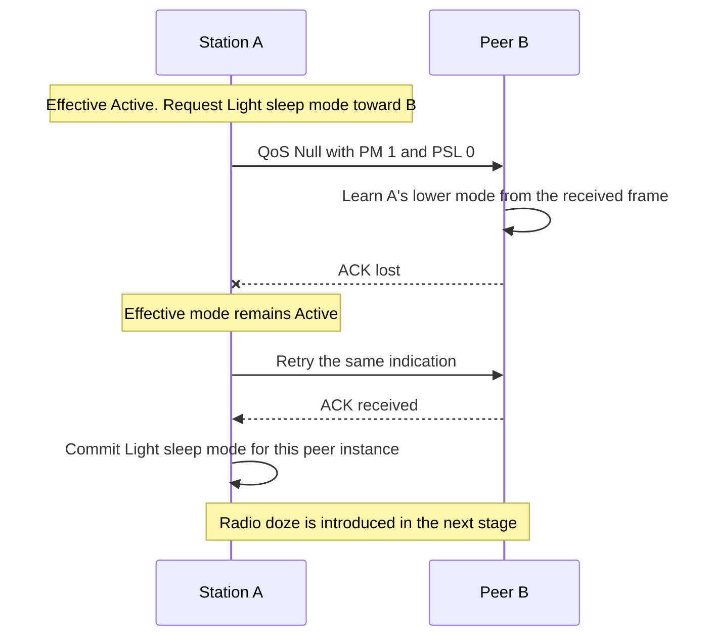
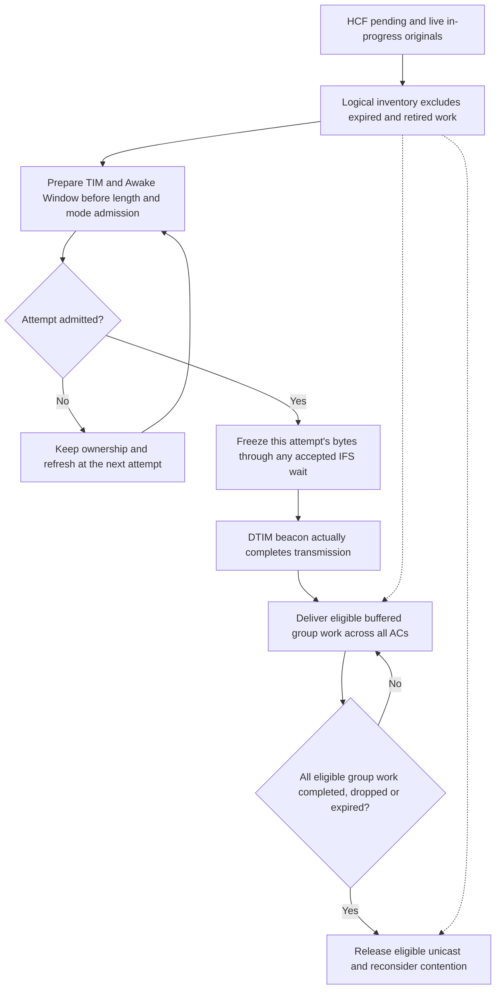

# Mesh power modes and buffered traffic

The mesh power policy distinguishes a requested local mode, the locally committed mode and the mode learned by the peer. A request to reduce activity waits for the actual acknowledgment of its individual indication. A request to increase activity takes effect locally immediately. Losing that acknowledgment can therefore leave the endpoints with different views temporarily; enqueueing and transmission alone do not commit a lower local mode.

This stage keeps the radios physically awake. Production activation remains gated until the complete service-period engine is available. The protocol fixtures explicitly permit the policy and supply bounded awake opportunities. They make no radio energy, doze or MPSP claim. The selected policy uses one matching Null original for a pending lower indication; unrelated DATA and MMPDUs continue advertising the committed mode, so their acknowledgments cannot commit a different indication.

## Owners and observations

The preceding G0 correction already supplies native group DATA No Ack behavior. P1 moves that fixed-size stamping into early content preparation and adds the new Null/power policy. Its final production tree and all 118 selected fixtures are identical to the original frozen P1 validation inputs; the original records retain their actual parent provenance. G0 has its own isolated parent/candidate proof rather than borrowing P1's feature evidence.

`MeshPowerSave` owns pending transitions and explicit opportunities. The MIB owns committed local and remote modes for each established peer, exposes the complete current view and emits `meshPowerModeChanged` only when that committed view changes. Management retains AIDs and peering Link IDs. A pending transition is correlated with its retained original and both existing Link IDs; a superseded or closed relationship cannot be committed by an old completion.

Commands register their original correlation before synchronous notifications. A group-active batch commits every local mode and derived capability before its first signal; copied notifications recheck current state. A newer individual command cancels the same-map broadcast correlation. After publication and old-original withdrawal callbacks, the producer rechecks the surviving identity and peer instances before handing off its locally owned packet. An unhanded superseded packet is deleted without transmission, and an outer command still retires all originals it displaced.

HCF owns every buffered packet, its deadline, acknowledgment and recovery state. Its copied inventory covers pending and live in-progress originals across all access categories, including currently ineligible units. It excludes expired identities and logically retired storage, and excludes resolved ACK work even before the borrowed packet is destroyed. Reversible previews, aggregate-step aliases and outgoing PSDU copies are not additional queue entries. Beacon and Probe Response timing units are separate from buffered group payload and management work.

An ACK notification follows acknowledgment-state resolution and precedes logical removal. The original-retirement notification follows logical erase and precedes destruction. Group completion is reported from the real completed original. These are typed calls; observational queue signals do not coordinate policy. On-air supersession removes live membership and owned recovery state while retaining borrowed storage and the current exchange until actual completion. An accepted or expired RECEIVE callback retains H3's handler ownership during synchronous policy work.

The enabled profile's queue capacities are declared in [Ieee80211MeshInterface.ned](../../../../src/inet/linklayer/ieee80211/Ieee80211MeshInterface.ned). Drop-new admission prevents a new priority management frame from evicting an older delivery unit. Existing DATA lifetimes remain authoritative. Mesh MMPDUs and mode indications use the selected five-second queued-control wait through the existing HCF lifetime owner; expiry does not become a payload error or PERR sample.

## Wire behavior

IEEE 802.11-2024 14.15.3.1 maps active, light sleep and deep sleep to PM/PSL pairs 0/0, 1/0 and 1/1. Nonpeer mode is deep sleep whenever any local peer mode is non-active. Group mesh DATA PSL and the advertised Mesh Configuration PSL are set only when at least one local peer mode is deep sleep. All-light relationships therefore give nonpeer deep sleep with group PM one and PSL zero. Applying that same any-deep PSL predicate to a group Null is the selected integration policy; 14.15.3.2 permits group Null but does not restate a Null-specific PSL formula. Group indications can announce higher activity; they do not lower the learned peer activity.

A native individual QoS Null is a four-address, 32-octet header plus FCS; a group indication uses the three-address, 26-octet header plus FCS. Both are bodyless, with no Mesh Control, A-MSDU or mesh-MSDU identity. Individual transmission uses Normal Ack and group transmission uses No Ack. Mode-only indications use RSPI zero and EOSP one, identifying no service period. The direct-link endpoint completion A3=peer/A4=local for individual Null is the selected model policy, rather than a separate Null-specific normative endpoint rule.

Table 10-5 SNS5 permits any Null sequence value without a sequence counter. The native producer selects zero without consuming DATA or management counters. Raw nonzero received Sequence Control remains representable. Null bypasses recipient duplicate caches, so successive equal-SN mode changes still take effect. Reserved bits are ignored on receive, including PSL when PM is zero and group RSPI. Ordinary MAC acknowledgment remains separate from established-peer control learning. Null never reaches LLC or contributes a payload airtime sample.

## TIM and delivery

Management takes a fresh logical inventory before temporarily removing any retained header for mutation. Variable TIM and conditional Mesh Awake Window content are prepared before mode, length and admission calculations; the existing late timestamp hook changes fixed-size fields afterwards. Each new plain fallback preview recomputes its own delivery-unit exclusion. Once Tx accepts a nonzero IFS, its retained copy freezes the snapshot.

TIM uses the reporting station's locally assigned AID. It describes buffered MSDUs and MMPDUs, excludes timing frames and bodyless power controls, and marks group traffic in a DTIM. After actual DTIM completion, one shared cross-AC barrier holds individual units until eligible group work completes, drops or expires. It remains active while a group original is on air. The queue owner then reconsiders all ACs without requiring another arrival.

Clause 9.2.4.1.8 requires individual More Data to describe additional buffered units for a light/deep recipient, and group More Data to describe additional group buffered units. A buffered unit is an MSDU, intact A-MSDU or bufferable MMPDU; an A-MPDU does not become one buffered unit. The standard does not resolve the selected same-PPDU snapshot boundary explicitly. The model therefore excludes all originals selected for that admitted PPDU, while each member retains its own buffered-unit identity and lifetime. A fallback uses its final selected source set, so unselected siblings still contribute. This exclusion is an explicit model policy, not a normative claim that aggregate members are one unit.

For a DTIM beacon, the admission snapshot and actual transmission completion have separate roles:

## Direct evidence

Both Mermaid diagrams rendered successfully and were visually inspected. Their event order distinguishes requested versus committed modes, admission snapshots and actual transmission completion.

The following configuration mapping describes the direct assertions in the frozen source and the reconciled final protocol executions.

| File / network | Production path and direct assertions |
| --- | --- |
| `MeshPowerModes / Test` | Real individual Null, lost ACK and retry; remote learning precedes local lower-mode commitment. Actual fixed SNS5, bodyless lengths, group NoAck, raw reserved fields and equal-SN successive indications; all-LIGHT group PM/PSL distinction. A group indication lost only at C updates B alone; a fresh individual exchange then updates C. No LLC, mesh identity or payload sample. |
| `QueuedTest`, `RetryTest`, `OnAirTest` | Supersession before first grant, after genuine ACK loss and synchronously while on air. The old original leaves logical inventory and recovery while borrowed completion remains safe. |
| `CloseTest`, `ExpiryTest` | A fresh relationship has different existing Link IDs; old completion cannot commit it. Exact five-second control expiry cancels a queued transition without air or payload feedback. |
| `PendingTrafficTest` | Previously queued DATA and MMPDU advertise the committed mode while a lower Null waits. Their ACKs do not commit that unrelated pending indication. |
| `FallbackTest` | A positive TXOP admits plain DATA but excludes the approved two-source A-MSDU. Fresh fallback fields use the reduced selected set; remaining sibling makes More Data one, and preview consumes no identity. |
| `OriginalAckTest`, `OriginalBarTest` | Four actual aggregate originals receive typed ACK facts after ACK status resolution and retirement facts after logical erase. Immediate BA and later BAR each preserve a retained Null and DATA-domain independence; outside-selected buffered work makes aggregate More Data one. |
| `CollisionTest` | Real DATA SN0 and native Null SN0 each lose an ACK. Null withdrawal and replacement ACK preserve DATA retry state; the actual DATA retry keeps its MAC/mesh identity and delivers once. |
| `StopTest`, `CrashTest`, `DeleteTest` | Isolated policy cleanup retires pending, never-transmitted Nulls; restart or missing-provider MAC queries cannot resurrect them. Peers survive. These cases do not claim whole-NIC restart or reset committed relationships. |
| `ReentrantTest` | A synchronous committed-mode observer issues a newer same-peer request. Only its current original remains queued and reaches air. The retained pre-fix case fails at 80ms/event189 because the outer command queues an extra Null. |
| `ReentrantGroupIndividualTest`, `ReentrantIndividualGroupTest`, `ReentrantGroupGroupTest`, `ReentrantWithdrawalTest` | Direct synchronous callbacks replace group/individual commands during the first group notification or during retirement of a genuinely transmitted, ACK-lost original. Batch reads are coherent, all displaced work retires, and only the surviving command is handed off. |
| `MeshTimDtim / Test` | Real high AID1025 plus low AID1 grow TIM to 129 bytes while the beacon is held. The 210-byte admission snapshot produces an actual 304us beacon; two group addresses finish across ACs before queued VO unicast. |
| `CapacityTest`, `ByteCapacityTest` | Shared per-AC frame capacity and a separately recorded98-byte test override drop NEW while preserving old identities. Exact DATA expiry is visible before the timer event; no PPDU/sample. |
| `ControlWaitTest` | Queued MMPDU expires exactly at five seconds; fresh control makes progress during an explicit opportunity. |
| `FreezeTest` | A genuinely admitted unicast SIFS successor retains its selected content when new work arrives during accepted IFS. The later hypothetical More Data differs, but actual bytes remain frozen and start exactly16us later. The beacon length proof uses its actual zero-IFS path. |
| `ConditionalTimTest` | Period-two non-DTIM with local LIGHT state and buffered AID1025 includes an Awake Window before rate selection. Compressed offset 128 / length 1 gives 82 bytes and actual 136us; the next empty DTIM still has its mandatory window. |
| `GroupExpiryTest` | A real completed DTIM opens the group barrier. Eligible group work is held until its original deadline; already queued higher-priority individual work remains blocked until the group expires, then progresses without a new arrival. |
| `RetryTimTest` | An actual DATA transmission loses its ACK. While the peer advertises and commits DEEP, the next actual beacon has this retry as that peer's sole buffered PAYLOAD/MANAGEMENT unit and sets its AID bit. Only afterward, sleeping-head and awake-successor packets queue in the same BE AC; the awake successor progresses while the retry remains. An explicit opportunity admits the identical retry, ACK removes it, and the next beacon clears the bit. |

The frozen source checkpoint is `/home/miguel/inet-mesh-p1-final-checkpoint/record.json`, based on H3 `8971a1e03d`: 84 production inputs, source-manifest SHA256 `899602b7bd2b20f355ef893ea45782bcd47b3b38379ea40fb6bd02bf5b88a52b`, matching debug library `3aa107eed4d2e85f31a54db70b48e2d52411b16b9195f452a223adc88149e72b`. The fresh build completed in `/home/miguel/inet-mesh-p1-reentrant-group-build.log`. Production and the library remained unchanged through all final executions.

The complete 41-file protocol campaign reports **37 PASS, three declared FAIL and the retained DataRetry FAIL**. All 23 mesh files pass, including nineteen power-mode cases, eight TIM cases and the source/relay NoAck control with power policy disabled. The final composition contains 489 native simulations: 484 protocol PASS, four protocol FAIL and one retained runtime abort. Mesh cases use explicit seed zero. The original campaign and its 2,441 hashed artifacts remain immutable at `/home/miguel/inet-mesh-p1-final-protocol`. A focused complete TIM-file rerun adds the isolated-retry proof; its raw, exact fixture hashes and the final unchanged-40-plus-TIM composition are `/home/miguel/inet-mesh-p1-final-isolated-retry-tim/record.json`.

All eighteen non-mesh controls retain the H3 failure reasons, termination endpoints and stderr exactly. The declared failures remain `N_Ampdu`, `Ac_Ampdu` and `Ac_VhtIe`, with assertion events 149187, 161849 and 48880 respectively. DataRetry retains its run-zero termination at 1.023764276562s/event3708 and run-one abort at 1.014105463846s/event2639. Its express progress output does not establish an assertion timestamp; that field remains unavailable. The runner returns one because of this known unexpected result; no expected-result marker or fingerprint baseline changed.

Protocol hygiene retains the known DataRetry undisposed WirelessSignal. The earlier `oversized-native-source` ownership warning disappears because the consuming `MeshMac::sendMeshData` entry now takes ownership before its bounded refusal. This is a scoped ownership correction, not warning suppression. Retained unit/module diagnostic attribution remains a separate verification record; this document does not claim globally clean ownership.

Development failures remain separate. The synchronous command beforestate fails at 80ms/event189 with an extra queued Null. The original conditional-TIM oracle mistakenly expected an uncompressed bitmap. The first group-loss tap rule was shadowed by its broader mutation rule. The first added retry case needed a tap medium, and its first passing oracle still allowed a pending sibling to supply the same TIM bit; the final case separates those phases and asserts a sole retry BU. A real 120ms assertion also exposed erroneous DATA allocation metadata on Null; the producer now excludes it. The related absent-tag concern was a source risk after proper Null separation, not an observed absent-tag crash.

The independent accumulated verification record is `/home/miguel/inet-mesh-p1-final-verification/record.json`: **27 units / 27 native runs and 23 modules / 121 native runs PASS**, both runners exit zero. All 84 production inputs, 50 selected unit/module fixtures, pinned/current library and feature/store hashes remained unchanged. The canonical NoAck literal-wire fixture and the direct recovery/ACK namespace unit both pass; the latter uses synthetic originals, while `CollisionTest` and retained-Null/DELBA cases establish radio/HCF integration separately. The older wire execution remains historical, rather than being relabeled as this final run.

The retained module capture audit also passes: twelve radio rounds, 24 PCAPs, 40 records and 44 checked artifact hashes. Unit/module hygiene remains exactly the H3/T0 diagnostic floor: 45 ownership warnings and 34 undisposed objects, with no new runtime diagnostic. These comprise TxNavChoice three ownership warnings, lifetime/congestion 22 and 20 ownership warnings, and FrameSequence 34 undisposed objects. Compiler diagnostics are zero unit and seven module warnings, matching H3. This is explicitly not an ownership-clean claim.

The final-library activation probe at `final-checkpoint/activation-refusal.json` rejects initialization with the explicit complete-service-period diagnostic before any model-time transmission. The independent final review verdict is recorded separately by the reviewer. Release/feature-off builds and fingerprint validation remain C9 work; the awake fixtures establish no radio doze, energy accuracy, full-NIC restart or external interoperability claim.
