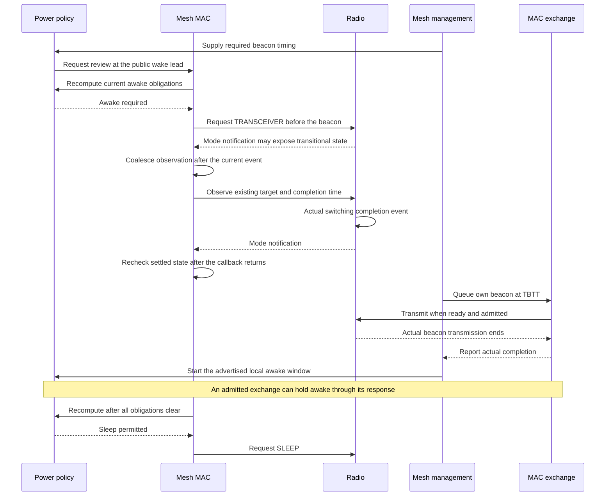
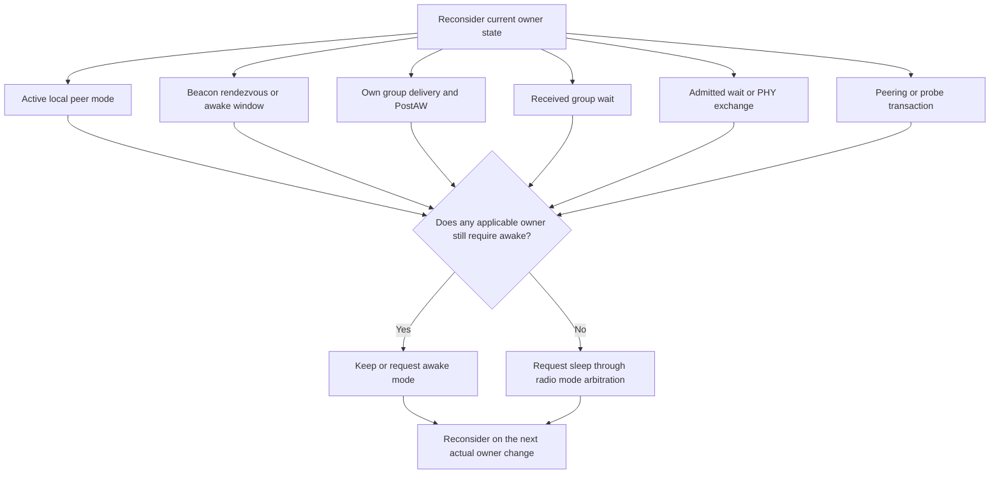
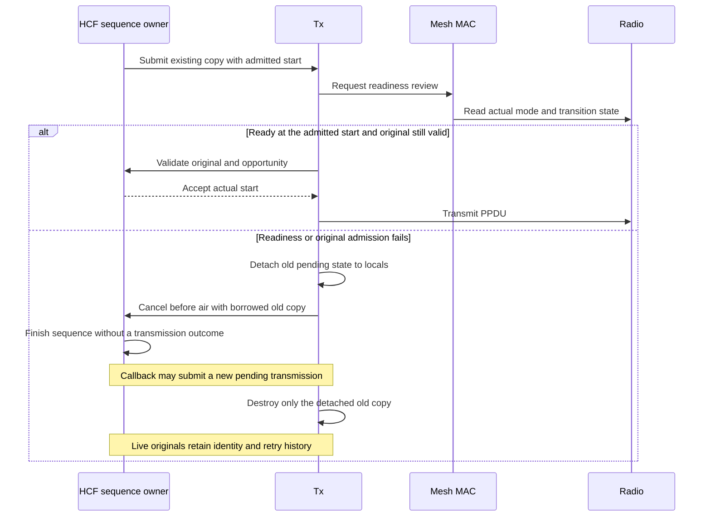

# Mesh awake windows and radio doze

The mesh power coordinator connects committed peer power modes to actual radio sleep and wake. Awake means TRANSCEIVER, including immediate SIFS responses. Production activation remains gated until the complete service-period engine is available. The direct protocol fixtures explicitly enable this intermediate coordinator and use empty unicast TIMs or return the relationship to ACTIVE before ordinary delivery. They implement no MPSP retrieval.

## Owners and timing

`MeshPowerSave` owns the future protocol-boundary timer, local Awake Window and PostAwakeDuration, required-peer rendezvous, buffered-group indications and continuous physical-idle evidence. `MeshMac` owns a separate coalesced same-time continuation. Only that continuation commands the public radio interface or resumes the existing retained Tx copy. A synchronous busy/nonreceptive observation invalidates idle evidence before coalescing, so an intervening interruption cannot disappear into a final idle snapshot.

Management remains the TSF, neighbor-offset and clock-slowing conversion owner. Its copied schedule supplies the next TBTT, ordinal and pending beacon/peering facts. The ordinal describes the next scheduled beacon, not a beacon already reached. Equal ordinals therefore use the absolute target deadline; a strictly later ordinal establishes that the maintenance target has passed. A reference with unusable timing does not discharge maintenance.

IEEE 802.11-2024 14.15.6 starts local AW at actual beacon or Probe Response transmission completion and extends the window itself for group traffic. The selected literal/model recurrence treats the effective timed window as the maximum of own AW and PostAW: a group PPDU starting strictly before either active endpoint extends PostAW to its actual completion plus the nominal advertised duration, including straddling completion. Equality does not qualify. The standard does not supply this recurrence as a formula. Pending announced DTIM group delivery independently requires awake and permits its remaining drain even after both timed endpoints; that pending state alone does not restart a timed window. Sleep requires both completed group delivery and expiration of the applicable timed hold.

The distinct receiver rule in 14.15.5 holds for indicated buffered group traffic until MoreData zero or continuous physical CCA idle for GroupDeliveryIdleTime. HCF obtains that interval through the existing PHY-default AC_VI TXOP authority; configured TXOP overrides and virtual NAV/TXNAV do not define physical idle. Receiver completion does not mirror the remote transmitter's pending inventory, so mandatory transmitter drain can outlive a receiver's independent listen obligation.

Light sleep listens for required peer beacons under 14.15.8.4. The selected deep-maintenance policy uses the lowest-address established peer every ten local beacon periods; 14.15.8.5 leaves the deep method outside the standard. Invalid selected timing holds the receiver awake for reacquisition. Received TIM uses the AID assigned by its reporting peer. Active local relationships, pending peering, accepted Tx waits, current reception/response exchanges, rendezvous, AW, PostAW and applicable buffered-delivery obligations all prevent doze.

A retained Probe Response has a distinct copied-inventory classification. It prevents doze until ordinary admission or retirement but remains excluded from TIM, group buffered units and the delivery barrier. This handles a queued timing response while the radio is already asleep without introducing another management queue or a pending-ID ledger.

Wake lead uses the initialized public SLEEP-to-TRANSCEIVER duration, the nonnegative margin declared by [MeshPowerSave.ned](../../../../src/inet/linklayer/ieee80211/mesh/MeshPowerSave.ned), and one kernel tick. That strict-before guard is model policy. A pre-TBTT latch bridges early wake completion through a delayed or pending beacon until actual timing-frame completion or retirement. If the known sleep/wake budget leaves no useful sleep interval, the radio stays awake. There is no private parameter parsing, polling timer, watchdog, second queue or copied radio deadline.

The timing path keeps policy decisions separate from radio commands:

Every current obligation contributes to the awake decision:

## Retained-copy admission and cleanup

The coordinator consumes R2's generic deferred-start contract. A copy accepted for an IFS retains its admitted start. Readiness does not stretch SIFS: a missed start cancels the unstarted copy and reconsiders the still-live original. Completion at the current timestamp is not readiness until the radio publishes its actual completion.

For power-managed submissions, final HCF admission checks current single/ordered aggregate membership before dereferencing originals, then lifetime, eligibility and actual readiness. Only acceptance records the actual PPDU start, highest-transmitted DATA index and owned-action attempt. No publishing callback intervenes before handoff. Both managed submission paths return immediately because a synchronous rejection can destroy their sequence context. The ordinary nonmanaged path retains its existing bookkeeping.

Pre-air rejection finishes through the existing REJECTED sequence path. It spends no DATA retry/BAR-wait budget and emits no airtime error, payload count, PERR, transmitted or failed-frame fact. Live originals retain identity and deadlines. Recipient cancellation cannot finish an unrelated originator wait. DELBA's disposal predicate distinguishes a retained TRANSMIT context from actual air time rather than treating membership alone as transmission evidence.

Isolated policy stop, crash or deletion cancels its future timer and detaches pending policy work. A surviving MAC conservatively requests awake and retains arbitration through real wake completion. Whole-subtree teardown does not call destroyed siblings. These checks do not establish whole-NIC restart semantics.

The retained copy and its source original have distinct lifetimes:

## Direct and retained evidence

The final model is `3c1dbd78d535319a45189573bc31b1664f55bc7180254f78bf4e3cbfcb65ec15`, based on committed Q0 `72f65ac7a297ec890fde0aced6671228a500ae19`. Fresh build output is `/home/miguel/inet-mesh-p2-eleventh-build.log`. The final accumulated campaign repeats all thirty new cases on this model. Each archived record preserves source and fixture copies, current/pinned library hashes, full runner/raw output and loaded-library resolution. Earlier development executions retain their actual model identities; the immutable model979f freeze is superseded by the arithmetic correction below.

| File / cases | Direct evidence |
| --- | --- |
| `MeshLightSleep`, cases 0–1 | Both nonzero and zero switching pass again in the final campaign. Actual own/peer beacon readiness is checked by preinserted higher-priority TBTT observers; repeated real sleep/wake cycles precede ACTIVE HWMP/DATA delivery. `light-complete-first/record.json` remains the historical model54ec milestone. |
| `MeshDeepSleep`, cases 0–3 | All four final runs pass normal maintenance, actual management clock slowing, invalid reference followed by real reacquisition, and insufficient useful sleep budget. Copied completed-state observations verify early valid references advance target10 to20 and then30 despite a next ordinal still9 or19. The nonselected peer's beacon does not require a wake. Normal and slowed references recur approximately ten local periods apart. The paired correction is also archived in `deep-early-cadence-after/record.json`. |
| `MeshAwakeWindow`, cases 0–9 | All ten final runs pass rolling PostAW, exact endpoint nonqualification and pending group drain after both timed endpoints. The receiver cases distinguish delivered, absent and physically received corrupt final groups; injected NAV/TXNAV reservations remain active after physical idle permits sleep. Other cases prove ACTIVE-peer-only hold, two real overlapping peer windows, empty-queue pending peering, actual DATA/SIFS ACK straddling, ProbeResponse completion AW, asleep pending-response wake and exact five-second held-response expiry. A queued response is injected through management's real generator, not claimed as a request received while asleep. The receiver's explicit awake opportunity only permits that control exchange and implements no MPSP. |
| `MeshLightSleep`, cases 2–15 | All fourteen managed and lifecycle cases pass in the final campaign. Cases preserve live originals across missed starts, zero-delay callback replacement, policy stop/crash/deletion, peer close, expiry and bare/three-member never-air disposal. A real16us DATA successor becomes ineligible during IFS. A real aggregate loses its BA; its unstarted BAR is refused after a committed opportunity change with identical covered originals, zero BAR expirations and unchanged n/ef. A later BAR acknowledges them without resampling DATA. Unrelated recipient cancellation injected during actual managed response waits preserves context and the absolute wait deadline. Three lifecycle cases stop/crash/delete policy while naturally asleep, prove public wake completion and preserve established relationships before later ordinary delivery. `light-recipient-and-bar/record.json` remains the earlier complete sixteen-run development record. |

The following General run numbers are the native scenario numbers, each executed with seed zero. All thirty pass in the final archive. The fixtures explicitly enable the intermediate coordinator; no row claims production activation or MPSP retrieval.

| `MeshAwakeWindow` run | Setup and stimulus | Required observation and limit |
| --- | --- | --- |
| 0 | Hold an own beacon beyond TBTT, then send two announced groups; the first straddles AW and the second starts inside PostAW. | Rendezvous holds awake through the delayed beacon; AW begins at actual end. Both groups arrive, and each qualifying completion extends by the nominal AW duration. |
| 1 | Use the same group sequence but drop its final group; inject NAV/TXNAV reservations at the receiver. | Receiver holds through continuous PHY idle and then sleeps despite remaining virtual reservations. Missing final delivery is intentional. |
| 2 | Corrupt the final group's actual reception. | Physical busy interrupts idle evidence; a fresh continuous idle interval permits sleep. Corruption does not count as valid MoreData zero. |
| 3 | Generate a Probe Response during an existing local AW. | Its early content includes the advertised AW, and actual completion restarts local AW. This is a management-generator entry, not a received over-air request. |
| 4 | Establish three nodes, retain one ACTIVE local relationship, then create overlapping received peer windows and a pending peering transaction. | Each independent obligation holds awake after the others clear; actual sleep occurs between them. Pending peering is checked with no active exchange or buffered frame supplying another hold. |
| 5 | Start real unicast DATA inside the received peer window, with completion after its endpoint. | DATA and its SIFS ACK finish in TRANSCEIVER; one delivery/sample occurs before both radios may sleep. |
| 6 | Hold the second announced group until both timed endpoints have expired. | Transmitter remains awake and drains the pending sequence without restarting PostAW. Receiver delivery is not required after its independent listen obligation ends. |
| 7 | While actually asleep, inject one Probe Response through management's generator. | Copied inventory contains the sole response, TIM remains empty, public wake precedes real response/ACK and completion AW. An explicit receiver awake opportunity permits only this control exchange. |
| 8 | Keep that response ineligible until its five-second control deadline. | It alone holds awake; exact-deadline inventory excludes it, normal retirement empties the queue, no response reaches air, and radio sleeps. |
| 9 | Release the second announced group to start exactly at the timed PostAW endpoint. | Pending delivery still drains, but equality does not extend the timed window. No receiver-delivery guarantee is inferred. |

| `MeshLightSleep` run | Setup and stimulus | Required observation and limit |
| --- | --- | --- |
| 0 | Establish LIGHT relationships with 200 us wake and 100 us sleep switching. | At least two real sleep/wake cycles, actual RX readiness strictly before own/peer TBTT, and later ACTIVE discovery/DATA progress. |
| 1 | Repeat run 0 with zero switching durations. | The same readiness and progress assertions hold without assuming an inline mode signal is the settled state. |
| 2 | Retain an admitted DATA copy, then force a real public sleep/wake lateness before its start. | No air/sample on rejection; original IDs, sequence, body and deadline survive for later actual delivery. The radio stimulus is fixture-controlled. |
| 3 | Use zero switching and reject at final start; the synchronous cancellation callback submits a replacement. | Old registration is detached before reentry; replacement and original later produce exactly two DATA/ACK outcomes. |
| 4 | Stop the power-policy owner during a retained readiness wait. | Conservative public wake and later original delivery; no stale pre-air outcome or whole-NIC restart claim. |
| 5 | Crash the policy owner at the same boundary. | The retained original survives, physical wake completes and later delivery progresses; peer relationships remain established. |
| 6 | Delete only the policy owner during that wait. | Surviving MAC arbitration safely wakes and delivers with the provider absent; no callback to the deleted owner. |
| 7 | Close the peer before retained DATA reaches air, then reopen and send fresh data. | Old original retires without air; actual fresh PREQ/PREP and new delivery progress. Fixture PREQ minimum is 1 ms and traversal is 5 ms, not production defaults. |
| 8 | Set original lifetime to 5 ms and the physical round trip to 11 ms. | Expired original never reaches air or samples; later fresh DATA progresses. |
| 9 | Apply the agreement-disposal predicate to a never-air bare original during readiness wait. | Original remains live and later transmits. This directly exercises the owner predicate, not an over-air DELBA exchange. |
| 10 | Train HT Block Ack, then retain a three-member aggregate and apply never-air disposal/cancellation. | All original identities survive for one later aggregate with three deliveries/ACK samples. Training traffic is separately identified. |
| 11 | Admit a real 16 us SIFS DATA successor under MULTIPLE protection and a positive TXOP; change committed remote mode to DEEP during IFS. | Final start refuses it without air/sample/retry cost; unchanged original progresses after ACTIVE returns. Mode change is an owner-level injected fact. |
| 12 | Stop policy while naturally SLEEPING. | Public wake reaches stable TRANSCEIVER, established relationships/local LIGHT commitment survive, and ordinary DATA later arrives. |
| 13 | Crash policy while naturally SLEEPING. | The same conservative wake/retention/progress assertions hold without a whole-NIC operation. |
| 14 | Delete policy while naturally SLEEPING. | Surviving MAC completes wake with the provider absent and later DATA progresses. |
| 15 | Lose a real aggregate BA, then remove the opportunity before its retained BAR starts. | No BAR expiration or DATA resampling occurs during refusal; covered IDs/lifetime/retry state and n/ef remain unchanged. One later actual BAR retires acknowledged originals; natural DELBA resets only n. Three intentional failed DATA samples are included. |

Managed response-wait probes additionally inject an unrelated recipient cancellation and require the originator context, current step and absolute deadline to remain unchanged. This is a callback-owner isolation assertion, not a claim that a received frame caused cancellation over RF.

| `MeshDeepSleep` run | Setup and stimulus | Required observation and limit |
| --- | --- | --- |
| 0 | Establish two DEEP relationships and use the lowest-MAC peer as the reference. | Actual maintenance reception follows the fixed ten-local-period cadence; nonselected-peer traffic does not require a wake. No payload/error sample accompanies sleep. |
| 1 | Apply actual management clock slowing to that reference. | Learned offset changes in the expected direction and later accepted maintenance references retain the cadence. Management remains the sole clock-conversion owner. |
| 2 | Mutate the selected peer's received beacon timing-validity bit and recompute FCS, then permit a later valid beacon. | Invalid reference is rejected, the radio remains awake for reacquisition, and actual valid timing restores maintenance. This is a deliberate receiver fault injection. |
| 3 | Configure public wake of 200 ms and sleep of 100 ms against a 102.4 ms beacon interval. | No useful sleep is attempted. Actual early accepted references advance maintenance 10→20 and 20→30 despite next ordinals 9/19, directly distinguishing unsigned-wrap behavior. |

The P1 `MeshPowerModes` and `MeshTimDtim` providers explicitly retain their earlier physically-awake/manual-opportunity policy. They override both coordinator review and received P2 AW facts, so their staged assumptions remain coherent. The final campaign passes nineteen Modes and eight TIM runs on frozen source; `p1-explicit-window-policy/record.json` remains the historical model54ec development record.

Failed attempts remain immutable. The initial Light switching text used unsupported `us` parser units, and a later include-order mistake kept its simulation limit before the final assertion. Its first-cycle warmup also demanded a wake before the actual lower-mode ACK and first sleep could produce one; final assertions still require repeated real cycles. Deep diagnostic runs exposed the next-ordinal/absolute-deadline distinction and premature discharge by an invalid reference; the corrected source has direct four-case evidence. The first AW prototype used a nonexistent interception method, declared a compound MAC as a simple module and omitted a listener's method context. Its initial simultaneous indications also failed to establish the intended local sleep modes; the final setup staggers real requests and asserts both committed modes before testing sleep. None of these raw outcomes is relabeled as a successful run.

The original-only PostAW oracle is superseded. `awake-rolling-before` on model976f fails at135.788ms/event365 when the second group starts inside timed PostAW but fails to extend it. The corrected source qualifies the effective timed window. `awake-pending-probe-before` on model6f403e fails actual wake at151ms/event351 with one retained response and an empty TIM. The new inventory kind closes that missing awake obligation. For early deep maintenance, `deep-early-cadence-before` on model979f emits target10 to14 at896.052033356ms/event1452 because unsigned subtraction wraps when the next ordinal is9. The comparison-before-subtraction correction produces10 to20 at the same reference and20 to30 at1.920052033356s. These are actual development before/after records; they are not renamed Q0 parent executions.

Supported mesh profiles reject RTS at initialization. An early source-only RTS concern was withdrawn after checking that guard and the sole production deferred-start consumer. No RTS support, guard weakening or speculative HCF repair was added. The rejected setup is profile-limit evidence, not a protocol runtime failure.

The corrected production freeze is `/home/miguel/inet-mesh-p2-corrected-production-checkpoint/record.json` (SHA256 `51a8bd8a2448adecf3db42ed3f8f78f8b59318eb359781a3b3ed76d018a4e984`): 97 inputs, matching current/pinned model3c1d, feature state and fingerprint store. Only the approved deep-cadence arithmetic differs from the previous model979f freeze. `direct-three-corrected-complete/record.json` executes all three current files together: **AW10, Light16 and Deep4, thirty native PASS with empty stderr**. Awake-decision observers read the completed `requiresAwake()` value, and repeated no-op decisions publish no extra change. These observations do not substitute for the final retained campaign.

The independent corrected retained record is `/home/miguel/inet-mesh-p2-corrected-final-verification/record.json`, SHA256 `740b928729a5f77e1c5d8aa9dde99b6f4618671214a8fe5d25b04f20c71327c9`: **28 units / 28 native runs and 29 modules / 143 native runs PASS**, both runner exits zero. All 97 production inputs, 57 selected fixtures, current/pinned library, feature state and store remained unchanged. The twelve-round capture control also passes: 24 PCAPs, 40 records and 44 checked artifact hashes.

Retained hygiene is explicitly not globally clean: **45 ownership warnings and 34 undisposed objects**, exactly the established T0 diagnostic floor. Compiler diagnostics are zero unit warnings and eleven module warnings, matching R2. There is no new stderr. The earlier model979f unit-only 28/28 record remains historical; its module category was held before the arithmetic correction and is not relabeled as this corrected execution.

The final protocol record is `/home/miguel/inet-mesh-p2-final-protocol/record.json`, SHA256 `9cfbaf0bc8a51924823b447a5b79e3fc80a1b488ef7461e0d2cdb4b39e69748f`. Its exact selection is **49 files / 610 native simulations**: the retained 46-file / 580-native floor plus thirty new cases. The serial no-build campaign records **605 native PASS** (521 ProtocolTest PASS and 84 direct-assertion native PASS), four retained ProtocolTest failures and one retained runtime abort. File outcomes are 45 PASS, three declared FAIL and the known unexpected `WifiBlockAckDataRetry` failure. The runner exits one for that retained unexpected outcome. All 23 non-mesh R2 comparisons match counts, failure reasons, available assertion endpoints, termination endpoints, runtime diagnostics and stderr exactly.

The declared failures retain their assertion boundaries: `N_Ampdu` at2s/event149187, `Ac_Ampdu` at2s/event161849 and `Ac_VhtIe` at2.5s/event48880. Their termination events are respectively149189,161851 and48882. `WifiBlockAckDataRetry` retains its run0 deadline-step failure and termination at1.023764276562s/event3708; its assertion timestamp is unavailable in express output and is not inferred from a progress header. Run1 retains the exact-start abort at1.014105463846s/event2639 and identical stderr. No expectation or baseline is changed.

The protocol archive contains 2,801 hashed artifacts and 49 loaded-library proofs. All 97 source inputs, 82 fixture inputs, 50 support inputs, current/pinned model, features and store remain unchanged through execution. Mesh protocol stdout has no ownership/undisposed diagnostics and its stderr is empty. The whole protocol union retains one DataRetry undisposed WirelessSignal. Its 44 compiler warnings have the same four signatures as R2: 41 existing `Radio::sendUp` overload-hiding warnings and one each for `LocalInputDriver::finish`, `InterframeDriver::finish` and `BlockAckFallbackAudit::finish`. The three added tests each include the existing Radio warning, accounting for the increase from R2's 41 total warnings.

The same reviewer independently reconciled the final protocol artifacts, legacy comparisons, loaders and input hashes, as well as the corrected unit/module record and paired arithmetic correction. Overall prose/index clearance is a separate final review step. Whole-NIC restart, MPSP retrieval, energy-model accuracy and external interoperability are not established by these fixtures. C9 release, feature-off and final fingerprint verification remain later work.
