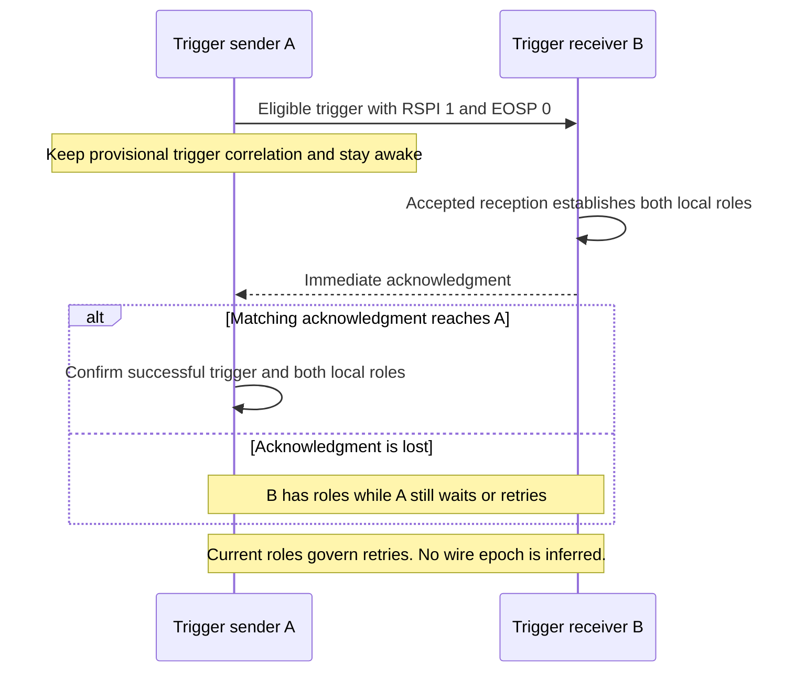
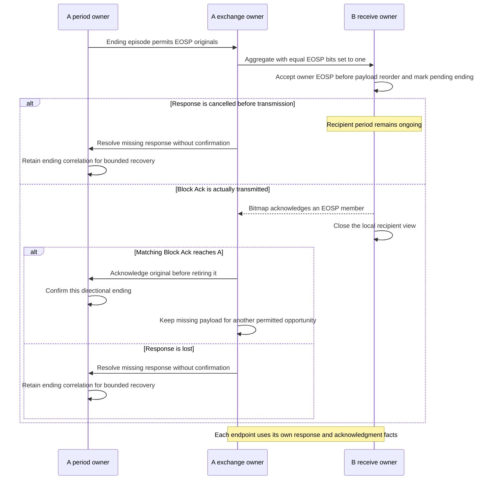
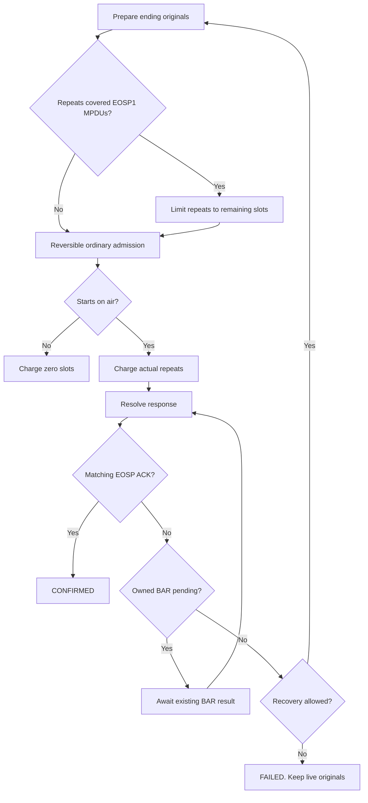

# Directional mesh service periods

This document describes the frozen P3 candidate against R3
`ee1a61fe6fd272079c20ba99d21e62810f0665d0`. The corrected matching debug
model and 96 new native cases are available. The focused retained campaigns
have run; independent final review and the later full same-model integration
campaign remain outstanding. No final P3 clearance is claimed.

## Owners and evidence boundary

`MeshPowerSave` owns one current OWNER and RECIPIENT role per established peer,
its provisional sent-trigger correlation, ending cohort and shared allowance.
Management remains the TBTT/TSF/advertised-window authority. MeshMac arbitrates
the real radio through the existing public observations. HCF retains original
packets, ordering, actual-start and ordinary ACK/BA/BAR/retry ownership.

The governing IEEE 802.11-2024 clauses are 14.15.9.1–14.15.9.4 and Table14-33,
with 14.15.6, 14.15.8.4/.6, 10.3.2.11, 10.12.1 and 10.25.6.6.1.
The [standards catalog](../../../../doc/project/evidence/standard/ieee80211/catalog.md)
records their model obligations. The current-state duplicate interpretation,
default retry allowance, shared ending episode and bounded fallback are
explicit model policies rather than additional wire identity requirements.
The sender confirms initiation from matching acknowledgment. The receiver
initiates on accepted reception, but confirms ending only after its actual
local acknowledgment response. Cancelled and transmitted-but-lost responses
therefore have different endpoint outcomes. No historical Null epoch/cache is
introduced, and current control remains distinct from payload duplication.

The first actual EOSP1 selection freezes its original cohort. Its shared
allowance counts later actual EOSP1 starts of those members; an earlier EOSP0
attempt or MAC Retry1 does not consume that member's first terminating use.
Ordinary retry history
and original lifetime remain authoritative. Copied causes arrive after full
HCF retirement/response batches, after sibling acknowledgment success. Unknown
recovery disposition preserves a surviving original's possible later BAR
success. A fully retired covered cohort cannot be held by unrelated recovery.

## Event order

An accepted trigger establishes the receiver's eligible roles immediately.
The sender confirms its roles from its own acknowledgment result.

Ending requires acknowledgment. A response cancelled before air leaves the
recipient period ongoing; a transmitted response can close that local view
even when the sender loses it.

The shared allowance counts actual repeated EOSP1 starts. Reversible previews
and holds charge nothing. The last permitted attempt resolves its response
before the policy decides whether the period failed.

## Current direct scenario mapping

These are development selections, not the final coverage inventory.

| File / native scenario | Setup and stimulus | Direct assertion and limit |
| --- | --- | --- |
| MeshPeerServicePeriod 0 | Two LIGHT peers, actual HWMP discovery and buffered DATA | Real rendezvous/trigger/ending, DATA delivery and sampling, both endpoint closure and real sleep. |
| MeshPeerServicePeriod 1–3 | DEEP/LIGHT, LIGHT/DEEP, DEEP/DEEP; controlled one-hop path and required precursor | Production ten-period deep rendezvous and full period engine; isolates independent discovery deadlines. |
| MeshPeerServicePeriod 4–7 | Both LIGHT; each RSPI/EOSP combination | Receiver roles before ACK, sender roles from actual ACK callback, exact confirmed directional closures; no payload samples. |
| MeshPeerServicePeriod 8–11 | Source ACTIVE, target LIGHT | Each table combination with direction toward ACTIVE excluded. |
| MeshPeerServicePeriod 12–15 | Source LIGHT, target ACTIVE | Opposite ACTIVE exclusion; same actual ACK/accepted-RX distinction. |
| MeshPeerServicePeriod 16–19 | Both DEEP; each table combination | Same actual accepted-RX/matching-ACK directional table, with real ten-period rendezvous; executed in the later peer matrix. |
| MeshPeerServicePeriod 20 | Cancel the first ending ACK at the real Tx retained-copy owner | Both endpoints stay live until a later actual retry response; same Null tree/SC0, Retry0→1. |
| MeshPeerServicePeriod 21 | Transmit but lose the first ending ACK | Recipient confirms before sender; a later same-original retry acknowledgment confirms the sender. |
| MeshPeerServicePeriod 22 | Fill the shared BE queue with64 legal DATA originals; trigger drop-NEW, then free one slot | Capacity and the unchanged old AW do not rearm the failed intent; a fresh actual peer beacon permits a new trigger and63 deliveries. Explicit MAC payload hold isolates capacity. |
| MeshPeerServicePeriod 23 | Hold the queued trigger for its real5s lifetime; DATA lifetime6s | Expiry leaves a failed quiescent intent; a fresh later beacon permits progress. The independent remote trigger is also held so it cannot reopen the role during this owner proof. |
| MeshPeerServicePeriod 24 | A synchronous drop-NEW listener expires one DATA and supplies a fresh accepted management-role input | Reentrant replacement survives the outer consuming call; old original cannot erase the newer intent. The management input is explicit, not a second RF beacon. |
| MeshPeerServicePeriod 25 | After closure, submit a second legal Null with the sameSNS5 SC0; change its received copy to Retry1 with validFCS | Fresh local opening identities and a second confirmed period; no historical Null epoch/cache suppression. Sender's second original is distinct. |
| MeshPeerServicePeriod 26 | Same equal-SC0/received-Retry1 control while the current ending is MAC-held | Both endpoints retain the same opening identity and at most one role; releasing the hold produces one ending confirmation. |
| MeshPeerServicePeriod 27 | Lose the initial trigger's actual Normal ACK | Receiver opens immediately while sender stays provisional through same-original Retry0→1; later matching ACK opens sender, without DATA samples. |
| MeshPeerServicePeriod 28–30 | Isolated stop/crash/delete of source policy during trigger air | No confirmed sender role from late ACK; surviving MAC/radio DATA succeeds, no terminal fact. Stop/crash restart has empty roles. |
| MeshPeerServicePeriod 31–33 | Same three operations during actual ending DATA air | Original DATA/ACK/sample completes under MAC ownership, without resurrecting the removed policy's period. |
| MeshPeerServicePeriod 34–36 | Same operations at recipient accepted ending before local ACK air | Later real response completion cannot revive old recipient state. Explicit later peer cleanup is not remote confirmed termination. |
| MeshPeerServicePeriod 37 | Change a received ending Null to MoreData1 with valid recomputed FCS; allow its actual acknowledgment | The recipient retains the buffered hint but does not rearm a retrieval request or transmit a trigger; it sleeps before any newer beacon. This isolates MoreData from a fresh TIM. |
| MeshPeerServicePeriod 38–40 | Individual, all-peers and synchronously nested individual ACTIVE request while the actual ending ACK is retained by Tx | The synchronous MIB observer sees the RECIPIENT already detached and the independent OWNER retained. One WITHDRAWN is published after ACTIVE; the old response airs without a stale recipient confirmation. The all-peers case has one peer; a separate two-peer batch proof is needed. |
| MeshPeerServicePeriod 41 | Queue one real link-metric report toward a sleeping peer | An actual trigger opens OWNER, the report is transmitted and received, and a separate ending Null confirms both endpoint roles. There are no DATA samples or terminal facts. |
| MeshPeerServicePeriod 42 | Establish two peers and both directional roles; issue all-peers ACTIVE from the first real retained ending ACK | The first synchronous MIB notification sees both RECIPIENTs detached and both OWNERs retained. A nested LIGHT request survives and commits through its real mode ACK. The first old stamped ACK airs without an obsolete confirmation; the second peer's old stamp is not transmitted. |
| MeshPeerServicePeriod 43 | Keep a DEEP/DEEP one-way period open beyond the peer windows, then enqueue reverse DATA | No reverse direction, trigger or DATA airs during the expired-window check; the next actual peer beacon permits delivery. The earlier ending is held and a one-hop path is fixture-installed. |
| MeshPeerServicePeriod 44 | Release the held DEEP ending after the receiver's own AW | The real ending ACK confirms both old roles. With a live OWNER and actual queued ending ID, a constructed RSPI1 admission accepts deadline−1 tick but rejects the deadline and a current actual-start authorization without changing the cohort or allowance; RSPI0 remains allowed. This is an admission-API probe. |
| MeshPeerServicePeriod 45 | Schedule an actual DEEP trigger across the receiver's own AW end | The receiver-derived start is before the AW end and the accepted reception completes after it; the receiving RECIPIENT opens. Zero contention and precise enqueue timing are fixture controls. |
| MeshPeerServicePeriod 46 | Two real LIGHT peers; request all-peers ACTIVE while the receiving radio is awake and no group payload is buffered | An actual group QoS Null airs with ACTIVE and NO_ACK, the matching broadcast transition clears on completion, and the receiver learns ACTIVE. No DATA attempt, payload transmission, terminal recovery or period outcome occurs. The controlled path-selection fixture has no HWMP PERR producer, so this is not an independent real-HWMP PERR observation. |
| MeshPowerSaveRecovery 0 | N0, two ending MPDUs, missing whole BA; one member expires before held BAR | Same ending cohort survives, one live member's later positive BAR confirms; no additional DATA sample. |
| MeshPowerSaveRecovery 1 | Same ending setup, both members expire | Recovery empties; exactly one initial fallback Null can confirm at zero remaining allowance; no BAR or extra DATA sample. |
| MeshPowerSaveRecovery 2 | Initial EOSP0 two-member aggregate, one expiry and later positive BAR | Sender remains unconfirmed until its positive BAR fact, then opens OWNER; base ending planner completes after ordinary pending work expires. |
| MeshPowerSaveRecovery 3 | Initial aggregate, all candidates expire | Failed current intent under the restored base planner; no automatic replacement before a fresh fact; explicit peer teardown resolves the remote ongoing asymmetry. |
| MeshPowerSaveRecovery 4 | Initial EOSP0 aggregate receives a partial positive BA; N0 | Retained Retry1 original receives its first EOSP1 opportunity at spent0 and succeeds; MAC/mesh identities and ordinary count retained. |
| MeshPowerSaveRecovery 5 | Same partial trigger, but lose first EOSP1 BA and return zero through real BAR | BAR ambiguity precedes FAILED; unchanged old window holds retained DATA without retry reset. A new received11 trigger after fresh TIM opens a new period and the same original progresses. |
| MeshPowerSaveRecovery 6 | N1 scalar ending: lose first ACK, allow last retry ACK | Exactly2 actual starts, shared spent0→1; the final matching ACK confirms before any cap-only failure. |
| MeshPowerSaveRecovery 7 | Two initial EOSP1 members receive badFCS; real BAR yields zeros, one shared slot; a fresh MSDU arrives after the first ending PPDU starts | Repeated whole-set preview refuses2 without mutation; actual one-member retry spends1 and confirms. The new original stays outside the frozen cohort with no authorized start, and remains queued through confirmation. Explicit post-confirmation hold exposes both remaining originals. |
| MeshPowerSaveRecovery 8–9 | N0/N1 scalar ending with every ending ACK lost | Exactly1/2 starts then FAILED; no replacement control, DATA sample or terminal/PERR fact. |
| MeshPowerSaveRecovery 10 | N100, ordinary short limit2, all ending ACKs lost | Ordinary recovery wins after2 starts; the policy does not reset or extend its owner. |
| MeshPowerSaveRecovery 11 | N100 first ending ACK succeeds; diagnostic clones use invalid limits−1/101 | Valid upper edge confirms; both production initialization checks reject. Test-only cleanup skips initialized-policy withdrawal for clones rejected before timer allocation; no invalid-module lifecycle claim. |
| MeshPowerSaveRecovery 12 | Hold the first ending Null before air until its real5s control deadline | At5.179483100067s the current owner fails with zero ending air attempts; no replacement/control spin, DATA sample or terminal/PERR fact. |
| MeshPowerSaveRecovery 13 | Lose the first actual ending Null ACK, hold its original, then invoke HCF's real internal-collision callback with ordinary limit2 | The retained original has one ordinary failure and zero shared PS retry debit. Drop and link-broken publications precede a FAILED listener that synchronously closes the peer, without another ending transmission. The collision callback is controlled, not a naturally contended EDCA race. |
| MeshPowerSaveRecovery 14 | Let a DEEP mode Null become the first EOSP1 cohort member, then request ACTIVE synchronously at its actual air start | The old cohort fails and its original is removed; the old ACK cannot revert ACTIVE. The remaining control inventory contains only preexisting controls or the new ACTIVE command. The fixture holds a separately queued automatic ending control. |
| MeshPowerSaveRecovery 15–16 | Lose the BA for two actual ending MPDUs, hold BAR, and call HCF's disposition owner for one or both originals | Partial non-expiry disposal retains the old cohort and its recovery until a real positive BAR confirms; whole disposal fails it without a fallback or BAR. This controlled owner call does not claim to induce DELBA or an A-MSDU capability change. |
| MeshPowerSaveRecovery 17 | TID5 DATA with VI ordinary limit4 starts three EOSP1 attempts, all unacknowledged; its real lifetime owner then expires it | The spent allowance is2. A BE fallback Null has ordinary cap1, starts with spent still2, and its actual ACK confirms before cap-only failure. The fixture holds the payload after the third start, sets its lifetime and installs a one-hop path. |
| MeshPowerSaveRecovery 18 | During two-member ending recovery with the BAR held, request recipient agreement teardown | An actual recipient DELBA goes over the air; originator agreement retirement discards both covered originals and fails the old period without a fallback or BAR. The peer link remains established. The fixture requests teardown through its existing HCF owner. |
| MeshPowerSaveRecovery 19 | Expire one of two covered originals during held BAR recovery; return zero BA bits for the survivor | The survivor reaches its ordinary retry limit and the old period fails without fallback. The fixture controls the two deadlines and mutates received BA bitmaps; four payload attempts produce three failures. |
| MeshPowerSaveHtVht 0–3 | HT/VHT times metricID1/2, three MSDUs, actual ADDBA | One initial Normal-Ack DATA and a later aggregate; actual constituent-per-PPDU n, ordered MPDU ef, encoded cost, FCS/EOF0 and endpoint closure. This is not a single3-member PPDU claim. |
| MeshPowerSaveHtVht 4–7 | Same families/metrics with6 MSDUs in3 intact A-MSDUs | Native nested delivery, per-MPDU samples and once-per-PPDU constituent counts; literal actual TX and receiver-derived MCS7/20MHz/LGI/NSS1 tuples. |
| MeshPowerSaveHtVht 8 | Advance record beyond negotiated start, stamp final positive BA, withdraw agreement before air | Fresh post-reorder record window is stamped; same-peer/period proof survives agreement withdrawal and actual response completion confirms. A newer actual TIM request accepted during this recipient period remains armed at its ending completion. |
| MeshPowerSaveHtVht 9 | Same stamped response, cancelled at actual retained Tx owner | No response air/confirmation; both roles remain pending at+1tick. Explicit peer teardown at+2ticks precedes sender BA timeout. The earlier200µs-cleanup run correctly produced two timeout samples and is retained separately. |
| MeshPowerSaveHtVht 10–13 | Plain3-member ending aggregate, one actual received memberFCS fault; HT/VHT times ID1/2 | Positive siblings confirm; retained original's later one-member EOF0 retry preserves ID/SN/body/deadline. Samples1101; literal n5/4→39/32, ef and encoded cost. Real pre-mode prime/held sentinel establishes BA; fixture paths isolate routing. |
| MeshPowerSaveHtVht 14–17 | Same with6 MSDUs in3 nested members | Entire two-MSDU body retries intact; pairs have explicit2s/3s constituent deadlines and inherit their maximum. Samples1101; n13/8→107/64. |
| MeshPowerSaveHtVht 18–21 | Plain/nested times HT/VHT, N0; additionally lose the whole BA of the later one-member EOSP1 EOF0 PPDU | Current ending remains pending/spent0 until one actual positive BAR confirms, without another DATA sample. Samples1100. Independent reverse ending is held until this BAR resolves, then released. |
| MeshPowerSaveHtVht 22–23 | HT/VHT out-of-order valid members2,0,1; alter first received BA tozero and hold retries until a real later TIM/automatic11 trigger/ACK | Accepted EOSP control precedes reorder payload release. New recipient period sees the first retry as an RC2-recognized duplicate (wire order1,0,2); its EOSP marks the current role ending before deletion. Three original upper deliveries only; samples000111 and actual shared debit3. Other old members are rejected by reorder, not falsely called duplicate-cache hits. |
| MeshPowerSaveHtVht 24–26 | Real three-node RF line; on-demand, proactivePREQ flag1 and RANN | Actual two-hop DATA, discovered route and relay sleep; the RANN case passes after the coalesced MAC review lets Tx cancel an unavailable pending response. The earlier Tx assertion and its private investigation remain archived. |
| MeshPowerSaveHtVht 27 | On-demand three-node sleeping relay; drop actual destination ACKs after the relay's first DATA start | The relay performs two actual DATA attempts, reaches the ordinary retry limit and transmits PERR. The receiver delivers once and no direct endpoint reception occurs; this is separate from a sleep hold or a missing ending Null ACK. |
| MeshPowerSaveHtVht 28 | After real on-demand two-hop delivery, queue another DATA immediately after the relay actually sleeps and set its real lifetime to2ms | One bounded expiry occurs at the deadline, with no second DATA air, attempt sample, terminal recovery or PERR. The path and sleep are real; the deadline is a fixture control. |

Recovery deadlines are explicit test overrides through the existing lifetime
owner. The fixture holds source BAR and the independent reverse ending long
enough to isolate a genuine EXPIRED wait. The unsuppressed reverse-ending
experiment was REJECTED with no ef sample; that raw attempt is preserved.
The supplementary initial-DATA fixture suppresses only the sender's automatic
initial Null until the first actual aggregate, then restores the base planner.
It establishes real ADDBA before mode changes and holds an ordinary lifetime
sentinel. It injects no period, acknowledgment or retry history. This tests the
real owner boundary and is not a default spontaneous scheduler trajectory.

## Retained development artifacts

The corrected model SHA-256 is
`6836d9ea0ab0a1d55c0da7ce3b68cd6b3edc970d6892229d440dd2cdd287d228`.
The eight affected protocol files produced 153 native PASSs with no skips or
runtime aborts, including Peer47, Recovery20 and HT/VHT29: 96 new native
cases. Their immutable record is
`/home/miguel/inet-mesh-p3-corrected-protocol/record.json` (SHA-256
`a380aaf3830c39ce0428062fec2c68cec8d6551a11c07c40646007a93cda9baf`).
The five retained P1/P2 files match their earlier native tuples, generated
assertions, outcomes, termination events and runtime diagnostics. Recovery
and HT/VHT also match the earlier P3 runs. Peer scenario 39 ends at the same
0.26 s but at event 496 instead of 480. Its all-peers ACTIVE command makes
the newly admitted group indication a plausible cause; those events were not
traced individually. Scenario 46 directly observes the group Null on air
and the matching completion and receiver learning.

The other 44 protocol files remain historical evidence from model
`25e10e4f0c672feb676080a2d53514aadd40ecb20dd0fa99710fa990b9a8ace1`:
553 native runs, 548 PASS, four known assertion failures and one known abort.
Combining those with the corrected eight gives 706 runs: 701 PASS, four FAIL
and one abort, across two models, not a same-model 52-file campaign. The
earlier failed candidate's 667-started-run archive remains preserved. The
later C9 integration must run its full union on one final model.

The corrected retained unit/module record
`/home/miguel/inet-mesh-p3-corrected-retained-final/record.json` (SHA-256
`3ce9a278a76d665b272bd611b8a34f5481c564ea8d5e568833fda1ce975b6ead`)
reports 29 unit cases and 155 module runs PASS on the corrected model. It
retains 49 inherited ownership warnings, 34 inherited undisposed-object
diagnostics and 11 inherited compiler warnings; these are not described as
clean runtime hygiene. The focused protocol build retained eight instances
of the existing `Radio::sendUp` compiler warning; its runtime stderr was empty.

- First production-policy real-air PASS:
  `/home/miguel/inet-mesh-p3-first-live-pass/record.json`.
- Four mode-pair flow PASS:
  `/home/miguel/inet-mesh-p3-four-modes-pass/record.json`.
- Actual-ACK table/ACTIVE slice, 16 native PASSs on model9a34d651:
  `/home/miguel/inet-mesh-p3-table-actual-ack-pass/record.json`.
- Ending/initial aggregate recovery pairs, four native PASSs on model9a34d651:
  `/home/miguel/inet-mesh-p3-trigger-subset-paired-pass/record.json`.
- Raw-producing HT/VHT repeat, four native PASSs on historical model1e753191:
  `/home/miguel/inet-mesh-p3-htvht-archived-repeat/record.json`.
- Peer37 native PASSs on model e3c3c37:
  `/home/miguel/inet-mesh-p3-policy-lifecycle-pass/record.json`.
- Peer38 native PASSs including the MoreData-only assertion on model e3c3c37:
  `/home/miguel/inet-mesh-p3-moredata-pass/record.json`.
- Peer41 native PASSs including local-ACTIVE withdrawal and response controls,
  on model fcea7202: `/home/miguel/inet-mesh-p3-active-first-pass/record.json`.
- Peer42 native PASSs including management-only delivery on model fcea7202:
  `/home/miguel/inet-mesh-p3-management-pass/record.json`.
- Peer43 native PASSs including the two-peer ACTIVE batch on model dd46a672:
  `/home/miguel/inet-mesh-p3-batch-pass/record.json`.
- Peer46 native PASSs including the fresh-initiation timing boundaries on model
  25e10e4f: `/home/miguel/inet-mesh-p3-boundary-pass/record.json`.
- Recovery13 native PASSs on historical model e3c3c37:
  `/home/miguel/inet-mesh-p3-ending-control-lifetime-pass/record.json`.
- Recovery13 native PASSs including the later fresh-arrival assertion on
  historical model e3c3c37: `/home/miguel/inet-mesh-p3-fresh-arrival-archive/record.json`.
- Recovery14 native PASSs including the controlled collision and synchronous
  peer close on model dd46a672: `/home/miguel/inet-mesh-p3-collision-pass/record.json`.
- Recovery15 native PASSs including the superseded on-air mode control and
  its control-inventory assertion: `/home/miguel/inet-mesh-p3-supersede-queue-pass/record.json`.
- Recovery18 native PASSs including controlled partial/whole disposition and
  strict lower-cap fallback: `/home/miguel/inet-mesh-p3-lowcap-strict-pass/record.json`.
- Recovery20 native PASSs including actual DELBA and expiry followed by
  ordinary exhaustion: `/home/miguel/inet-mesh-p3-expiry-limit-pass/record.json`.
- The same generated collision case against the source-compatible pre-fix
  model fails its event-order assertion before peer close:
  `/home/miguel/inet-mesh-p3-collision-before/record.json`. This observes the
  early FAILED publication; the stopped run does not demonstrate a UAF.
- HT/VHT24 native PASSs on historical model e3c3c37:
  `/home/miguel/inet-mesh-p3-current-period-duplicate-reorder-pass/record.json`.
- Earlier27-case extension:26 native PASSs plus the RANN runtime abort:
  `/home/miguel/inet-mesh-p3-rann-transmit-owner-assert/record.json`.
- The corrected 28-case HT/VHT and relay selection, including RANN and the
  genuine DATA terminal/PERR control: `/home/miguel/inet-mesh-p3-terminal-pass/record.json`.
- HT/VHT29 native PASSs including bounded expiry across the real sleeping
  relay on model 25e10e4f: `/home/miguel/inet-mesh-p3-relay-expiry-pass/record.json`.

Those are separate overlapping development invocations, not a final common
fixture freeze or a substitute for the retained campaign and independent review.

For an unchanged peer awake deadline, an IFS cannot by itself turn an accepted
new trigger into a deadline rejection. HCF checks the prepared scalar member at
`simTime()+ifs` in `transmitFrame()` and the aggregate set at that same planned
start; `Tx::transmitFrame()` records the identical `admittedStart`, and its
continuation only admits at that exact time. The existing deadline only extends
outside peer/policy removal. The separate direct API probe above checks refusal
without debit at the deadline; it does not claim a physical IFS rejection.

The non-expiry disposition probe calls the existing HCF owner directly; it does
not claim an actual capability downgrade. The corresponding production callers
check a retained mesh A-MSDU before normal DATA preparation or transmission.
A changed peering OPEN can update an established peer's PHY in place; a lower
transport limit can make an old body impermissible while HT remains usable.
HCF's rate-change listener only retires the agreement if its profile becomes
unusable. The retained direct disposition test and the earlier H2 accepted
capability-update test bound those owners separately; the combined downgrade
trajectory has not been executed. For one batch containing both expiry and
ordinary exhaustion, the copied-resolution code checks ordinary exhaustion
before its expiry fallback. Recovery19 demonstrates the ordered, separate-event
case rather than a simultaneous batch.
The explicit early EOSP0-accounting failure and its source-compatible paired
after run are retained separately; subsequent fixture scheduling corrections
are not relabeled as production failures. New successful runs have empty
stderr and no runtime ownership/undisposed diagnostics. Protocol compilation
retains the existing `Radio::sendUp` hiding warning. Initialization failures,
assertion-aborted runs and their partial-simulation diagnostics remain in the
corresponding immutable failed archives.

The earlier HT/VHT CLI PASS lost its generated/raw directory to the next
runner invocation and is retained only as CLI/log/result evidence. The
separately recorded repeat supplies the actual immutable raw/loader evidence;
it is not a relabel of that older execution. Every later invocation archives
its selected work directory before starting another protocol runner.
