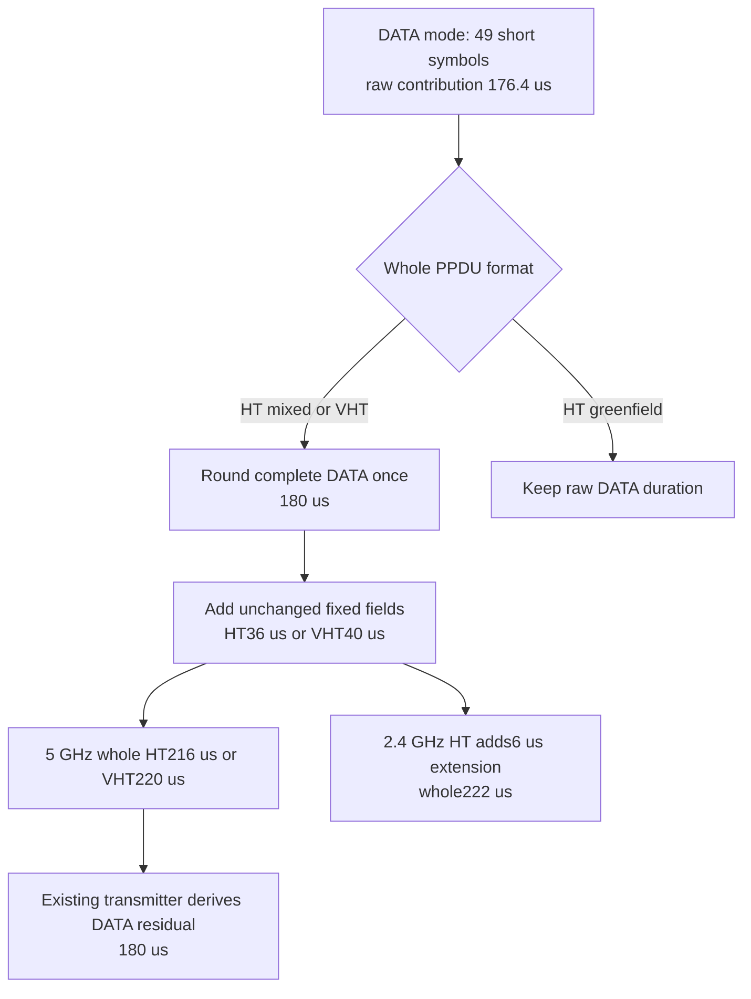

# Shared HT/VHT timing correction

T0 corrects the existing PHY timing authorities before mesh multi-MPDU support. Short GI already changed nominal rate and the typed transmit vector, but DATA duration still used four-microsecond symbols. HT additionally chose BCC encoders from gross rate, introducing an extra encoder and tail bits for legal one-encoder modes such as HT40/MCS15/NSS2. This stage changes four shared mode files; it adds no mesh-side duration formula, modulation tuple, STBC/LDPC support or aggregation engine.

## Timing owners

DATA mode owns the raw symbol duration: 3.6 microseconds for short GI and four for long GI. Whole HT-mixed and VHT mode owns the once-per-total-DATA rounding to four microseconds. HT greenfield keeps raw short symbols. Fixed signaling/training intervals remain unchanged, and the existing HT 2.4 GHz extension is added after rounding. These rules follow IEEE 802.11-2024 19.4.3 Eq19-90/91/92 and 21.4.3 Eq21-109/110/111; the original PDF ceilings were independently visually verified in the stage handoff.

The packet-level transmitter continues consuming whole mode duration and deriving its DATA residual after fixed parts. It therefore transmits the correct rounded occupancy without a second equation. The raw DATA duration can be shorter than that residual, so the existing part-duration unit now checks this distinction rather than assuming equality.

HT BCC encoder selection uses existing modulation/FEC information to evaluate net PHY rate with the fixed 800 ns GI, as required by 19.3.11.4/Table19-32. HT40/MCS15/NSS2 uses one encoder for both GIs because its long-GI net rate is 270 Mb/s. HT40/MCS23/NSS3 uses two. VHT retains its existing table-based encoder selection.

## Independent literals and actual transmission

The new unit encodes independent literals, rather than computing expected values through the changed mode helpers. All rows use BCC, no STBC/extension streams, and 5 GHz; the separate extension/greenfield assertions cover those distinctions. HT length is PSDU length; VHT length is APEP length.

| Mode | Bytes | Encoders | Long GI us | Short GI us |
| --- | ---: | ---: | ---: | ---: |
| HT20 MCS7 NSS1 | 1 | 1 | 40 | 40 |
| HT20 MCS7 NSS1 | 1560 | 1 | 232 | 216 |
| HT20 MCS7 NSS1 | 1602 | 1 | 236 | 216 |
| HT20 MCS7 NSS1 | 1623 | 1 | 240 | 220 |
| HT40 MCS15 NSS2 | 132 | 1 | 44 | 44 |
| HT40 MCS15 NSS2 | 1347 | 1 | 80 | 76 |
| HT40 MCS23 NSS3 | 402 | 2 | 60 | 60 |
| VHT20 MCS7 NSS1 | 1560 | 1 | 236 | 220 |
| VHT20 MCS7 NSS1 | 1602 | 1 | 240 | 220 |
| VHT80 MCS7 NSS1 | 1602 | 1 | 84 | 80 |
| VHT80 MCS9 NSS2 | 7000 | 2 | 116 | 112 |

`Ieee80211HtVhtTiming_1.test` also asserts raw 49-symbol SGI DATA as 176.4 microseconds and the rounded residual as 180, a greenfield one-symbol contribution of 3.6, its whole 27.6-microsecond PPDU, a six-microsecond extension and the resulting HT 2.4 GHz whole 222-microsecond duration. HT-SIG/VHT-SIG-A stays eight microseconds.

`Ieee80211HtVhtTransmissionTiming_1.test` sends real packets through dimensional radios. Its 1560-byte HT PSDU and 1560-byte VHT APEP both require 49 DATA symbols. The medium's actual departure observation asserts raw DATA176.4, transmitted residual180 and whole HT216/VHT220 microseconds, including unchanged fixed parts and the real per-PPDU vector. The VHT bare member is 1556 bytes before its delimiter; both packets also reach the receiver. This proves actual occupancy and ownership through the transmitter rather than only a helper predicate.

## Evidence status

The timing Mermaid diagram rendered successfully and was visually inspected, including the separate 5-GHz whole-duration and 2.4-GHz extension branches.

The clean parent counterfactual was compiled and run before any production/header edit, using H2 commit `74468283db52ce40b8d97d0f3ef807fbbb11936c`, its original inline bodies and debug library `e1ed30eb8c9c035b70eb9c6e457559809cf2d612fa1f9ef99e58826dab6090b3`. The literal unit reports the SGI and encoder mismatches; the actual radio fails at its raw49-symbol DATA assertion. Exact original sources, generated tests and raw failures are `/home/miguel/inet-mesh-t0-raw/parent/`. Early fixture namespace/sequence setup errors are setup failures; only the archived valid-input run counts as the actual-radio timing reproduction.

The corrected four-file source manifest is `bf7f052c3f25a828faf192542b26625faf743dc1914ade9705497c1aa815184b`; matching debug library is `5472a695a9409dac3a56e53772fcaaea90f26e8ec88c3ff7dcbdd253f9d8b052`. Build log and exact hashes are `/home/miguel/inet-mesh-t0-source-checkpoint/record.json`. Direct development verification passes both timing units and the actual-radio fixture, followed by 18 focused mode/capability units and four relevant module files. These executions remain distinct from the accumulated independent campaign.

The final explicit 37-file protocol union reports **33 PASS, three declared FAIL and the one preserved unexpected WifiBlockAckDataRetry FAIL**. All 19 mesh files pass, including 104 native A-MSDU, five airtime, 16 HT negotiation, 64 VHT negotiation and 34 high-throughput boundary configurations. Across 262 invocations there are 257 protocol PASS results, four assertion failures and one runtime abort. The exact filter, preview and log are `/home/miguel/inet-mesh-t0-protocol-selection.json`, `inet-mesh-t0-protocol-preview.log` and `inet-mesh-t0-protocol-final.log`; generated/source inputs, raw outputs and the 1718-file hash manifest are `/home/miguel/inet-mesh-t0-raw/protocol-final/`.

The three declared failure assertions retain H2's exact boundaries: N_Ampdu at 2 s/event149187, Ac_Ampdu at 2 s/event161849 and Ac_VhtIe at 2.5 s/event48880. WifiBlockAckDataRetry retains its run-0 deadline failure at 1.023764276562 s/event3708 and run-1 exact-start abort at 1.014105463846 s/event2639. All 261 normal terminal event/time records also match the H2 archive. Two intermediate express-mode progress records differ because they are printed at wall-clock sampling points; their terminal boundaries are identical. The bounded comparison is `h2-event-comparison.json`, and does not claim full trajectory or fingerprint equality.

The timing changes are causal and intentional: the independent parent literal probe reports 232 us for HT20/MCS7/1560-byte SGI, whereas corrected whole timing is 216 us; VHT's corresponding 236 us becomes 220 us. HT40/MCS15/1347 bytes previously used two encoders and 84 us; the correct one-encoder values are 80 us long GI and 76 us short GI. Shorter actual DATA occupancy can advance ACK completion and later contention, while encoder correction can remove a tail-induced DATA symbol at a length boundary. The actual-radio probe separately establishes the rounded 180-us transmitted DATA residual rather than substituting the raw 176.4-us symbol interval. Retained protocol outcomes and failure boundaries stay unchanged in this campaign; unobserved intermediate trajectories remain for C9 fingerprints.

The final independent accumulated campaign passes **24 unit files and 22 module files across 109 native simulations**, with runner exit 0 for both categories. The new timing module executes both real HT/VHT transmissions in General/run0/seed0. The authoritative `/home/miguel/inet-mesh-t0-final-verification/record.json` retains exact commands/selectors, four source hashes, 46 test hashes, loader proofs and pinned-library/source/raw snapshots; all remained unchanged during execution.

The campaign is not ownership-clean: 45 ownership warnings and 34 undisposed objects remain. Lifetime22, Congestion20 and FrameSequence34 diagnostic lines exactly match the separately executed older H0a baseline; TxNavChoice's three ownership warnings match retained H2 raw. The older baseline is not mislabeled as an exact H1/H2-parent execution. Original normalizer false-failure envelopes and their adjudicated results are retained. No unrelated sink or source cleanup was included.

The author self-audit retraced DATA/raw versus whole-format timing, unchanged fixed parts, net long-GI encoder authority and the actual transmitter consumer, with focused architecture and whitespace checks passing. Independent final review clears the bounded source/tests and evidence: 27 PASS, 19 N/A, no flags/questions, with C9 fingerprints explicitly unverified. It verifies all four production inputs, 46 test hashes and 1718 protocol archive hashes. No source change is pending. No sealed target, timer, RNG draw, mesh-side formula or VHT encoder table changed.

No expectation marker or stored baseline is changed. C9 release, feature-off, lifecycle and native fingerprint comparison remain separate; this correction must not be described as fingerprint-preserving without that execution.
