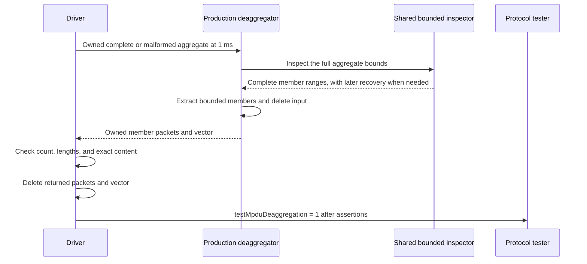

# RANGE-USE: Extract MPDUs from bounded aggregate ranges

This document belongs to **RANGE-USE**, with subject **ieee80211: fix: recover bounded MPDUs during deaggregation**. Its fixture is [WifiMpduDeaggregation.test](common/WifiMpduDeaggregation.test). The [PHY plan](../../../plan/pending/ieee80211-ampdu-phy-reception.md) assigns this production consumer after the shared delimiter inspector.

The deaggregator must extract only member ranges that fit inside the aggregate. Before this commit, it directly uses each delimiter's declared length. After this commit, it uses the shared inspector's bounded ranges. A malformed delimiter can therefore leave later complete members available for extraction. Extraction does not establish MAC acceptance.

## Original scenario, cause, and correction

The complete aggregate contains three members with lengths 100, 100, and 20 octets. Each member follows a four-octet typed delimiter. The first two members contain a typed `Ieee80211DataHeader` and zero-filled content. The last member contains twenty zero octets. These lengths require no alignment padding, so the aggregate contains 232 octets.

The recovery case changes only the middle delimiter's declared length, from 100 to 2000 octets. Its actual member still contains 100 octets, with the same typed header and zero-filled content. The 128-octet suffix starts at that malformed delimiter. Within this suffix, the later member starts at offset 108. Within the complete aggregate, the later member starts at offset 212.

Before this commit, the deaggregator consumes the first delimiter and member. It then requests a 2000-octet slice after the middle delimiter, although only 124 octets remain. The unchecked delimiter length causes an out-of-bounds request. The old path cannot return the required first and later members for this scenario.

The correction makes [MpduDeaggregation](../../../src/inet/linklayer/ieee80211/mac/aggregation/MpduDeaggregation.cc) consume the ranges from [the shared inspector](../../../src/inet/linklayer/ieee80211/mac/aggregation/MpduAggregationUtils.cc). The inspector rejects the middle delimiter's member bounds. It examines later delimiter candidates at four-octet intervals, through the typed MAC header and content. It finds the final valid delimiter and its complete twenty-octet member. The deaggregator extracts the first and final ranges. This test checks that local API contract. It makes no additional normative IEEE claim.

## Setup, stimulus, and assertions

At 1 ms, a simple driver passes an owned aggregate to the production `MpduDeaggregation::deaggregateFrame` method. This method is the production extraction boundary. It owns and deletes the input aggregate. The fixture does not replace the inspector or call it directly.

Four runs combine the complete or recovery layout with typed chunks or reconstructed bytes. Each run uses seed zero. For byte reconstruction, the driver serializes the complete aggregate, deletes that packet, and creates a new packet from its bytes. The typed runs retain the MAC header chunks that delimiter recovery must cross.

The driver requires these results:

- The complete layout returns three members with lengths 100, 100, and 20 octets.
- The recovery layout returns two members with lengths 100 and 20 octets.
- Each returned member equals its expected content byte for byte.
- The final twenty-octet member remains available after the malformed middle delimiter in both representations.

The expected first and middle content comes from separate member packets before aggregate extraction. The final content is a fixed vector of twenty zero octets. Exact lengths and content prevent delimiter bytes, padding, or an overlong slice from passing as a recovered member.

The driver deletes every returned `Packet` and the returned vector. Only after these checks and disposal does it emit `testMpduDeaggregation = 1`. The protocol tester requires that event. The driver's final assertion also requires completion. A missing call or failed extraction therefore cannot pass through an empty observation.



The complete cases must pass before and after the correction. On the original parent, the recovery cases must fail before the required event because the 2000-octet request exceeds the available bytes. After the correction, all four cases must pass. These statements describe expected results. No execution result or expected-failure declaration substitutes for the assertions.

## Verification and limits

From the INET root, use this exact filtered debug command on the parent or behavior commit:

```sh
opp_run_protocol_tests --load . -p inet -m debug -w '^tests/protocol/wifi$' -f 'WifiMpduDeaggregation\.test$' --no-concurrent
```

The expected output includes `PROTOCOLTEST wifi_mpdu_deaggregation: PASS` and four successful runs. The [execution record](../../../plan/pending/ieee80211-ampdu-phy-execution.md) describes the installed runner's descriptor limitation. Use its compatible descriptor when that limitation applies. The runner supplies the NED paths.

The results above define the expected observations. The [comparison record](mpdu-deaggregation-comparison.md) reports the parent and commit executions with identical fixture bytes. The diagram agrees with the fixture's direct call and ownership sequence by source inspection. Mermaid rendering remains unverified.

The fixture establishes extraction through the production consumer, including bounded recovery across typed MAC header bytes. It does not establish radio reception, delimiter acceptance by the MAC, member FCS acceptance, upper delivery, or implicit Block Ack. It does not test region tags, every malformed delimiter form, or every alignment remainder. The inspector's unit tests supply broader range checks.
