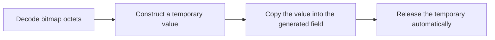

# S5-P4: Remove leaked bitmap temporaries

This document belongs to **ieee80211: fix: release temporary Block Ack bitmap allocations**. The change repairs memory ownership without a protocol behavior change.

Before this commit, each Basic bitmap entry uses a temporary heap allocation without deletion. The Compressed decoder also leaves an allocated bitmap unowned. After this commit, both decoders construct values directly. Generated fields retain their own values, and no temporary allocation remains unowned.

## Why a protocol comparison does not apply

A valid frame produces the same decoded bitmap before and after this commit. Repeated successful exchanges can leak memory without any protocol assertion failure. A protocol test that passes only after the change would therefore need a memory detector, not a different frame expectation.

The direct [wire fixture](../../unit/Ieee80211BlockAckWire_1.test) preserves independent Basic and Compressed octet checks. It establishes value equivalence. Ordinary execution cannot establish the absence of a leak. A future memory comparison must run repeated decode under a leak detector and identify allocations from this decoder. Process memory growth alone cannot isolate the allocation owner.

## Evidence and limits

No new protocol test is assigned to this commit. No parent protocol failure is claimed. This task does not add a leak-detector campaign. The following wire-validation commit owns protocol rejection of malformed Types; that separate behavior must not be attributed to this ownership repair.

The diagram shows value ownership because an on-air exchange would hide the relevant allocation lifetime.
