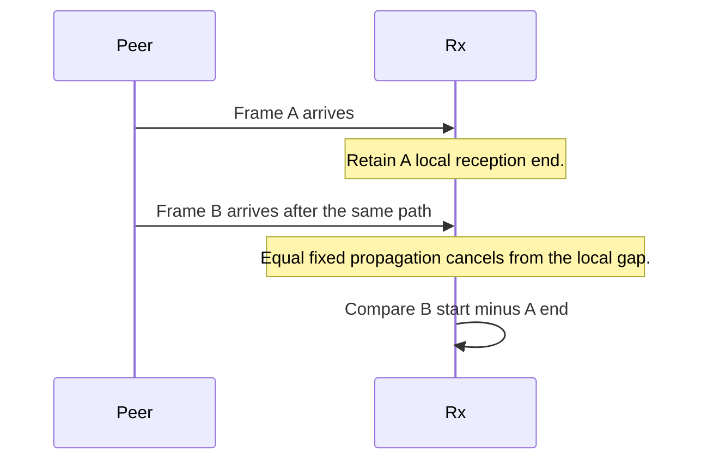
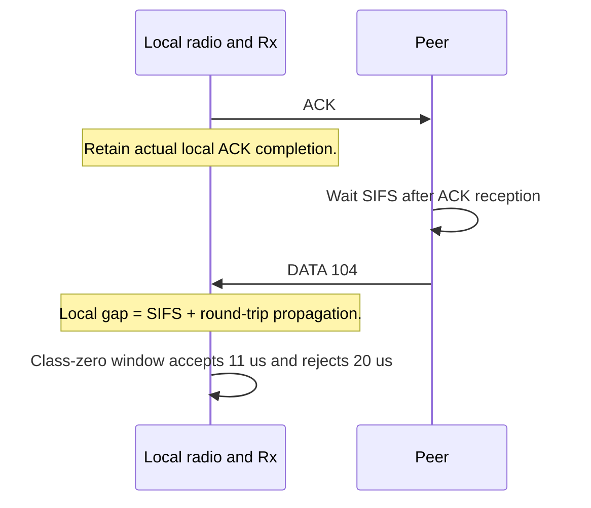
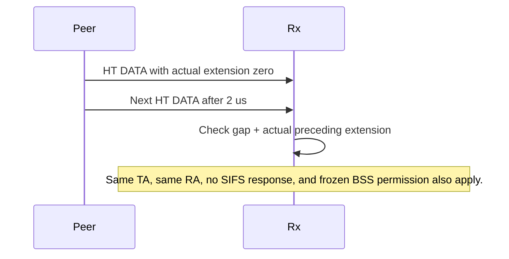
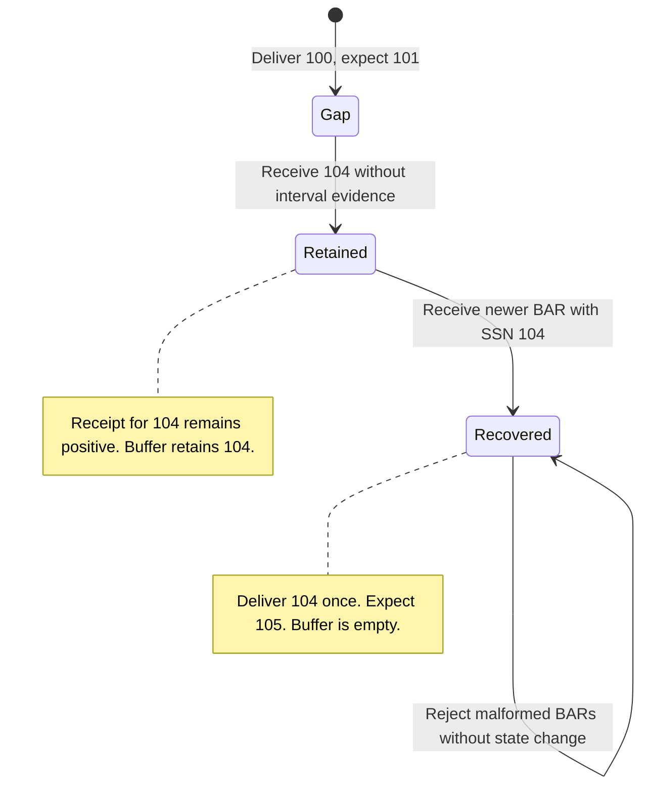
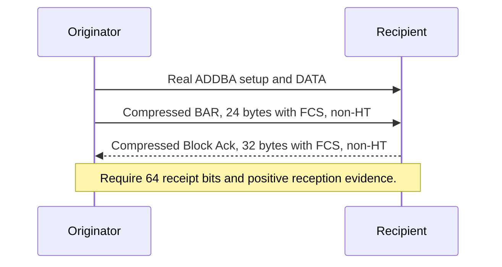

# S5-P9: Activate a complete explicit Compressed exchange

This document belongs to **ieee80211: add: complete explicit immediate Compressed Block Ack**. The protocol test is [N_CompressedBa.test](11n/N_CompressedBa.test).

Before this commit, HCF rejects the Compressed profile during initialization. Wire validation, local Rx interval evidence, preparation, receipts, and rate helpers exist. No production Compressed exchange connects them. After this commit, eligible HT peers establish immediate agreements and exchange Compressed BAR and Block Ack frames. Basic remains the default at this boundary.

Master supplies S4 setup, BAR-first arbitration, window operations, DATA Retry, and completion DELBA. The infrastructure fixture uses those owners. That fixture creates no association or accepted agreement.

## Local interval consequences

[WifiLocalInterframe.test](common/WifiLocalInterframe.test) checks delivery consequences through production radio, Rx, HCF, recipient service, and reorder behavior. A deterministic peer supplies physical frames. A test subclass supplies an accepted immediate Compressed agreement with buffer size four. This fixture does not establish negotiation. It supplies no interval tag or relation boolean.

The core case receives sequence 100, leaves positions 101–103 absent, and receives sequence 104 after the local ACK. Rx classifies the interval. HCF passes the frame's indication to the recipient service. Receipt state records 104 regardless of that relation. The reorder service conditionally releases 104 only when its receipt and interval conditions permit release.

At 0.5-microsecond one-way propagation, a peer that waits ten-microsecond SIFS produces an eleven-microsecond local gap. Rx accepts that class-zero interval. At five-microsecond propagation, the same wait produces a twenty-microsecond gap. Rx supplies no SIFS evidence. Sequence 104 remains buffered with positive receipt evidence. A newer BAR with SSN 104 releases it once. A subsequent check excludes duplicate delivery.

Each run checks receipt bits, the receive-window origin, buffer length, delivery order, response counts, and the Rx indication. The fixture then sends the recovery BAR. It checks receipt evidence and exactly one delivery of the retained frame. Six malformed BARs must leave that recovered state unchanged and discard Rx history.

The finite matrix uses eleven scenarios and three propagation values: zero, 0.5 microseconds, and five microseconds. The busy-only scenario adds 100 microseconds to create its intended interruption. Every run uses seed zero and asserts its own completion.

| Scenario | Initial condition and stimulus | Required result |
| --- | --- | --- |
| 0, local ACK delay | Receive 100 and its ACK. Receive 104 after the peer waits SIFS. | Small local gaps permit conditional release. The five-microsecond path retains 104 until BAR recovery. |
| 2, missing prior receipt | Start with 101 instead of 100. Receive 104 after the ACK. | Receipt conditions prevent release despite accepted interval evidence at small delay. BAR recovery releases 104 once. |
| 3, sequence wrap | Start at 4094. Receive sequence 2 across the gap. | The same local-delay rule applies across wrap. BAR recovery advances the receive window without duplicate delivery. |
| 4, unrelated frame | Insert a decoded frame addressed to another station. Receive 104 SIFS after it. | Same-transmitter local reception supplies evidence. Delivery and receipt assertions remain valid. |
| 5, RTS and CTS | Insert RTS and the recipient's CTS before 104. | Completed CTS supplies no own-ACK evidence. BAR recovery releases the retained frame. |
| 7, permitted RIFS | Send HT DATA without extension or an expected SIFS response. Receive 104 after two microseconds. | Rx supplies RIFS evidence and the reorder service conditionally releases 104. |
| 8, extension control | Keep the normal six-microsecond extension before the same positive gap. | Rx rejects the RIFS relation. Receipt evidence survives until BAR recovery. |
| 10, agreement replacement | Retire the agreement after the first ACK. Install a replacement with prior receipt state. | HCF invalidates Rx history. The old ACK cannot authorize release in the replacement agreement. |
| 11, unrelated outside gap | Receive an unrelated frame before 104. Use a gap one tick above the local SIFS window. | The interval fails. Receipt state remains positive and BAR recovery succeeds. |
| 12, prior BAR | Start with a BAR at 101, receive 101, and leave a gap before 104. | The receipt and reorder checks retain their separate state. The later BAR releases 104 once. |
| 13, busy-only activity | Insert an unsupported waveform after the local ACK. Require BUSY without another reception attempt. | Two DATA reception starts and a BUSY transition occur. No interval relation permits early release. |









## Disposition of the former module fixture

The former `tests/module/Ieee80211CompressedBlockAckInterframe_1.test` has no residual module-only contract. Its physical exchange assertions move to the protocol fixtures. The table assigns every former scenario and shared assertion before removal.

| Former case or assertion | Disposition and reason | Destination |
| --- | --- | --- |
| Case 0, own ACK followed by DATA | Replace the remote-gap expectation with local delay classification and BAR recovery. Preserve receipt, buffer, delivery, and ACK counts. | Exchange scenario 0. |
| Case 1, outside SIFS tolerance | Replace the transmitter-relative boundary with the actual local boundary and adjacent outside tick. | Input fixture SIFS cases and own-ACK cases 29–30. |
| Case 2, absent receipt before the gap | Preserve independent receipt, buffer, delivery, and ACK assertions. | Exchange scenario 2. |
| Case 3, sequence wrap | Preserve cyclic receipt, window, and delivery checks. Apply the intentional local-delay limit. | Exchange scenario 3. |
| Case 4, unrelated addressed frame | Preserve physical reception and delivery assertions. | Exchange scenario 4. |
| Case 5, RTS and CTS | Preserve the non-ACK control and response count. | Exchange scenario 5. |
| Case 6, exact SIFS endpoint | Replace the remote endpoint with an actual local endpoint. | Input fixture endpoint cases and own-ACK case 29. |
| Case 7, omitted-extension RIFS | Preserve physical reception and conditional release. | Exchange scenario 7. |
| Case 8, normal-extension RIFS control | Preserve rejection, receipt, and buffer assertions. Add BAR recovery. | Exchange scenario 8. |
| Case 9, outside RIFS tolerance | Preserve the adjacent outside value without a second exchange matrix. | Input fixture RIFS cases 41–44. |
| Case 10, agreement replacement | Preserve context invalidation and independent replacement receipts. | Exchange scenario 10. |
| Case 11, unrelated outside interval | Preserve physical reception and rejected conditional release. | Exchange scenario 11. |
| Case 12, prior BAR and receipt gap | Preserve initial BAR response, receipt bitmap, buffer origin, and delivery assertions. | Exchange scenario 12. |
| Case 13, busy-only waveform | Preserve two reception attempts, a BUSY transition, and rejected early release. | Exchange scenario 13. |
| Shared six malformed BARs | Preserve fragment, trailing-body, and Multi-TID rejection. Preserve receipt and delivery state. | Every exchange run, after BAR recovery. |
| HCF pending-history watch | Replace the private HCF observation with Rx history invalidation. | Exchange checks after malformed BARs. |
| Actual extension from a transmitter query | Replace that query with local receive indication checks. | HT extension fixture and input RIFS matrix. |
| Snapshot identity, retained cache endpoints, absent cache entries, and cache expiry | Remove these assertions because the API never enters the reconstructed series. No replacement medium mechanism is necessary. | None. |
| Medium preceding-gap query | Remove the query. Check local physical gaps independently. | Input fixture and exchange Rx indication. |

The input fixture owns detector boundaries, overlap, event order, reconfiguration, and missing evidence. The exchange fixture owns receipt and delivery consequences. It retains one permitted RIFS exchange and one extension control. It does not repeat the RIFS permission matrix.

Input case 49 adds the HCF corruption callback to the stale-delivery check. A stale corrupt duplicate reaches the MAC while a newer clean reception remains active. Rx discards only evidence for that corrupt delivery. HCF handles its frame-sequence notification without a second global history reset. The newer frame retains its valid interval result. Input case 50 checks an idle notification from the MAC mode-set source through a test extension. It adds no dynamic configuration API to production MAC code.

## Detection limits

The detector supports coverage class zero. It adds no distance-derived allowance or tolerance parameter. Unknown extension disables the applicable RIFS evidence. Missing or rejected interval evidence does not reject a valid frame or erase a positive receipt. Unresolved sequence gaps can delay delivery until a later BAR or another applicable recovery action.

Rx supports delivery at the reception completion time through the standard interface. Custom connections with delayed delivery remain outside its storage bound. Radio OFF clears all interval evidence. These detector checks do not establish complete MAC stop/start support, all propagation models, all seeds, or a measured performance improvement.

## Scenario and assertions

The fixture explicitly selects Compressed at all three HCF instances in the infrastructure network. Both wireless hops use real management and usable HT state. Seed zero, run zero, and a three-second limit select a bounded exchange. Rapid standalone DATA makes BAR due without A-MPDU support.

The first assertion selects the originator's first BAR by frame type. It requires the Compressed class, a 24-byte frame with FCS, and a non-HT mode. The second assertion selects the first received Block Ack. It requires the Compressed class, 32 bytes with FCS, a non-HT mode, a 64-bit bitmap, and a positive receipt bit.

These conditions are assertions on selected events. An incorrect first response cannot disappear through a filter while the matcher waits for a later correct response. Missing frames fail their bounded waits. The fixture also rejects an explicit protocol FAIL verdict.



## Local reconstruction evidence

The original control is `d8f98b8bf3f4477f5780564c983662006c11c27f`. A fresh debug build passed all twenty-eight original physical runs. The original core case also passed with 0.5-microsecond propagation through a parameter override. The same DATA and ACK stimuli therefore permit early release in both original delay cases.

The revised fixture checks the actual local gap: eleven microseconds at 0.5-microsecond propagation and twenty microseconds at five-microsecond propagation. Before BAR recovery, the latter case retains positive receipt bit 104, one buffered frame, and receive-window origin 101. Recovery advances that origin to 105 and delivers 104 exactly once. All thirty-three revised physical exchange runs pass.

The revised input fixture passes fifty-one runs. These include the HCF stale-corruption path and the MAC mode-set notification. The focused activation checks also pass the seven protocol files, four Compressed module files, and the Tx NAV unit file. The execution record is `/tmp/inet-local-interframe-20261028/execution.md`. The record separates these results from the historical comparison below.

## Historical activation comparison

The parent compiles the fixture but fails initialization with `Compressed Block Ack exchanges are not implemented`. The wrapper reports FAIL; no protocol exchange starts. The child completes the explicit exchange and reports protocol PASS. Its first BAR and first response satisfy the new assertions.

The recorded comparison uses parent `src` tree `bd37288e48a39d1677ab35cff707480cf061a400` and child `src` tree `6dc06e64ab4783dab6cff44d26a0d244370b95b9`. Each comparison uses its own fresh debug library in the same retained worktree. The fixture files are identical on both sides. This comparison establishes exchange activation; the input fixture below checks the current subtype boundary separately.

The comparison worktree is `/home/user/omnetpp_ws/inet-s5-protocol-verification-20261027`. Raw output and machine-readable results reside under `/tmp/inet-s5-protocol-design-20261027/`. The stage records are `09-before` and `09-after-10-before`. Local artifacts can be absent in another environment.

Run the following commands from the checkout root for each source version:

```sh
make MODE=debug CXX='ccache clang++' -j12
opp_run_protocol_tests --load @opp -p inet -m debug --no-build --no-concurrent -w '^tests/protocol/wifi$' -f '(N_CompressedBa)\.test$'
```

Initialization failure in the parent is the missing-capability result. It is not a failed on-air assertion because the exchange cannot start. Both versions compile the same fixture. The child must reach the real exchange and report PASS. An expected-failure declaration is not added to the committed fixture.

## Ownership and coverage limits

The recipient service uses receipt and reorder state only for QoS DATA. Non-QoS DATA has no transmitted TID. Its unused model field defaults to zero, which must not select a TID 0 agreement. Otherwise, ordinary DATA can create false receipt evidence, and fragmented DATA can reach the Compressed no-fragment assertion. IEEE Std 802.11-2024, Clause 10.25.1 defines the applicable QoS DATA scope.

The [input fixture](../../module/Ieee80211CompressedBlockAckInput_1.test) supplies a TID 0 agreement under both profiles. It passes ordinary non-QoS DATA and two consecutive fragments through HCF. The service must deliver ordinary DATA immediately and reassemble the fragments without agreement updates. The fixture requires one ACK for each received frame, no receipt bits, and no change to the agreement's highest received sequence. It also retains the separate rejection checks for fragmented QoS DATA under Compressed agreements. These cases use supplied agreements; they do not establish ADDBA negotiation or wireless reception.

HCF owns admission and the frame sequence. Agreement records own receipts, and the reorder service owns delivery. Before DATA commitment, HCF evaluates complete exchange cost with one selected mode. Refusal preserves source MSDUs, deadlines, and sequence state. Those admission boundaries receive complementary coverage from the existing [admission fixture](../../module/Ieee80211CompressedBlockAckAdmission_1.test).

The infrastructure fixture establishes activation, control format, non-HT mode use, and positive receipt evidence. The local interval protocol fixtures establish the selected physical interval and delivery cases above. Existing input, originator, and infrastructure module fixtures retain their separate claims. These checks do not establish every bitmap hole, shifted window, invalid override, or TXOP exception.

The requirement basis includes IEEE Std 802.11-2024 Tables 9-36 and 9-37 and Clause 10.25.6.3. The normative corpus nodes occupy physical PDF pages 719–723 and 2060–2061. No A-MPDU, implicit BAR, delayed Compressed Block Ack, or Multi-TID support follows from this exchange.
