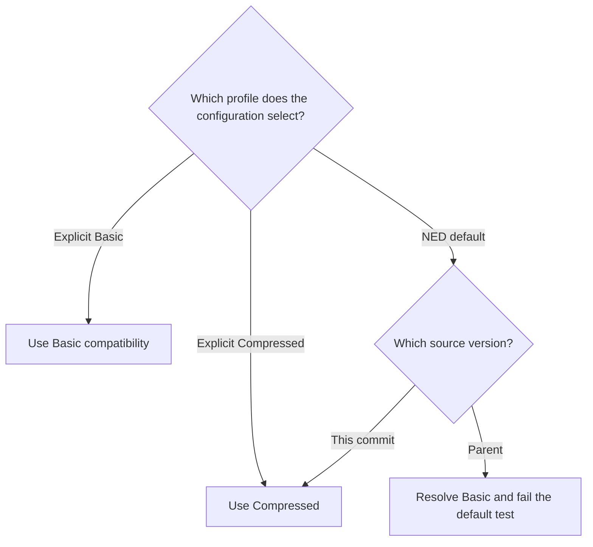

# S5-P10: Select Compressed by default

This document belongs to **ieee80211: change: default HCF to immediate Compressed Block Ack**. The protocol fixtures are [N_BlockAck.test](11n/N_BlockAck.test) and [Ac_BlockAck.test](11ac/Ac_BlockAck.test).

Before this commit, an omitted selector uses Basic. A complete Compressed exchange requires an explicit selector. After this commit, the HCF NED default selects Compressed. Explicit Basic remains available, and links without usable HT state retain Normal Ack.

## Scenario and assertions

Each fixture runs three seed-zero infrastructure cases. The profiles are explicit Basic, explicit Compressed, and the unquoted INI keyword `default`. The keyword invokes the parameter's NED default; it does not supply the string `"compressed"`.

All cases retain real association and production ADDBA. The n and ac fixtures observe the corresponding BAR and response classes and positive receipt bits. Each fixture's post-run script splits the output into three separate runs. It checks the requested profile, the resolved profile at all three HCF instances, and the run's own PASS verdict. It rejects a FAIL verdict in any run.

| Case | Parent result | Child result |
| --- | --- | --- |
| Explicit Basic | Basic exchange succeeds. | Basic exchange succeeds. |
| Explicit Compressed | Compressed exchange succeeds. | Compressed exchange succeeds. |
| NED default | The selector resolves to Basic; the Compressed requirement fails. | The selector resolves to Compressed; the exchange succeeds. |



## Comparison and limits

Both parent fixtures complete their explicit Basic and explicit Compressed controls with protocol PASS. Their third runs resolve the default to Basic and report protocol FAIL. The run-specific post-run scripts reject those failures, so the wrappers report ERROR. Both child fixtures pass all three runs, with six protocol PASS verdicts and no FAIL. These are verified runtime differences, not compilation failures.

The parent `src` tree is `6dc06e64ab4783dab6cff44d26a0d244370b95b9`. The child `src` tree is `55cd71a3ad15a764ec926420af5247643f52dd2c`. Each comparison uses its own fresh debug library in the same retained worktree. The fixture files are identical on both sides.

The comparison worktree is `/home/user/omnetpp_ws/inet-s5-protocol-verification-20261027`. Raw output and machine-readable results reside under `/tmp/inet-s5-protocol-design-20261027/`. The stage records are `09-after-10-before` and `10-after`. Local artifacts can be absent in another environment.

Run the following commands from the checkout root for each source version:

```sh
make MODE=debug CXX='ccache clang++' -j12
opp_run_protocol_tests --load @opp -p inet -m debug --no-build --no-concurrent -w '^tests/protocol/wifi$' -f '(N_BlockAck|Ac_BlockAck)\.test$'
```

The controls distinguish a default change from a general exchange repair. A shared PASS substring cannot establish three successful runs. The run-specific checks and rejection of FAIL are therefore part of the test.

The ac fixture covers its configured exchange, not complete VHT transfer conformance. These two fixtures do not establish every fallback or initialization diagnostic. The [migration fixture](../../module/Ieee80211CompressedBlockAckMigration_1.test) and [variant fixture](../../module/Ieee80211BlockAckVariant_1.test) retain those complementary checks.

The default is an INET configuration choice. IEEE 802.11 does not negotiate this selector through ADDBA. Both endpoints must use the same profile. A-MPDU, implicit BAR, delayed Compressed Block Ack, and Multi-TID Block Ack remain outside scope.

The default Compressed profile uses Rx local interval detection. HCF passes the indication to the recipient service. The detector supports coverage class zero. An outside local gap supplies no SIFS evidence, even when the peer waits nominal SIFS after an ACK. A valid frame retains its positive receipt but can remain buffered behind a sequence gap until a later BAR permits delivery. The [exchange reviewer document](s5-compressed-exchange.md) defines the local-delay cases and their recovery assertions.

The local reconstruction repeats the same three-profile comparison against revised parent `1bb14dd8fb501ed3641edf23649d59088385a0e1`. Its C++ source remains unchanged across this default choice. The parent passes both explicit profiles but fails the third profile because the NED default remains Basic. Both revised fixtures pass all three profiles. The local record is `/tmp/inet-local-interframe-20261028/execution.md`. It preserves the historical source-tree comparison above separately.
