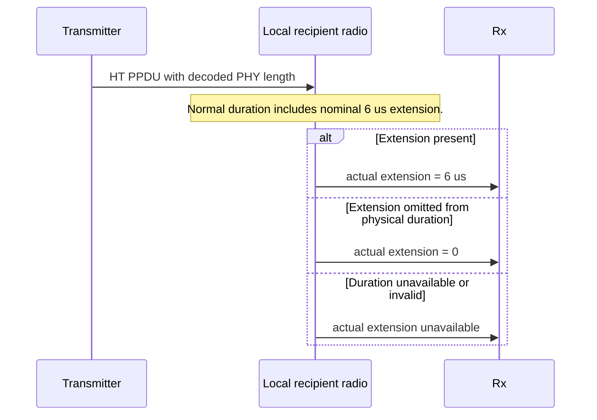
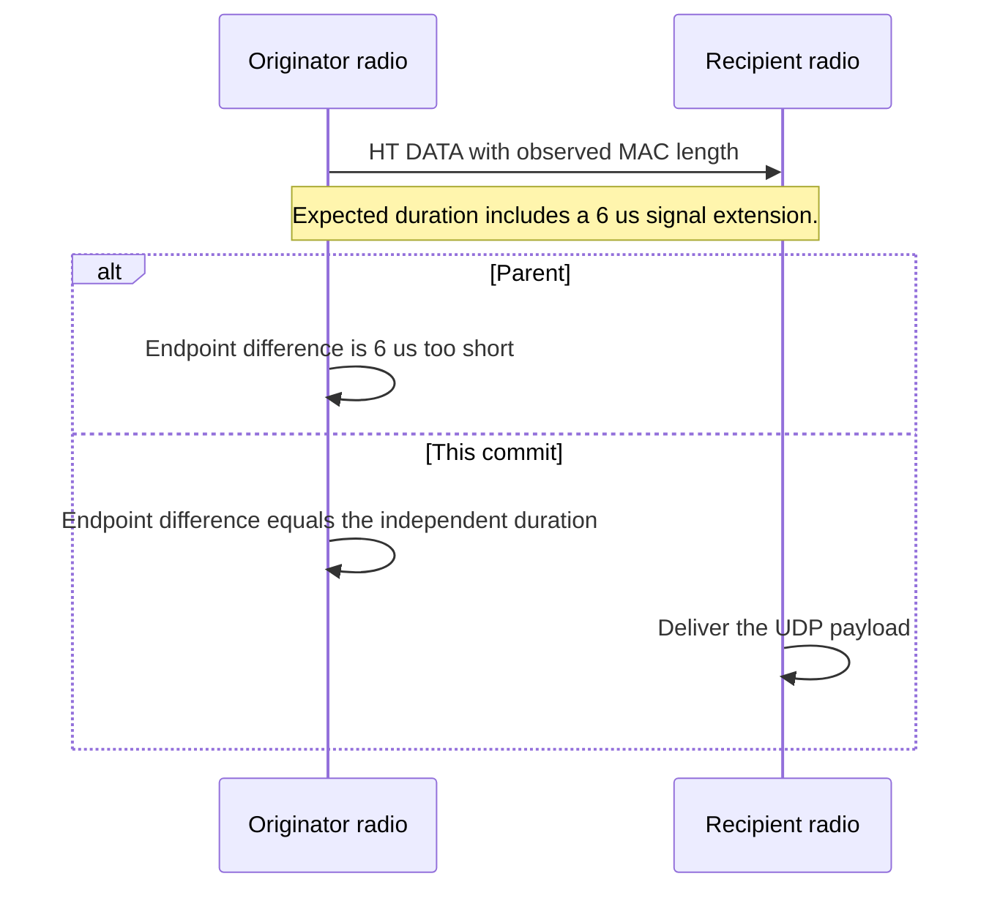

# S5-P2: Include the HT signal extension in radio airtime

This document belongs to **ieee80211: fix: include the HT signal extension at 2.4 GHz**. The protocol test is [WifiHtSignalExtension.test](common/WifiHtSignalExtension.test).

Before this commit, a transmitted HT waveform at 2.4 GHz ends six microseconds early. The mode duration omits its signal extension. After this commit, that duration includes the extension. Radio endpoints therefore describe the complete PPDU.

IEEE Std 802.11-2024 Table 19-25 defines a six-microsecond HT signal extension at 2.4 GHz. The table appears on physical PDF pages 3493–3494. Its corpus identifier is `ieee80211-2024:table:19-25`. This is a normative PHY requirement.

## Scenario and assertion

The fixture uses the shared infrastructure network with real association. It selects one spatial stream, 20 MHz, long GI, and DATA MCS 0. Block Ack support is disabled. Every run uses seed zero. The application sends one UDP payload after association.

The five runs use these conditions:

| Run | Physical stimulus | Expected actual extension |
| --- | --- | --- |
| 0 | Normal 2.4 GHz HT PPDU. | Six microseconds. |
| 1 | Normal 5 GHz HT PPDU from the catalog that also supports VHT. | Zero. |
| 2 | 2.4 GHz HT waveform without its nominal extension. | Zero. |
| 3 | Normal 2.4 GHz waveform with no local duration indication. | Unavailable. |
| 4 | Normal 2.4 GHz waveform with invalid local duration. | Unavailable. |

The configuration selects HT MCS 0 through production rate selection at 2.4 GHz. Normal 2.4 GHz waveform cases use the production transmitter without a mode override. The 5 GHz case uses a test subclass to select HT MCS 0 from the `ac` catalog. Bitrate configuration alone selects VHT at the same 6.5 Mbps rate. This override preserves the HT family required by the independent duration formula.

The omitted-extension case also uses the test subclass. It retains production mode selection but adjusts physical and analog duration together. The missing-duration cases change only the local indication before production decapsulation. They supply no actual-extension value.

A read-only observer listens to the originator radio's transmission event. It selects QoS DATA and reads the actual PHY Length field and physical endpoints. It computes the expected duration independently:

```text
Nsym = ceil((16 + 8 * MAC_octets + 6) / 26)
expected = 36 us + Nsym * 4 us + 6 us
```

The constants apply only to the configured HT mixed format, MCS 0, one stream, and long GI. The test does not call the changed mode-duration helper for its expectation. It also requires payload reception at the destination. A missing DATA event cannot pass through an empty observation.

The receive observer reads the indication that the production radio attaches after decapsulation. The radio subtracts nominal duration from local reception duration. It adds back the nominal extension to identify the actual extension. A missing indication or an unsupported duration supplies no extension evidence. An absent extension indication disables later RIFS evidence only.



The local input fixture adds both SIFS endpoints and adjacent outside ticks for 2.4 GHz and 5 GHz HT. It also checks same-transmitter SIFS with five-microsecond propagation. A local ACK case reaches the upper class-zero endpoint after round-trip delay. One additional simulation tick supplies no relation. Expected gaps come from physical endpoints and the peer's wait.



## Comparison and limits

The original comparison below fails at the parent radio-duration assertion at one second. It measures 1352 microseconds against an independent expectation of 1358 microseconds. Its child passes that assertion and delivers the payload. Both executions compile the same fixture.

The parent `src` tree is `da4be0834c1d80fdde0d9915d08e9da42253c76e`. The child `src` tree is `8bdb2bb47d11d23cb16d3e2669644ca5d962856e`. Each comparison uses its own fresh debug library in the same retained worktree. The fixture files are identical on both sides.

The comparison worktree is `/home/user/omnetpp_ws/inet-s5-protocol-verification-20261027`. Raw output and machine-readable results reside under `/tmp/inet-s5-protocol-design-20261027/`. The stage records are `02-before` and `02-after-03-before`. Local artifacts can be absent in another environment.

The local-interval reconstruction uses parent `604bc95fa9acb9df80b38bbdb70daadb1ad5e189`. The same extended fixture compiles against that parent. Its first run reproduces the 1352 versus 1358 microsecond duration failure. This is a physical airtime failure. The parent's absent actual-extension field remains a separate interface limit. The reconstruction record is `/tmp/inet-local-interframe-20261028/execution.md`.

Run the following commands from the checkout root for each source version:

```sh
make MODE=debug CXX='ccache clang++' -j12
opp_run_protocol_tests --load @opp -p inet -m debug --no-build --no-concurrent -w '^tests/protocol/wifi$' -f '(WifiHtSignalExtension)\.test$'
```

The fixture checks the selected HT durations and receive indications. It does not establish short-GI fidelity, other MCS values, other channel widths, or all propagation models. The existing [mode fixture](../../unit/Ieee80211HtModeSet_1.test) remains complementary calculation coverage.
