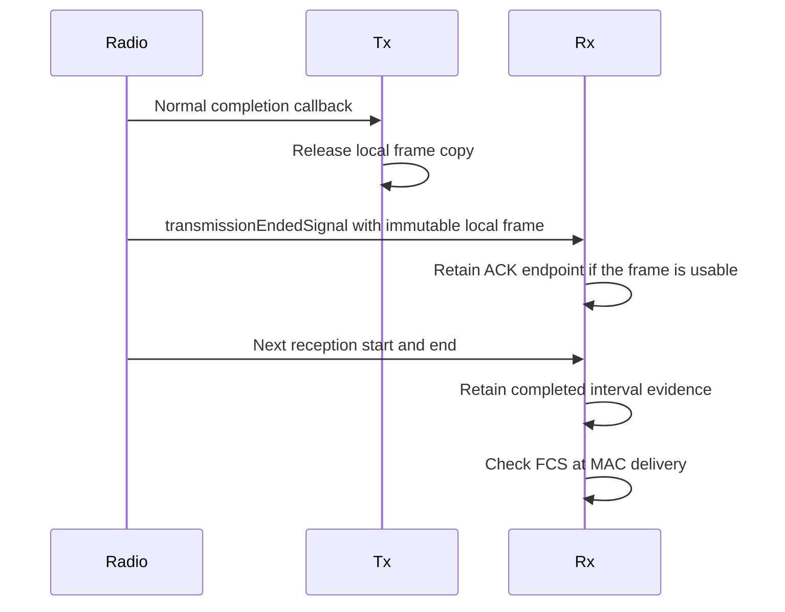

# S5-P1: Detect intervals from local radio observations

Rx supplies local interval evidence for each frame that passes FCS. This change prepares that evidence without a Compressed Block Ack agreement.

Before this commit, Rx checks FCS but supplies no interval result. After this commit, Rx compares consecutive local endpoints. The detector uses the SIFS tolerance for coverage class zero. Both tolerance endpoints pass. An absent endpoint or an outside gap supplies no relation. FCS acceptance remains independent of that result.

For example, an OFDM reception ends at the local station. Another reception starts 15.1 microseconds later. The SIFS value is 16 microseconds. The slot time is 9 microseconds. The detector accepts this lower endpoint. One simulation tick less supplies no relation.

The radio emits a normal completion notification after the Tx callback. Rx reads the immutable local frame through that notification. Only a completed ACK establishes own-ACK history. A radio OFF abort emits no normal completion notification.

Completed reception evidence remains separate from permission to become a future predecessor. Later activity revokes that permission without a change to the completed interval. Rx retains three optional records and one ambiguity endpoint. The detector creates no event and scans no other station.

## Direct checks

[WifiLocalInterframeInputs.test](common/WifiLocalInterframeInputs.test) supplies complete OFDM frames through the production radio and Rx. It checks both SIFS endpoints, one simulation tick outside each endpoint, and exact SIFS. Each run checks its physical local gap and FCS acceptance.

[Ieee80211RxTransmissionCompletion_1.test](../../module/Ieee80211RxTransmissionCompletion_1.test) submits ACKs through production Tx. It checks immediate and delayed submission with `updateLocalNav=false`. It also checks non-ACK completion and radio OFF before ACK completion. The observation occurs after the Tx callback releases its frame copy.

The completion matrix repeats each case with zero and one-microsecond return-to-receiver switch times. It covers typed PHY headers, supported legacy bytes, and an incomplete completion representation. The incomplete-header fault enters at completion because the medium rejects that representation at submission.

Rx subscribes to local radio signals at the network interface. OMNeT++ propagates these signals upward with the original radio as their source. Both callback forms accept only signals from a radio directly inside that interface. The completion test also emits transmission-start and radio-OFF signals from the interface itself. These signals must preserve the ACK history because their source is not a radio.

The input fixture also checks these local history transitions:

- Idle channel, PHY mode, and mode-set changes discard future history.
- OFF and SLEEP discard future history.
- Overlapping attempts, including equal endpoints, supply no interval evidence. Two distinct reception-start notifications establish each overlap. A clean frame permits its successor to recover.
- Residual BUSY after frame B completes preserves B's interval result but revokes its predecessor eligibility.
- Reception C before B's MAC delivery preserves B's result but prevents B from replacing newer history.
- Missing timing, FCS failure, stale delivery during a newer reception, and an aborted reception cannot establish a false relation.

The overlap cases use a receiver extension that admits concurrent attempts. Other cases use the standard receiver. The same-time delivery case changes only the MAC packet priority. The stale-delivery case adds a delayed duplicate as an explicit unsupported input. Neither case calls Rx directly or supplies an interval result.

## Evidence and limits

The parent does not supply the indication or history operation. That interface difference does not establish a behavioral parent failure. Compressed delivery remains outside this boundary. The standard interface delivers frames at the reception completion time. Custom connections with delayed MAC delivery remain outside the storage contract.
