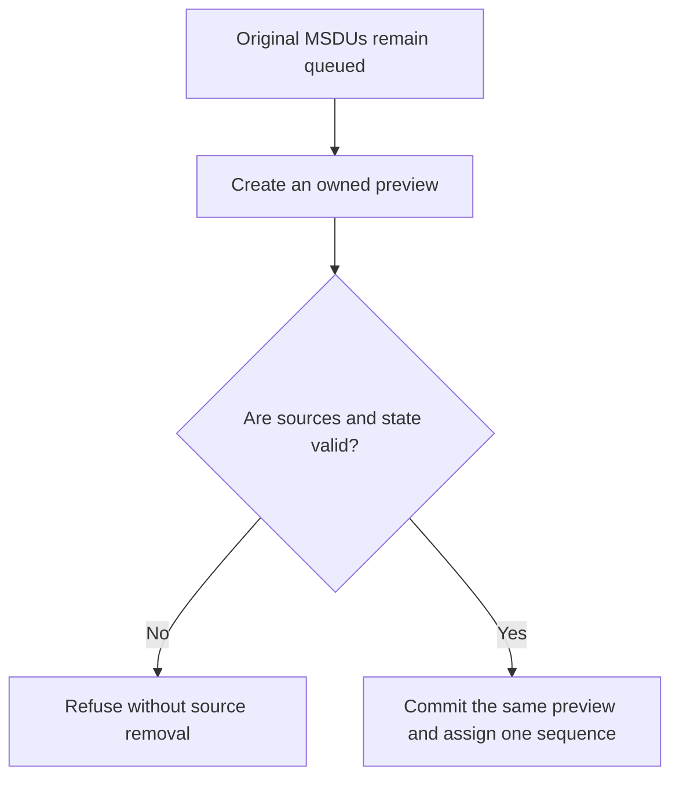

# S5-P6: Inspect DATA without source removal

This document belongs to **ieee80211: add: prepare QoS DATA without queue extraction**. It introduces the service contract required by complete exchange admission.

Before this commit, borrowed preview cannot construct an owned aggregate without source extraction. The caller cannot evaluate that aggregate while all original MSDUs remain queued. After this commit, preparation creates an owned duplicate. Commitment transfers that preview only after identity, eligibility, deadline, sequence, and aggregation checks.

## Why a protocol comparison does not apply here

Production HCF does not use this preparation callback until the Compressed activation commit. HCF still rejects Compressed selection at this boundary. A protocol test cannot distinguish the new service operation without a production caller. A helper-only fixture must not claim end-to-end admission coverage.

The direct [prepared DATA fixture](../../module/Ieee80211PreparedQosData_1.test) uses the production data service and queue. Ten runs cover ordinary and aggregate previews, commitment, cancellation, stale sources, and stale sequence state. It checks original identities, owners, deadlines, sequence counters, and the retained preview pointer.

For example, an ordinary MSDU waits two milliseconds before commitment. The resulting DATA retains that queueing time and one queue departure. A refused commitment leaves the original source queued. Those observations establish the service contract without a radio exchange.

## Integration and limits

The later activation commit owns HCF's complete exchange admission. Its network and module fixtures cover refusal and aggregate fallback through that caller. This preparation commit receives no claimed parent protocol failure. The diagram explains ownership; it does not imply that HCF already invokes this path.
