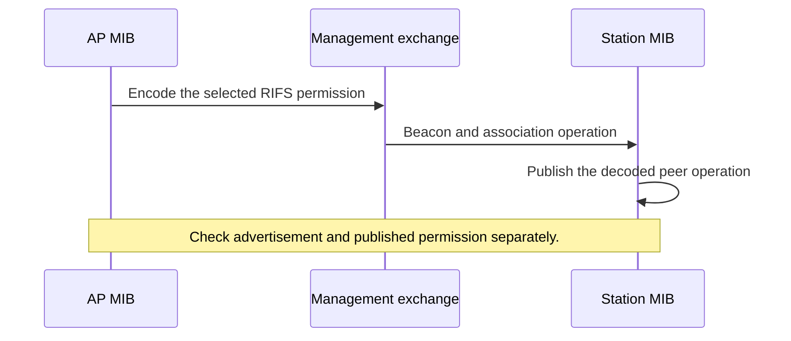
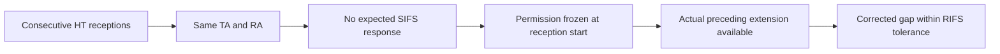
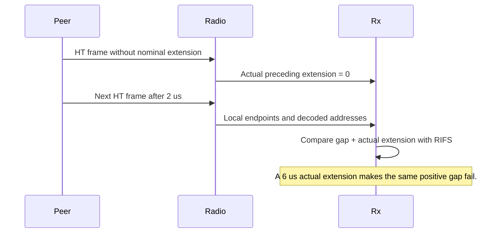

# S5-P3: Preserve RIFS permission through management

This document belongs to **ieee80211: fix: preserve advertised RIFS permission**. The protocol test is [WifiRifsPermission.test](common/WifiRifsPermission.test).

Before this commit, management conversion loses RIFS Mode. An unprotected HT AP therefore cannot publish the required permission through its management exchange. After this commit, the MIB selects the permission, outgoing management retains it, and the station retains the received operation.

IEEE Std 802.11-2024 Clause 10.27.3.3 requires RIFS Mode one outside nonmember and non-HT mixed protection. The model selects the permitted conservative zero policy in those two protected modes. Clause 11.38.1 requires a VHT AP to advertise zero. These requirements concern advertised permission; this commit adds no RIFS transmitter scheduler.

## Scenario and assertions

Eight seed-zero runs combine HT or VHT operation with HT protection values 0, 1, 2, and 3. Each run uses real Beacon and association exchanges. No fixture supplies an accepted association or Block Ack agreement.

The observer checks the RIFS Mode field in an actual AP Beacon. At 0.9 seconds, it checks real station association and the station's published peer HT state. It converts that published operation back to a management element for observation. This uses an API available in the parent and child. The observer does not construct the station's peer state or replace the receive path.

| Operation | Protection values | Required observed value |
| --- | --- | --- |
| HT | 0 and 2 | One in the Beacon and published station operation. |
| HT | 1 and 3 | Zero under the model's conservative policy. |
| VHT | All four | Zero. |



## Local reception checks

[WifiLocalInterframeInputs.test](common/WifiLocalInterframeInputs.test) adds consecutive physical HT receptions through production Rx. These cases require no Compressed Block Ack agreement. The receiver retains the production HCF ACK policy. Frames use a foreign unicast receiver address, so HCF sends no response during the input check.

The permitted case uses the same TA and RA, no expected SIFS response, and a two-microsecond local gap. Its preceding HT waveform omits the nominal six-microsecond extension. The radio supplies zero actual extension. Rx accepts the RIFS relation.

The fixture changes one condition at a time:

- A different TA or RA rejects RIFS.
- An expected SIFS response rejects RIFS.
- Disabled infrastructure permission or VHT operation rejects RIFS.
- Normal six-microsecond extension rejects a positive two-microsecond local gap after extension correction.
- Unavailable preceding extension rejects RIFS.
- A non-HT predecessor or current frame rejects RIFS.
- Both ten-percent tolerance endpoints pass. The adjacent outside ticks fail.
- Fixed five-microsecond propagation preserves the same-transmitter RIFS gap.
- A permission change after reception start does not change the frozen result.

Separate controls use a valid SIFS gap while RIFS permission or extension evidence is unavailable. Both controls retain SIFS evidence. The existing non-QoS input cases also prove that no HCF policy module is necessary for SIFS.

The infrastructure permission checks configure the public MIB channel before the stimulus. The pre-association management cases supply no RIFS evidence until operation is available. They still accept valid frames through the normal receive path.





## Historical comparison

The parent fails run zero at the advertised-permission assertion. Its first HT Beacon loses the required permission. That simulation error stops the remaining seven parent runs. The child completes all eight runs with PASS and no FAIL verdict. The parent comparison therefore establishes the first permission-one case, not every parent control.

The parent `src` tree is `8bdb2bb47d11d23cb16d3e2669644ca5d962856e`. The child `src` tree is `b3da28e5e8509799a085acc9a5cffd2c09805a15`. Each comparison uses its own fresh debug library in the same retained worktree. The fixture files are identical on both sides.

The comparison worktree is `/home/user/omnetpp_ws/inet-s5-protocol-verification-20261027`. Raw output and machine-readable results reside under `/tmp/inet-s5-protocol-design-20261027/`. The stage records are `02-after-03-before` and `03-after`. Local artifacts can be absent in another environment.

The local-interval reconstruction compares the management fixture with revised parent `b93c4a2cff287fedad75ee3c55dc5b128962b516`. The parent compiles the fixture. Its first Beacon fails the advertised-permission assertion at 0.038179866314 seconds. This conversion defect is separate from the parent's absent Rx RIFS capability. The execution record is `/tmp/inet-local-interframe-20261028/execution.md`.

The same parent also compiles the extended local input fixture. Its first thirty-one SIFS and history cases pass. The permitted RIFS case then fails its relation assertion at 0.001178 seconds. The revised tree passes that physical input and all forty-nine input cases. This comparison establishes Rx RIFS behavior separately from the management conversion repair.

Run the following commands from the checkout root for each source version:

```sh
make MODE=debug CXX='ccache clang++' -j12
opp_run_protocol_tests --load @opp -p inet -m debug --no-build --no-concurrent -w '^tests/protocol/wifi$' -f '(WifiRifsPermission)\.test$'
```

The HT permission-one cases distinguish the conversion repair. The other management cases are compatibility controls; they need not fail in the parent. The input fixture establishes local RIFS detection. It does not establish release across a Compressed receive gap or complete VHT transfer behavior.

The normative sources are `ieee80211-2024:clause:10.27.3.3`, physical pages 2089–2090, and Clause 11.38.1. The corpus omits the latter clause's later RIFS sentence. Direct inspection of physical PDF page 2886 supplies that requirement.
