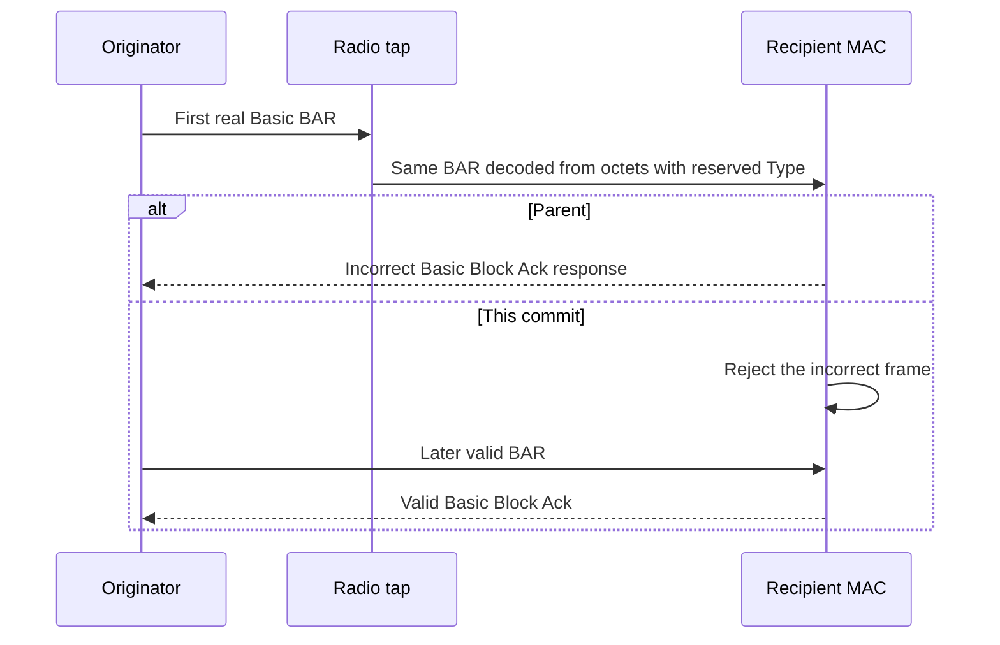

# S5-P5: Reject reserved BAR Types at the MAC boundary

This document belongs to **ieee80211: add: serialize Basic and Compressed Block Ack Types**. The protocol test is [WifiBlockAckWireType.test](common/WifiBlockAckWireType.test).

Before this commit, the decoder examines only two Type bits. Reserved Types 4 and 12 therefore appear as Basic requests. After this commit, it checks all four bits and marks these requests incorrect. The production receive component rejects the incorrect frame before HCF can respond.

IEEE Std 802.11-2024 Tables 9-36 and 9-37 define the four-bit variant encoding. Type 2 selects Compressed. The current standard reserves Type 0; INET retains it as a Basic compatibility profile. The valid Basic control establishes compatibility, not current-standard Basic conformance.

## Scenario and assertions

Three seed-zero runs select Type 4, Type 12, or the valid Basic Type 0. The shared lifecycle configuration establishes real association and ADDBA. Aggregation is disabled to retain a simple standalone DATA and BAR exchange.

A radio-medium tap selects only the first BAR delivered to the AP. It serializes that real header, changes the four Type bits, and decodes those octets through the production serializer. It preserves the PHY prefix, address fields, tags, and trailer. The receiver still performs its normal correctness check. The tap inserts neither an agreement nor a response.

For a reserved Type, the test forbids an AP Block Ack during the immediate-response interval. It then requires another BAR and a Basic response. This second exchange checks that rejection does not destroy progress. The Type 0 control requires ordinary feedback without the rejection interval.



## Comparison and limits

The parent reports protocol FAIL for both reserved Types because the AP transmits a forbidden immediate Block Ack. Its valid Type 0 control passes. The child reports PASS in all three runs, including the valid retry after each rejected request. Both versions compile the same fixture.

The parent `src` tree is `864c978a7ef788c66f4eef959656ee12a86e8d01`. The child `src` tree is `527e42c74b8d9884d9635b2f2689355a95cb65df`. Each comparison uses its own fresh debug library in the same retained worktree. The fixture files are identical on both sides.

The comparison worktree is `/home/user/omnetpp_ws/inet-s5-protocol-verification-20261027`. Raw output and machine-readable results reside under `/tmp/inet-s5-protocol-design-20261027/`. The stage records are `05-before` and `05-after`. Local artifacts can be absent in another environment.

Run the following commands from the checkout root for each source version:

```sh
make MODE=debug CXX='ccache clang++' -j12
opp_run_protocol_tests --load @opp -p inet -m debug --no-build --no-concurrent -w '^tests/protocol/wifi$' -f '(WifiBlockAckWireType)\.test$'
```

The positive control must pass on both versions. A test that merely misses every response cannot pass because the valid exchange must complete. The [wire unit fixture](../../unit/Ieee80211BlockAckWire_1.test) separately checks golden octets, Compressed fragments, lengths, and bitmaps.

This fixture observes the production MAC receive path after an explicit byte conversion. Ordinary packet-level radio operation does not itself guarantee serializer execution. The test establishes neither Compressed exchange activation nor rejection of every unsupported Type.

The normative corpus identifiers are `ieee80211-2024:table:9-36` and `ieee80211-2024:table:9-37`. Their physical PDF pages are 719–720 and 722–723.
