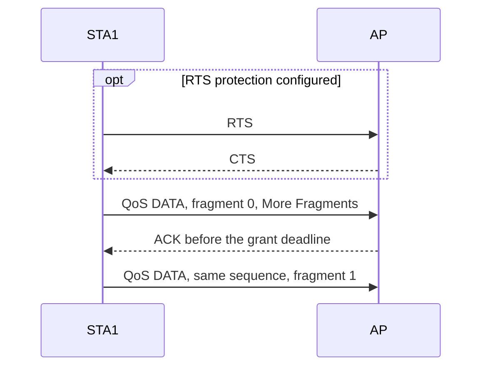

# Fresh TXOP admission for ordinary QoS DATA

[N_TxopBoundedFragment.test](11n/N_TxopBoundedFragment.test) sends a 1,500-byte UDP payload from STA1 through an infrastructure AP to STA2. STA1 uses 6.5 Mbit/s, a 1 ms AC_BE grant, a 2,346-byte fragmentation threshold, and Normal Ack. The original MSDU fits the configured fragmentation threshold but its exchange exceeds the grant.

The two runs use 100-byte and 3,000-byte RTS thresholds. The fixture checks the first fragment's ACK policy, the completion time of its ACK, and the sequence and fragment numbers of the next DATA. The separate [zero-limit fragment controls](zero-txop-fragment-continuation.md) exercise burst continuation and retransmission.
