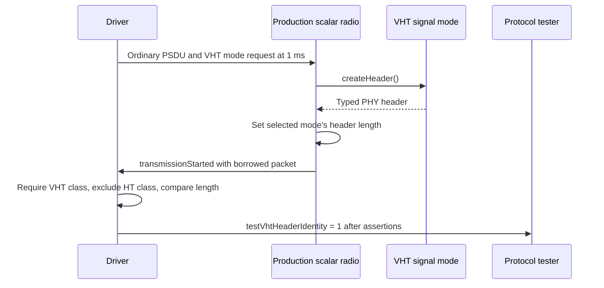

# VHT-PRE: Create VHT headers for VHT signal modes

This document belongs to **VHT-PRE**, with subject **ieee80211: fix: create VHT headers for VHT signal modes**. Its fixture is [WifiVhtHeaderIdentity.test](common/WifiVhtHeaderIdentity.test). The [PHY plan](../../../plan/pending/ieee80211-ampdu-phy-reception.md) assigns this prerequisite before HT header validation.

The production radio must preserve the selected mode's PHY family when it creates a typed header. Before this commit, a VHT signal mode creates an `Ieee80211HtPhyHeader`. After this commit, that mode creates the existing `Ieee80211VhtPhyHeader`. This requirement concerns the local mode and header classes. It makes no claim about VHT protocol fields or their byte representation.

## Original scenario, cause, and correction

At 1 ms, the driver submits a 100-octet ordinary PSDU to a production scalar radio. Both mode requests select VHT MCS 0 and 20 MHz. The long-GI run selects one spatial stream. The short-GI run selects two spatial streams. Both runs use seed zero and typed transmission.

These are existing entries in the [`ac` mode catalog](../../../src/inet/physicallayer/wireless/ieee80211/mode/Ieee80211ModeSet.cc). That catalog has no one-stream short-GI entry for VHT MCS 0 at 20 MHz. The fixture uses two radio antennas to support both selected modes. It changes no production catalog entry.

The radio asks its transmitter for the selected mode. The radio calls that mode's header factory, sets its length, and places the header before the PSDU. On the original parent, the VHT factory chooses the HT class. The radio therefore transmits an HT header object under a VHT mode. This mismatch exists before later HT validation changes.

The correction changes the class that the [VHT signal mode](../../../src/inet/physicallayer/wireless/ieee80211/mode/Ieee80211VhtMode.h) constructs. The [production radio](../../../src/inet/physicallayer/wireless/ieee80211/packetlevel/Ieee80211Radio.cc) continues to set the header length from the selected mode. The [header declarations](../../../src/inet/physicallayer/wireless/ieee80211/packetlevel/Ieee80211PhyHeader.msg) supply separate HT and VHT classes. These source contracts establish the class requirement without a normative IEEE claim.

## Production observation and assertions

The fixture uses the production `Ieee80211ScalarRadio` and its scalar medium. A driver connects directly to the radio's upper input gate. The runner supplies the NED paths. The fixture declares its driver's C++ class explicitly.

The radio uses channel zero in `5 GHz (mapped 20 MHz)` with a 5.18 GHz center frequency. The transmitter uses `bitrate = -1bps` because every packet supplies an explicit valid mode request. This setup avoids the radio's default 11 Mbps bitrate, which the `ac` mode set does not support.

The driver observes `transmissionStarted`, which confirms an actual transmission. Within that callback, it borrows the transmission's `Packet` and reads its front header. It retains no packet or header pointer after the callback.

The callback requires all three conditions:

- The header has type `Ieee80211VhtPhyHeader`.
- The header does not have type `Ieee80211HtPhyHeader`.
- The header length equals the selected mode's header length.

Only after those assertions pass does the driver emit `testVhtHeaderIdentity = 1`. The protocol tester requires that event. The driver's final assertion also requires an observation. A missing transmission therefore cannot pass through an empty observation.



On the original parent, the VHT class assertion must fail because the factory creates an HT object. After the correction, both GI runs must pass. These are expected results. No expected-failure declaration weakens either assertion.

## Verification and limits

From the INET root, use this exact filtered debug command on the parent or behavior commit:

```sh
opp_run_protocol_tests --load . -p inet -m debug -w '^tests/protocol/wifi$' -f 'WifiVhtHeaderIdentity\.test$' --no-concurrent
```

The expected output includes `PROTOCOLTEST wifi_vht_header_identity: PASS` and two successful runs. The [execution record](../../../plan/pending/ieee80211-ampdu-phy-execution.md) describes the installed runner's descriptor limitation. Use its compatible descriptor when that limitation applies. The test does not override the runner's NED paths.

The results above define the expected observations. The [comparison record](vht-header-identity-comparison.md) reports the parent and commit executions with identical fixture bytes. The diagram agrees with the fixture's gate and callback sequence by source inspection. Mermaid rendering remains unverified.

Coverage stops at the transmitted typed header. The fixture does not check VHT serialization, byte conversion, protocol fields, waveform construction, aggregate support, peer reception, or MAC delivery. Long GI and short GI exercise the two selected VHT modes without extra permutations.
