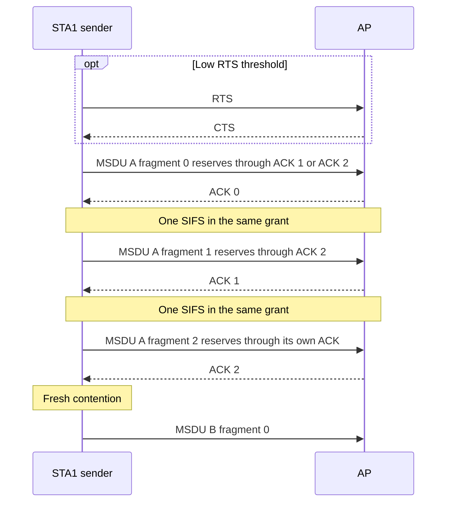
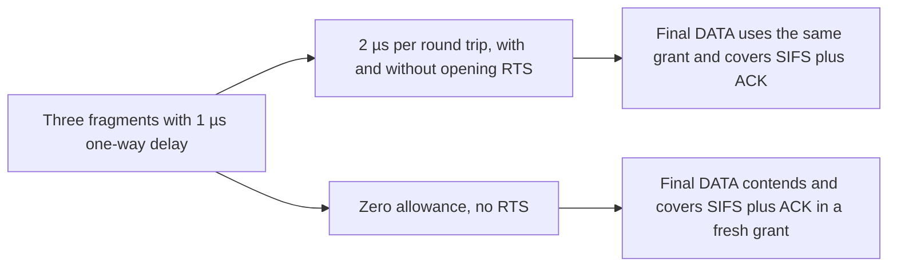
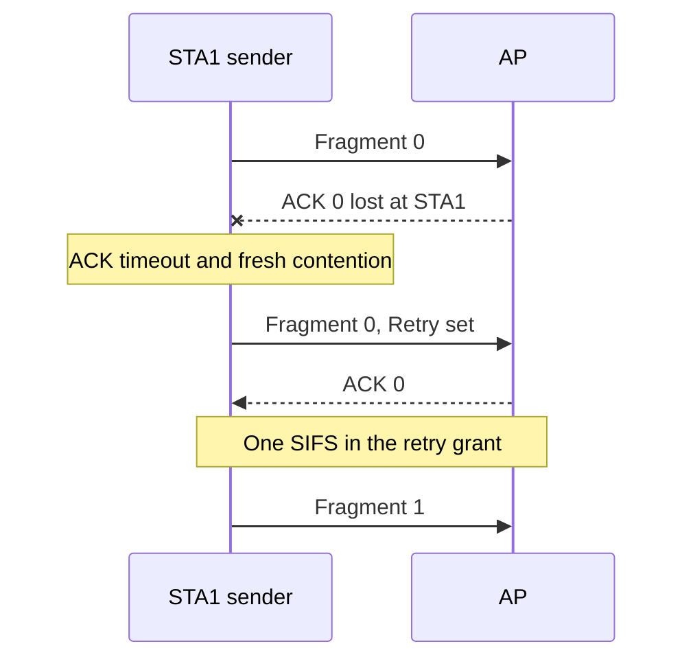

# Fragment bursts in a zero-limit EDCA TXOP

[BD-26](../../../plan/pending/baseline-catch-up-defects.md#bd-26-a-zero-limit-txop-loses-the-rest-of-a-fragment-burst),
`ieee80211: fix: continue fragment bursts in zero-limit TXOPs`.

IEEE Std 802.11-2024 §10.23.2.9(a)(1) permits a zero-limit TXOP to carry fragments of one
MSDU or MMPDU, along with required acknowledgments and protection. The next exchange can
start at SIFS under §10.23.2.8 when it fits the remaining TXNAV. Section 9.2.5.2(a)(8) and
(b)(1–2) specify the Duration/ID fields for single and multiple protection. Section
10.3.4.5 describes fragment-burst recovery after a missed acknowledgment.

HCF previously treated a zero limit as exhausted after the first exchange. The selector
ended the frame sequence even after a successful ACK, and the Duration/ID calculation
protected only the opening exchange. The selector and submission path now use the preceding
accepted ACK and transmit step to identify the next in-progress fragment. A DATA sequence
allocation must match in addition to the receiver, TID, sequence number and fragment order.
The match excludes A-MSDUs. IEEE 802.11-2024 §10.4 covers their separate dynamic
fragmentation rules.
Single protection reserves the next fragment and its ACK. Multiple protection reserves the
eligible burst when it establishes the reservation. Submission checks the actual exchange
airtime against TXNAV. An ACK timeout still ends the frame sequence through existing recovery.

## N_TxopFragments

[N_TxopFragments.test](11n/N_TxopFragments.test) queues two UDP MSDUs from STA1 to STA2 via
an infrastructure AP after association. The test uses AC_BE, a zero TXOP limit, a fixed
6.5 Mbit/s data rate. A 300-byte threshold splits each 700-byte UDP payload into three
MPDUs. Four zero-delay runs exercise single and multiple protection, each with and
without an opening RTS/CTS.

The first fragment must reserve through ACK 1 with single protection and ACK 2 with
multiple protection. The last fragment reserves only through its own ACK. Fragments 1
and 2 must start exactly one SIFS after the preceding ACK and retain the sequence number
and TXOP start time. The next MSDU starts with fragment 0, a different sequence number
and a later grant.



### Multiple protection with propagation

Three runs use 1 µs one-way propagation. With a 2 µs round-trip allowance, the
whole burst fits, with or without an opening RTS/CTS. The test checks that each
fragment retains the original grant and that the final DATA's encoded Duration/ID
covers SIFS plus the selected ACK airtime. With no allowance and no RTS, the first
successor still fits. The final fragment must get a fresh grant.

Before the ACK coverage check, the final fragment in the no-RTS case used its
original grant and advertised 72 µs for a 76 µs response interval. The strict
TXNAV check passed because it compared the remaining time with the exchange
airtime at the decision, one SIFS before the actual DATA start.



## N_TxopFragmentRetry

[N_TxopFragmentRetry.test](11n/N_TxopFragmentRetry.test) sends one fragmented MSDU with
the same AC, rate and propagation settings. The radio-medium tap drops the first addressed
ACK for STA1. STA2 still decodes it, which confirms the AP transmitted it. The next DATA
must be the original fragment with the same sequence number and length, Retry set and a
later TXOP start. After the retry is acknowledged, fragment 1 must follow by exactly one
SIFS in that new grant.



These fixtures exercise Normal Ack and the originator's MAC exchange. They leave
rate adaptation, Block Ack feedback policy, and third-party NAV behavior outside
their coverage.

## Execution

The release build of parent `bd49a8450e` failed the reservation assertion in all four
`N_TxopFragments` runs. `N_TxopFragmentRetry` reached the accepted retry ACK and then
failed the assertion that fragment 1 start at SIFS in the retry's grant. Run 0 uses seed 0
in both fixtures. The protection variants of `N_TxopFragments` use runs 0–3 with the same seed.

Both fixtures passed on the repair in debug and release. The related positive-TXOP,
group Duration/ID, Basic DATA admission, Basic BAR reservation and Compressed Block Ack
fixtures passed in both modes.

```sh
make MODE=debug -j5
make MODE=release -j8
for mode in debug release; do
    opp_run_protocol_tests --load . -p inet -m "$mode" --no-build \
        -w '^tests/protocol/wifi$' -f 'N_TxopFragment(s|Retry)\.test$'
done
```
